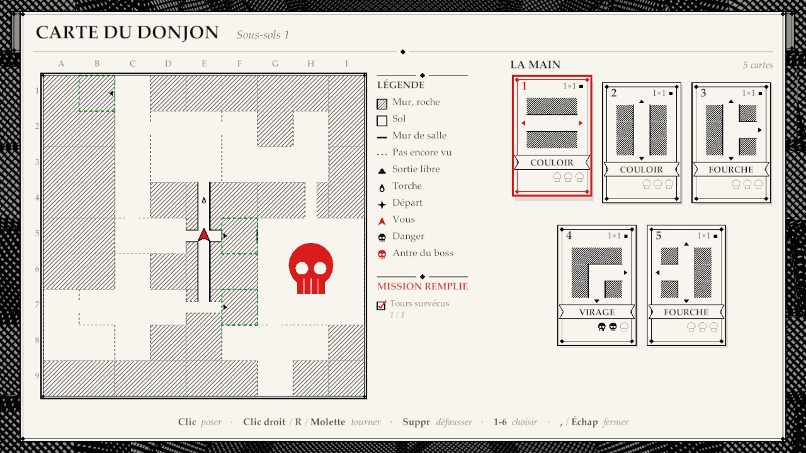

# Antre du boss, escalier, étages

Tâches 5 et 6 de la [todo](todo.md). Une fois la [mission](mission.md) remplie, **le jeu pose lui-même l'antre du boss** (idée de l'utilisateur, 2026-11-16, voir [GDD §2](gdd.md#un-étage)). Le boss, un [loup-garou](monstres/loup-garou.md), y dort. Le vaincre ouvre **l'escalier** vers l'étage suivant.

## Où elle apparaît

`DungeonBoard.FindBossLair` (logique pure, testée dans `Assets/Tests/EditMode/BossLairTests.cs`) :

- sur des emplacements **jamais visités** (où le joueur n'a jamais mis les pieds) ;
- **le plus loin possible du joueur**, en chemin à travers les tuiles ; à distance égale, la plus **grande** forme qui tient (3 × 3, 3 × 2, 2 × 2, puis 2 × 1 emplacements), puis celle qui écrase le moins de tuiles ;
- elle peut **remplacer** des tuiles posées mais jamais visitées, couloirs compris : la tuile part en entier, avec son contenu ; jamais le départ ni la tuile du joueur ;
- elle s'appuie **contre le labyrinthe** (choix de l'utilisateur : « contre une paroi ou une porte libre, qu'importe ») : une porte face à chaque passage d'une tuile voisine qui donne sur elle ; s'il n'y en a aucun, elle **perce le mur** de la voisine la plus proche du joueur ;
- tout le labyrinthe doit rester **d'un seul tenant** (chaque emplacement posé reste atteignable du joueur).

Chaque essai se fait sur une copie du plateau (≈ 80 ancres × 6 formes, quelques millisecondes). S'il n'y a pas de place (tout est visité), `MissionTracker` réessaie à chaque tour et à chaque tuile posée.

Ce qui avait été vu des emplacements de l'antre est **oublié** (`Exploration.Forget`) : elle reste à découvrir, en esquisse sur la carte. Elle y est marquée d'un **grand crâne rouge**, même dans le brouillard, et entre dans la légende (« Antre du boss »). Message : « Un hurlement monte des profondeurs : l'antre du boss est sur la carte ».

L'antre ne compte ni dans le plafond de salles de la pioche, ni comme salle nettoyée pour la mission (déjà remplie). Formes : `TileCard.BossShapeList` (`antre`, `antre_3x2`, `antre_2x2`, `antre_2x1`, nom affiché « Antre du boss »), contenu `antre`. Elles ne sont jamais piochées.

## Son décor

`LairDecor.Layout` (testé) place le décor, des prefabs Synty (POLYGON Dungeon) avec leur secours en formes simples, dans `Assets/Prefabs/Props/Antre/` :

| Pièce | Où | Bloque |
|---|---|---|
| **Brasero** (flamme et lumière blanche, sans ombre) | les quatre coins, et de part et d'autre du trône | oui |
| **Trône** (`SM_Prop_Skeleton_Knight_Throne_01`) | milieu du mur le plus loin des portes (à vol d'oiseau) ; le boss dort devant | oui |
| **Cage** de torture, **tas d'os** | le long des murs des grandes antres (≥ 36 cases), une case sur trois, jamais deux côte à côte | oui |
| **Ossements** épars | au sol, au milieu, une case libre sur huit | non |

Jamais sur une porte ni juste devant, jamais au milieu : l'antre reste traversable d'une porte à l'autre. Une pièce qui bloque est un `LairDecor` (objet de grille sans tour) : le joueur, les monstres et la charge du boss s'y arrêtent.

## L'escalier

À la mort du boss, l'**escalier** (`Stairs`, prefab `Assets/Prefabs/Props/Escalier.prefab`, colimaçon Synty `SM_Env_SpiralStairs_01` avec une lueur blanche) sort du sol à sa place, avec un raclement de pierre (si le joueur s'est avancé sur la case, à côté de lui). On le prend en avançant dessus ou avec Interact :

1. l'écran se voile d'encre, « Étage 2 » s'affiche au milieu (`Hud.FadeOut` / `FadeIn`) ;
2. le Donjon passe à l'**étage suivant** (`Dungeon.NextFloor`) : nouveau plateau, départ tiré au hasard, **nouvelle main** et nouvelle mission, mémoire de l'étage neuve ;
3. le joueur repart du départ **avec ses PV** (choix de l'utilisateur : PV gardés, nouvelle main).

## Étages

`Dungeon.Floor` (1 au départ) : affiché dans le HUD (« Étage 2 · Tour 31 · ATQ 1 · DÉF 0 »), sur l'écran de mort et sur la carte (« Sous-sols 2 »). Plus on descend, plus les monstres sont forts (`Enemy.ScaleForFloor`, voir [loup-garou.md](monstres/loup-garou.md#plus-fort-plus-bas)). Avec une graine fixe, chaque étage a son propre tirage (graine + étage).

## Fichiers

- `Assets/Scripts/Tiles/DungeonBoard.cs` : `FindBossLair`, `PlaceBossLair`, `BossLair`, `SlotDistances`, `TileRemoved`.
- `Assets/Scripts/Tiles/Dungeon.cs` : `Floor`, `NextFloor`, `TryPlaceBossLair`, `BossLairPlaced`.
- `Assets/Scripts/Mission/MissionTracker.cs` : pose l'antre à la mission remplie (`BossLairPending` tant qu'il n'y a pas de place).
- `Assets/Scripts/Tiles/Spawner.cs` : décor, boss, louveteaux, escalier ; contenu des tuiles remplacées retiré.
- `Assets/Scripts/Props/LairDecor.cs`, `Stairs.cs` ; `Assets/Scripts/Editor/BossBuilder.cs` (prefabs, *Deckscent > Ajouter le boss aux scènes*).
- Tests : `Assets/Tests/EditMode/BossLairTests.cs`, `Assets/Tests/PlayMode/BossTests.cs`.
