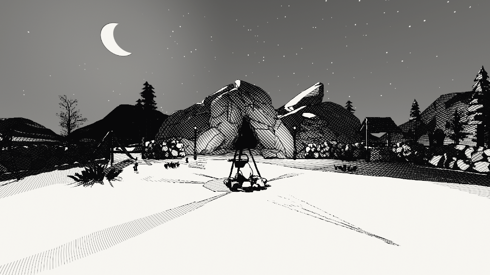
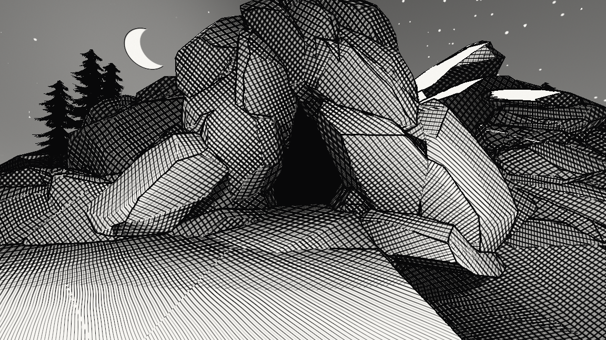
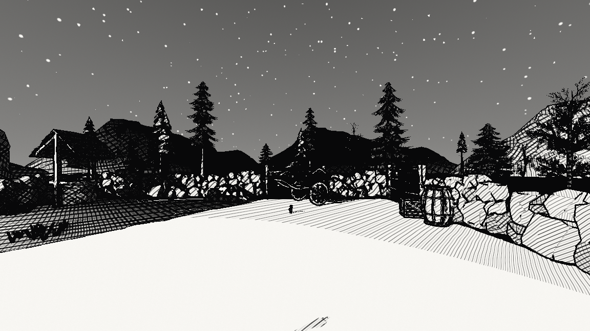
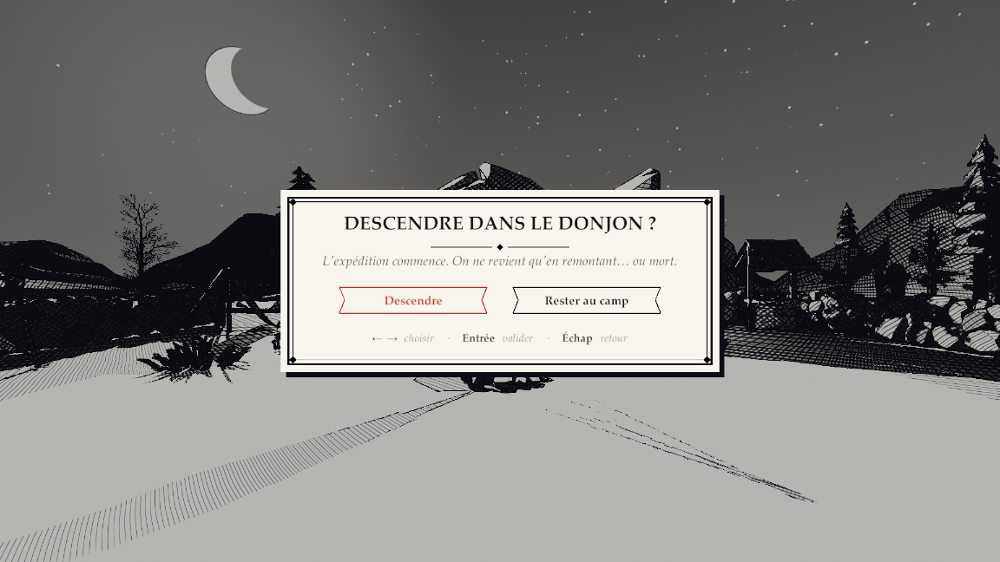

# Le camp (hub)

Le camp à la surface, d'où part l'expédition et où l'on revient (GDD §7, [todo.md](todo.md)). Décidé avec l'utilisateur le 2026-11-21 :
- **camp 3D** où l'on se déplace **case par case comme dans le donjon** (mêmes touches, même caméra) ;
- **crépuscule** : un ciel un peu sombre, étoilé, avec un **croissant de lune** ;
- construit avec les **pièces Synty** (Nature, Meadow Forest, Farm).

## Ce qu'on y trouve

- Au **nord**, l'**entrée du donjon** : une arche de rocher dans la falaise, encadrée de deux torches plantées. **Avancer dedans** (ou Interact) demande confirmation, « Descendre dans le donjon ? » : **Descendre** lance l'expédition, **Rester au camp** (ou Échap) annule (demande de l'utilisateur).
- Au **centre**, le **feu de camp** : la lumière du camp. Le joueur part juste au sud, tourné vers la grotte.
- Autour : tente, séchoir, épée dans la pierre, puits, charrette, caisses et tonneaux, tas de bûches, quelques touffes d'herbe et des fleurs (clairsemées, retour de l'utilisateur).
- Fermé par des **murets** bas et une clôture : on voit par-dessus la **forêt** de pins et d'arbres morts, la cabane, le chariot brisé, des tombes et les collines.
- **Étape (b), à venir** : le cartographe et ses déblocages (salles, améliorations permanentes).

## Enchaînement

Titre → « Descendre » → **camp** → grotte → donjon. La mort (« retour au camp ») et la remontée ramènent au **camp** ; le menu pause garde « retour au menu ».

## Rendu

- **Ciel** (`CampSky`, objet « Ciel ») : le post-process gravure dessine ce qui n'a pas de décor au lieu du fond noir du donjon. C'est un **aplat d'encre en dégradé** (noir au zénith, gris sombre vers l'horizon) : l'utilisateur n'a pas voulu de traits dans le ciel. S'y ajoutent des **étoiles** en points blancs, fixes dans le ciel, et un **croissant de lune** cerné d'encre dans un halo, dans la direction du clair de lune. Réglages : tons, finesse des étoiles, taille de la lune.
- **Obscurité repoussée** : dehors, les distances du noir (`_DarkStart`, `_DarkEnd`) sont multipliées par `darknessScale` (3) : la grotte et la forêt se lisent, les silhouettes lointaines se découpent en noir sur le ciel.
- **Lumières** : clair de lune blanc faible (0,35, ombres dures), feu de camp (3 / 12 m), deux torches plantées (2 / 8 m). Ambiante unie 0,2, comme le donjon.
- Les **feuillages** Synty (cartes avec alpha) passent au toon avec la **découpe alpha** et les **deux faces** (`_AlphaClip`, `_Cull` du shader toon, réglés par la conversion de *Installer le rendu gravure*).
- Le donjon n'est pas touché : `_SkyOn` et `_DarkScale` retombent à 0 en quittant le camp (captures de la scène de test inchangées).

## Technique

- Plan du camp (`CampBuilder.Plan`) : `~` = hors du chemin **sans mur** (la bouche de la grotte), une nouvelle case du labyrinthe. Pas de plafond (pièce facultative du labyrinthe).
- `CampObstacle` : décor qui bloque sa case. `DungeonEntrance` : la case de la grotte (Interact → confirmation `ConfirmScreen`, prefab `UI/Confirmation`, puis `SceneFlow.LoadGame`).
- *Deckscent > Construire le camp (prefabs, scène)* (`CampBuilder`) : prefabs dans `Prefabs/Camp/` (une pièce Synty par prefab), scène `Scenes/Camp.unity`, ordre du build (Menu, Camp, Main). Relancer écrase les prefabs et la scène.
- Tests : `CampTests` (ciel allumé, le feu bloque, la grotte demande confirmation puis lance l'expédition, le donjon retrouve son noir), `MenuTests.DescendreMeneAuCamp`.
