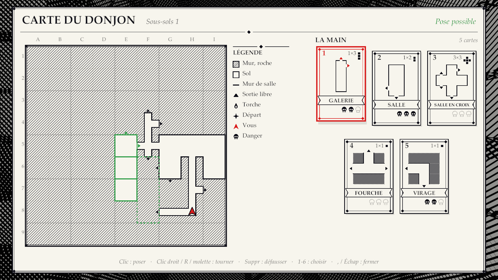

# L'écran de carte

C'est là que le joueur **pose ses tuiles**. Code : `Assets/Scripts/UI/MapScreen.cs`, prefab : `Assets/Prefabs/UI/CarteDuDonjon.prefab` ([doc du prefab](prefabs/CarteDuDonjon.md)), tests : `Assets/Tests/PlayMode/MapScreenTests.cs`.

*Le départ « Zigzag », la carte 5 (une salle en croix) choisie et son aperçu en vert, avec une flèche sur chacune de ses trois entrées : « Pose possible ».*

## Ouvrir, fermer

- **Virgule** (M en QWERTY) ou **Triangle / Y** : ouvrir ou fermer.
- **Échap** ou **Rond / B** : fermer.
- **Le jeu est en pause** tant que la carte est ouverte : le joueur ne connaît pas la carte, il est juste en pause. Ouvrir la carte et poser ne coûtent pas de tour.

## Commandes, carte ouverte

| | Souris | Clavier | Manette |
|---|---|---|---|
| Choisir une carte | clic sur la carte | 1 à 6, Tab | LB / RB |
| Viser un emplacement | survol | flèches | croix, stick gauche |
| Poser | clic sur le plateau | Entrée, Espace | Croix / A |
| Tourner | clic droit, molette | R | Carré / X |
| Défausser | | Suppr, Retour arrière | Select |

Les touches sont dans la map **Map** d'`InputSystem_Actions` (sauf l'ouverture : `Player/Map`), la souris est lue directement.

## Ce qu'on voit

- **En-tête** : « Carte du donjon », l'étage (« Sous-sols 1 »), et à droite l'état : « Pose possible » en vert, ou la **raison du refus** en rouge (« Doit se raccorder par un passage »…), ou le dernier message (« Tuile posée : Couloir », « Carte défaussée »).
- **Le plateau** (9 × 9 emplacements, coordonnées A–I et 1–9) : **tout ce qui n'est pas du sol est hachuré de la même façon**, en traits gris espacés (6 px) pour ne pas papilloter (roche pas encore construite comme murs des tuiles : la carte est d'un seul tenant), le sol des tuiles posées s'y découpe en papier, avec ses contours et les **murs fins des salles** à l'encre, les torches (flamme), le départ (étoile) et **le joueur** (flèche rouge, dans sa direction). Emplacements en pointillés. **Une petite flèche sur chaque sortie encore libre** (passage ou porte qui mène à un emplacement vide) : on voit où le donjon peut s'agrandir ; pas de flèche sur une sortie raccordée, ni sous l'aperçu de la carte à poser. Une ouverture tournée vers l'extérieur du plateau est un mur.
- **Où poser** : la forme de la carte choisie en **pointillés verts** partout où elle peut être posée telle quelle. Sous le curseur, son **aperçu** en vert (posable) ou en rouge (refusé), avec **une flèche sur chaque entrée** (porte d'une salle, passage d'un couloir) : on voit où la tuile s'ouvre avant de la poser.
- **La main** : les cartes au style « carte à jouer gravée » : numéro, emprise (« 2×1 » et ses carrés), plan de la tuile avec une flèche sur chaque sortie, bandeau du nom, flamme si elle a une torche, **danger en crânes** (0 à 3). La carte choisie est soulevée et cerclée de rouge. Une carte qui ne peut être posée nulle part, dans aucune orientation, est voilée de hachures (« aucune place »).
- **La légende**, en colonne étroite entre le plateau et la main.

## Technique

- Dessin « à la main », comme le `_draw` de Godot : `InkCanvas` (un `Graphic` uGUI qui trace rectangles, traits, pointillés, polygones, hachures) et `TextPool` (textes, police à empattements du système). Les primitives gravure partagées sont dans `Engraving.cs` (cadres, bandeaux, cartes, crânes, flamme, rose des vents) : le menu ([menu.md](menu.md)) s'en sert aussi.
- Canvas en **surimpression** (Screen Space Overlay) : dessiné par-dessus le jeu, il n'est pas touché par le post-process gravure, couleurs libres.
- Surface de référence **1152 × 648** (celle de l'écran Godot), mise à l'échelle de l'écran : mêmes proportions que la version Godot (cartes de la main, plateau, légende).
- Le dessin n'est refait que quand quelque chose change (curseur, carte choisie, pose).
- **Traduit** (option Langue du menu) : tous les textes sont des codes clés traduits par `Loc.T` au moment du dessin, y compris les noms de formes (`TileCard.DisplayName`, clé `forme.<identifiant>`) et les raisons de refus (`DungeonBoard.CheckPlacement` renvoie une clé `refus.…`, ou "" si la pose est permise). Le nom de l'étage est le champ `Biome Key` du prefab (`biome.sous_sols`). Voir [menu.md](menu.md#traduction).
- Réglages dans l'inspecteur du prefab : couleurs (papier, encre, vert, rouge, accent du joueur), écart des hachures (roche et murs), part de l'écran, voile derrière.
