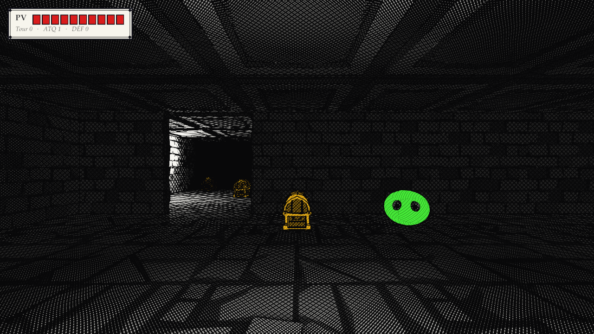

# Coffres

Code : `Assets/Scripts/Props/Chest.cs`, prefab : `Assets/Prefabs/Props/Coffre.prefab` ([doc du prefab](prefabs/Coffre.md)). Apparaît dans les tuiles « trésor » et dans la plupart des salles (voir [tuiles.md](tuiles.md#ce-qui-apparaît)).

Un coffre Synty (`SM_Prop_Chest_03`) **doré** : couleur saturée, donc gardée en couleur par le post-process (accent), avec une petite lueur propre (`_Glow` 0,2) pour qu'on le voie dans le noir. Sans le pack Synty : un coffre en blocs dorés cerclés d'encre. Il est tourné vers un passage ouvert.

## L'ouvrir

- **Avancer vers lui** (droit devant) ou **F** / bouton du bas quand il est droit devant : petit élan, le couvercle bascule. Ça **coûte un tour** (les ennemis jouent ensuite).
- Il bloque sa case tant qu'il est fermé.
- **Butin**, annoncé au HUD :
  - **une carte de plus dans la main** (jusqu'à 6) : « Coffre : une carte de plus dans la main » ;
  - ou **+3 PV** : « Coffre : +3 PV ».
  Une chance sur deux (`Card Chance`). PV au maximum : toujours une carte ; main pleine : toujours des PV.
- Vidé, il reste un instant, puis **s'enfonce dans le sol** et libère sa case. Événement `Cleared` (salles nettoyées, à venir).
- Un monstre peut se poser sur sa case : il **cache** le coffre tant qu'il y est, et avancer vers la case attaque le monstre.

## Réglages (prefab `Coffre`)

| Réglage | Défaut | Rôle |
|---|---|---|
| `Heal Amount` | 3 | PV rendus. |
| `Card Chance` | 0,5 | Chance d'une carte plutôt que des PV. |
| `Lids` | les deux charnières | Couvercles qui basculent (décor Synty et secours : un seul est affiché). |
| `Open Angle` | −105° | Angle d'ouverture du couvercle. |
| `Open Time` | 0,35 s | Durée de l'ouverture. |
| `Vanish Delay` | 0,8 s | Temps avant de s'enfoncer. |
| `Sink Depth` | 1 m | Profondeur où il s'enfonce. |
