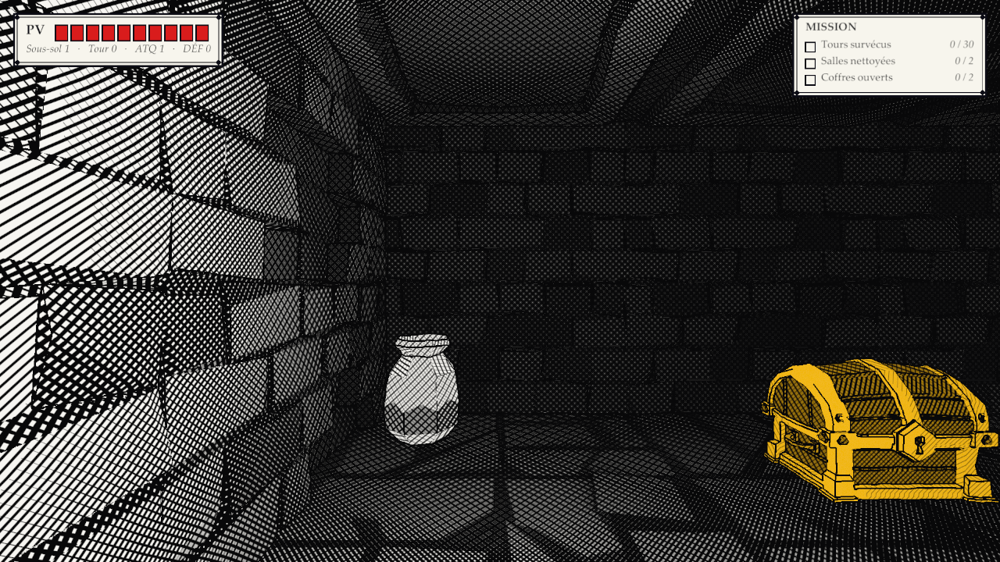

# Décor du donjon et objets à briser

Demande de l'utilisateur (2026-11-18) : « des décors dans le donjon, salles et couloirs, et des éléments de gameplay ». Chaque tuile posée reçoit, après son contenu, un **décor d'ambiance** tiré au hasard.

## Le décor d'ambiance

`Ambience.Layout` (logique pure, testée dans `Assets/Tests/EditMode/AmbienceTests.cs`), appliqué par le `Spawner` sur les cases restées libres (ni contenu, ni joueur, ni départ, ni portes de salle) :

| Où | Quoi | Bloque |
|---|---|---|
| **Coins des salles** (deux murs qui se touchent), 4 sur 10 | **vase** (45 %) ou **caisse** (40 %) à briser, **statue** (15 %) | oui |
| Le long des murs des salles, 12 % des cases | **bougies** (allumées : une petite lumière blanche qui vacille, 1,4 / 3,5 m, **ombres dures en basse résolution** : sans ombre, la lumière traversait les murs fins), **crâne** ou **os** | non |
| **Couloirs**, une tuile sur trois | une seule petite pièce (bougies, crâne, os) contre un mur | non |

- Un coin bloqué ne coupe jamais le passage (ses deux voisins se rejoignent par l'intérieur), un couloir ne se bouche jamais.
- Chaque pièce est calée contre son mur (ou dans l'angle), un peu tournée au hasard. Pas de décor d'ambiance dans l'antre du boss (elle a le sien, voir [antre.md](antre.md)).
- Si l'antre remplace une tuile, son décor disparaît avec elle.
- Case à décocher pour les essais : `Ambience` du Spawner.

## Vases et caisses à briser

`Breakable` (prefabs `Assets/Prefabs/Props/Decor/Vase.prefab` et `Caisse.prefab`, Synty `SM_Prop_Vase_02` / `SM_Prop_Crate_Wood_01`, lueur propre 0,25 comme les coffres : on les repère dans le noir). On les **brise en avançant dessus** (comme une attaque, un tour), avec un bruit de casse : ils **explosent** (demande de l'utilisateur) en une douzaine d'éclats de leur matière qui jaillissent, rebondissent au sol et contre les murs de la case, puis rapetissent et disparaissent (`Fragments`, `Burst`, `Debris Time`). Les briser ne lance pas la musique de combat (seul un coup sur un ennemi la lance).

| Butin | Vase | Caisse |
|---|---|---|
| Potion (+2 PV, si on n'est pas au maximum) | 30 % | 20 % |
| Une carte de plus dans la main | 6 % | 12 % |

Ce ne sont pas des ennemis : ils ne comptent ni pour la mission ni pour le bilan.

## La fontaine (retirée pour le moment)

Une fontaine qui soigne (le « sanctuaire » du GDD) a été essayée, puis **retirée de la pioche** à la demande de l'utilisateur (2026-11-20 : « moche »). Le code (`Shrine`, contenu « sanctuaire ») et le prefab `Fontaine` restent pour une prochaine version ; rien ne la fait plus apparaître.

## Fichiers

- `Assets/Scripts/Tiles/Ambience.cs`, `Assets/Scripts/Props/Breakable.cs`, `Shrine.cs`, `LairDecor.cs` (statue, bougies, crâne, os : objets de grille sans tour).
- `Assets/Scripts/Tiles/Spawner.cs` : `SpawnAmbience`, élément « sanctuaire ».
- `Assets/Scripts/Editor/DecorBuilder.cs` : *Deckscent > Construire les prefabs du décor (vases, caisses, statues, fontaine)* et *Deckscent > Ajouter le décor aux scènes*.
- Sons : `SoundBank.Shatter` (casse), `SoundBank.Drink` (gorgées), voir [sons.md](sons.md).
- Tests : `AmbienceTests` (EditMode), `BossTests.LaFontaineSoigneUneSeuleFois` et `LeDecorAmbianceApparaitEtLesVasesSeBrisent` (PlayMode).
