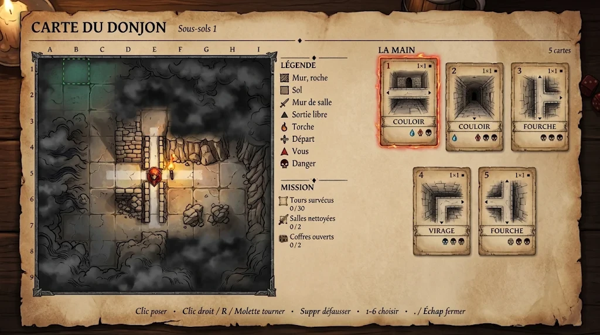

# Deckscent — Game Design Document

*Deckscent* : **deck** + **descent**, les cartes et la descente.

> Document vivant. Les décisions prises sont écrites au présent ; ce qui reste à trancher est marqué **❓ À décider**. L'état technique actuel est dans les docs voisines ([tuiles](tuiles.md), [carte](carte.md), [tour par tour](tour-par-tour.md)…) et la liste des tâches dans [`todo.md`](todo.md).

## 1. Vision

### Pitch

Un dungeon crawler dark fantasy en vue subjective, au tour par tour sur une grille, où **le joueur construit lui-même le donjon qu'il doit survivre**, en posant des cartes-tuiles. Rendu gravure noir et blanc façon BD.

### Fantasme du joueur

**L'architecte de sa propre perte.** Le but est de construire son donjon et de **descendre le plus loin possible**. Plus le donjon qu'on se construit est risqué, plus il rapporte : *high risk, high reward*.

### Piliers

1. **Chaque tuile est un pari** : poser une tuile ouvre du chemin, mais amène aussi du danger avec la récompense.
2. **Descendre toujours plus bas** : étages infinis, sans retour à un étage précédent. La seule limite est la difficulté qui monte et les cartes qui s'épuisent.
3. **Le monde avance avec le joueur** : tour par tour sur grille, embuscades et pièges.
4. **Une gravure qui respire** : noir et blanc, encre et hachures, la couleur réservée à ce qui compte (accents).
5. **Un RPG léger** : peu de stats, peu de compétences, mais des choix qui comptent (pas « 3000 compétences »).

## 2. Boucle de jeu

### Structure : expéditions

On part de la surface (hub), on descend, on récupère du butin, et on choisit de **remonter** ou de **risquer plus bas**. Une expédition dure **30 à 60 minutes**.

- **Remonter** n'est possible qu'à la **fin d'un sous-biome** (tous les 3 étages, voir [Profondeur et biomes](#profondeur-et-biomes)) : le boss du dernier étage de la tranche donne accès à la remontée. Ailleurs, c'est rare. Tant qu'on n'y est pas, on est condamné à descendre.
- **Mourir** fait perdre **tout le butin de l'expédition**. Le deck et la progression du hub sont conservés.

### Un étage

1. On arrive sur une **nouvelle grille** avec une tuile de départ.
2. On pose des tuiles et on explore. Chaque étage a une **recette** affichée : les types de salles à poser avant d'obtenir le boss, par exemple **2 salles de monstre, 1 piège et 1 trésor**.
3. Une fois la recette remplie, la **carte boss** arrive dans la main. On choisit où la poser.
   **Décidé** (idée de l'utilisateur, 2026-11-16, faite le 2026-11-18) : plutôt qu'une carte boss en main, le jeu pose lui-même l'**antre du boss** sur des emplacements **jamais visités**, le plus loin possible du joueur, quitte à remplacer des tuiles posées mais inexplorées (même un couloir), contre le labyrinthe (porte libre ou mur percé). Ça force à aller vers l'inexploré. Voir [antre.md](antre.md).
4. Le **boss est l'escalier** : le vaincre ouvre l'étage suivant.

- Une salle ne compte qu'**une fois nettoyée** : monstres tués, piège traversé ou désamorcé, trésor ouvert. Impossible de tricher en posant loin et en évitant.
- La recette est **tirée au hasard à chaque étage** (courte et dure, longue et facile…) ; la difficulté des monstres et pièges monte avec la profondeur.
- Elle doit toujours être réalisable avec les cartes du deck et celles qu'on trouve dans le donjon.

### Ce qui limite la pose de tuiles

- **Les tuiles portent du danger** : monstres et pièges arrivent avec la récompense.
- **Le deck s'épuise** : nombre de cartes limité (aujourd'hui illimité dans le prototype).
- **La sortie se mérite** : il faut remplir la recette puis vaincre le boss.

### Le temps

- Chaque action du joueur (pas, quart de tour, attaque, objet) = **un tour** : les monstres jouent, la lumière et la faim s'usent.
- **Ouvrir la carte et poser une tuile est gratuit** (la carte met le jeu en pause).
- **En combat**, la carte reste consultable, mais **on ne peut plus poser de tuile**. On est en combat quand un monstre **voit** le joueur à **3 cases ou moins**. La ligne de vue compte : un monstre à 2 cases derrière un mur ne voit pas le joueur, et ne bloque donc pas la pose.

## 3. Combat

**Direct sur la grille** : on attaque la case devant soi, chaque action = un tour, le positionnement et les embuscades comptent.

### Stats

Classique et léger :

| Stat | Rôle |
|---|---|
| **PV** | À zéro, mort. |
| **Attaque** | Dégâts des coups. |
| **Défense** | Réduit les dégâts reçus. |

### Compétences et éléments

Six éléments : **feu, terre, eau, vent, lumière, ténèbres**.

- **Faiblesses / résistances** : chaque monstre a un élément. Cycle : **feu > vent > terre > eau > feu**, et **lumière ↔ ténèbres** (chacun fort contre l'autre).
- **Compétences par élément** : quelques compétences par élément, pas plus. Elles ont un temps de recharge en tours. Le héros a **3 emplacements de compétences**, toutes issues de sa **classe**.
  - Au **hub**, on débloque des compétences : elles entrent dans le **pool** de la classe.
  - On commence chaque expédition avec **seulement l'attaque de base**.
  - On gagne de l'**XP en tuant des monstres** (les monstres durs en donnent plus : high risk, high reward).
  - À chaque **niveau**, on choisit **une option parmi 3** tirées dans le pool : une nouvelle compétence, ou une **amélioration** d'une compétence déjà prise. Quand les 3 emplacements sont pleins, une nouvelle compétence **remplace** une ancienne.
  - Niveaux et compétences sont **perdus en fin d'expédition** : chaque expédition repart de l'attaque de base.
- **Biomes** : chaque biome a ses éléments dominants (voir [Profondeur et biomes](#profondeur-et-biomes)). Savoir où l'on descend oriente sa préparation.

## 4. Personnage et progression

### Classes

Le joueur choisit une **classe** avant l'expédition :

| Classe | Style | Arme | Exemples de compétences |
|---|---|---|---|
| **Guerrier** | Robuste, frappe fort au corps à corps. | épée / hache | frappe lourde, cri, charge |
| **Mage** | Fragile, compétences élémentaires à distance. | bâton (portée 2) | trait de feu, gel, bourrasque |
| **Voleur** | Désamorce les pièges, attaques de dos, repère les embuscades. | dagues (double coup) | attaque de dos, fumigène, désamorçage |
| **Clerc** | Soins, lumière : sa torche dure plus longtemps, fort contre les ténèbres. | masse | soin, éclat de lumière, bénédiction de torche |

Les **sets de base sont communs** à toutes les classes. Ce qui distingue une classe, ce sont son **arme** et ses **compétences**.

Chaque classe a **1 arme** de départ. Au début, son pool ne contient qu'**une compétence tirée au hasard** ; toutes les autres se **débloquent au hub**.

### Équipement et inventaire

Dans le donjon, on trouve :

| Type | Rôle |
|---|---|
| **Armes** | Propres à la classe, parfois avec un élément. |
| **Armures** | Défense, résistance à un élément. |
| **Consommables** | Potions, torches, rations, bombes, parchemins à usage unique. |
| **Reliques** | Objets passifs uniques qui changent les règles (ex. « les pièges vous soignent »). |

- Le **sac est limité** (choix entre la potion et la torche…), et **s'agrandit** avec des améliorations du hub.
- Une remontée réussie ne ramène que l'**or et les cartes**. Équipement, niveaux et compétences restent au fond : seule la progression du hub est durable.

### Ressources de survie

Trois jauges, qui s'usent au fil des tours. À zéro, les malus sont **progressifs** :

| Ressource | S'use… | À zéro | Se recharge avec |
|---|---|---|---|
| **PV** | aux coups, pièges | mort | soins, repos |
| **Lumière** (torche) | à chaque tour | vision réduite à 1 case, embuscades plus fréquentes | torches trouvées, sanctuaire |
| **Faim** (rations) | à chaque tour | perte de PV à chaque tour | rations trouvées en butin |

Le rythme d'usure de la lumière et de la faim est **à équilibrer en jeu** : on part de valeurs de départ et on ajuste en jouant.

La lumière est liée à la DA : moins de lumière = plus d'encre à l'écran.

## 5. Tuiles et deck

Fonctionnement actuel : [tuiles.md](tuiles.md) et [carte.md](carte.md).

### Tailles de tuiles

La tuile de base fait **1×1 emplacement** du plateau (comme aujourd'hui). S'y ajoutent des **grandes zones avec structures**, sur plusieurs emplacements et de formes variées : **2×4, 5×2, en T, en L**, etc. Une grande zone est **une seule carte**, plus rare, qu'on **tourne** comme les autres. Elle porte souvent une salle de recette.

### Contenu d'une tuile

| Type | Rôle |
|---|---|
| **Monstres + trésor** | Salle gardée : plus le monstre est dur, meilleur est le butin. |
| **Pièges** | Dalles piégées, fléchettes, fosses… parfois avec un coffre au bout. |
| **Repos / sanctuaire** | Tuile sûre : rallumer la torche, manger, soigner. Rare. Une fontaine a été essayée puis retirée (2026-11-20), voir [decor.md](decor.md). |
| **Marchand / autel** | Échanger du butin contre des cartes, objets ou bénédictions. |
| **Boss (escalier)** | La sortie de l'étage, obtenue en remplissant la recette. |

### Information

Avant la pose, le joueur voit la **forme** et un **niveau de danger** (risque/récompense) sur la carte, mais pas le détail du contenu : c'est un **pari informé**.

### Deck

- On part en expédition avec un **set de base tiré au hasard**. Des améliorations du hub permettent d'avoir **jusqu'à 3 sets proposés** au hasard, parmi lesquels on choisit.
- Dans le donjon, on **récupère de nouvelles cartes** pour continuer : coffres, surprises, boss.
- Deck vide et pas de carte en vue = on est coincé : il faut gérer ses poses.

## 6. Monstres, pièges, boss

Monstres existants : [slime](monstres/slime.md). Premier boss prévu : **loup-garou** (animé ; charge annoncée, 2ᵉ phase).

### Comportements

Chaque monstre a son propre réveil :

- **Errants** : actifs dès la pose de leur tuile, ils se baladent dans le donjon (poser loin de soi n'est pas sans danger).
- **Gardiens** : restent dans leur salle et défendent le trésor.
- **Embusqués** : invisibles ou immobiles jusqu'à ce que le joueur soit à portée.

Tous jouent **après chaque action du joueur** (tour par tour), et ont un **élément**.

### Profondeur et biomes

Les étages sont infinis et organisés en **sous-biomes de 3 étages**. On **choisit l'entrée** au hub, chacune avec sa lignée de biomes :

| Entrée | Éléments dominants | Sous-biomes en profondeur |
|---|---|---|
| **Sables** | feu, vent | ruines ensablées → tombeaux royaux → cœur de verre |
| **Terre** | terre, ténèbres | mines → cryptes → racines du monde |
| **Océan** | eau, lumière | grottes marines → cité engloutie → abysses |

Après le 3e sous-biome, les trois entrées mènent à un **biome final commun**, infini et de plus en plus dur : **The Maw** (la Gueule), un gouffre qui avale tout. C'est là que se joue le « plus loin possible ».

Chaque sous-biome apporte ses monstres, ses pièges, son boss et ses tuiles. Le boss du 3e étage d'un sous-biome ouvre la remontée.

## 7. Hub (surface)

Entre deux expéditions, au hub, on peut :

- **Débloquer des cartes** avec le butin ramené.
- **Améliorer le choix du set de base** (jusqu'à 3 sets proposés).
- **Améliorer les classes** : débloquer des classes et des compétences (pool de la classe).
- **Agrandir le sac**.
- **Choisir l'entrée** du donjon (sables, terre, océan).
- **Forge / craft** : un mini-jeu d'adresse pour améliorer ou fusionner des cartes.
- Parler aux **PNJ** : une histoire légère, portée par des personnages (ex. un personnage bloqué qu'on peut libérer en atteignant une profondeur).

## 8. Direction artistique et ambiance

Rendu actuel : section « Rendu gravure » de `CLAUDE.md`.

- **Ton : dark fantasy.** Sombre, oppressant, mortel : cryptes, malédictions, horreur discrète.
- **Rendu gravure** : noir et blanc, encre, hachures. La couleur (accents saturés) est réservée à ce qui compte : monstres, trésors, dangers.
- **Récit** : narration **environnementale** dans le donjon (décors, objets, textes de cartes) et **histoire légère au hub** via les PNJ.

### Piste pour l'écran de carte

Image de référence (non contractuelle) qui plaît : la carte du donjon devient un **parchemin posé sur une table** (bois, bougie, dés), le plateau est **peint** (dalles, murs de pierre, éboulis) avec un **brouillard** sur ce qui n'est pas exploré, et les cartes de la main portent une **petite illustration** de la tuile (couloir en perspective, fourche, virage) au lieu du seul plan. Mise en page, légende, mission et aide aux touches restent celles de l'écran actuel (`docs/carte.md`).

## 9. Périmètre et jalons

- **Objectif** : projet perso / portfolio, sans pression commerciale.
- **Plateforme** : PC, **clavier + souris et manette** (la carte doit être jouable à la manette).

### Jalons

1. ✅ **Construction** : pose de tuiles depuis la carte, labyrinthe 3D, rendu gravure, premier monstre (slime, sans combat).
2. **Un étage complet** *(prochain)* : tour par tour, combat direct (PV / attaque / défense), au moins un monstre qui joue, un piège, un coffre, une recette d'étage et un boss-escalier. La boucle d'un étage de bout en bout.
3. **Boucle d'expédition** : étages enchaînés, deck qui s'épuise et se recharge en butin, lumière et faim, mort et remontée en fin de sous-biome.
4. **Hub minimal** : surface → donjon → surface, déblocage de cartes.
5. **Contenu** : classes, éléments et compétences, biomes (sables, terre, océan), grandes tuiles, PNJ, forge.

## 10. Questions ouvertes

- **Compétences** : liste complète par classe et par élément.
- **Ressources** : valeurs de départ de l'usure (à caler en jouant).
- **Courbe d'XP** : combien d'XP par niveau, combien de niveaux par expédition visés.

## 11. Idées pour plus tard

Notées le 2026-11-16, pas encore décidées.

De l'utilisateur :

- **Crevasses** : descendre plus vite aux étages inférieurs (par exemple sauter un étage, mais sans le butin du boss).
- **Le menu devient le hub** : écran « Deckscent — Appuyer pour jouer », puis directement le hub (réglages, entrées des biomes, quitter…), avec toujours un accès rapide aux cartes possibles.
- **Salles à secrets** : interrupteurs cachés, énigmes.

Propositions :

- **Coffre mimique** : un coffre qui mord, dans l'esprit du pari informé.
- **Cartes malédiction** : glissées dans la main par certains pièges ou boss, à poser obligatoirement.
- **Sanctuaire et marchand** (déjà au §5) comme premières tuiles sûres, pour rythmer.
- **Notes et graffitis gravés** sur les murs : la narration environnementale, en encre.
- **Graine du jour** : le même donjon pour tout le monde.
- **Mode photo** : pour profiter du rendu gravure (portfolio).
- **Lumière** (§4) branchée sur le rendu sombre : la torche s'use, l'encre gagne.
