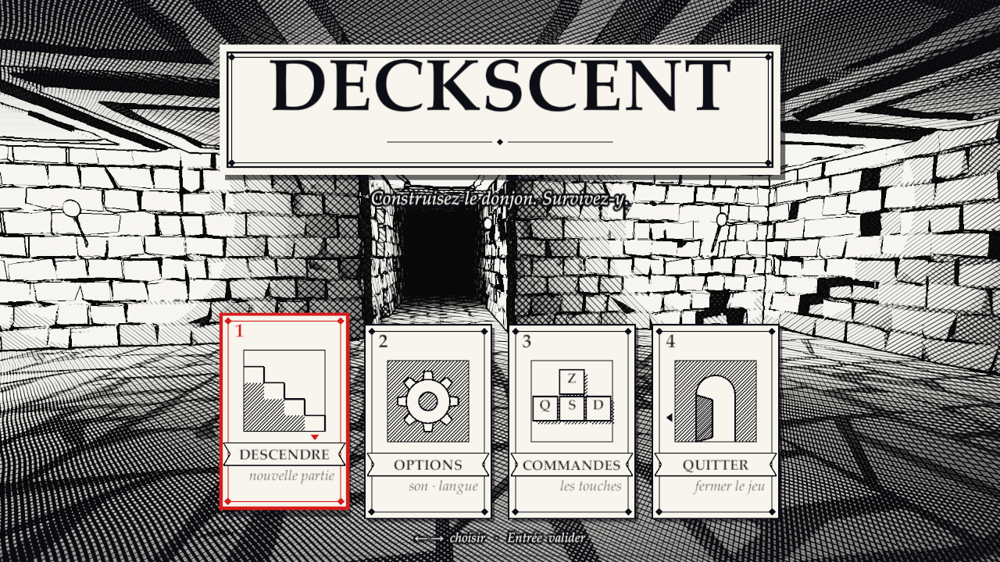
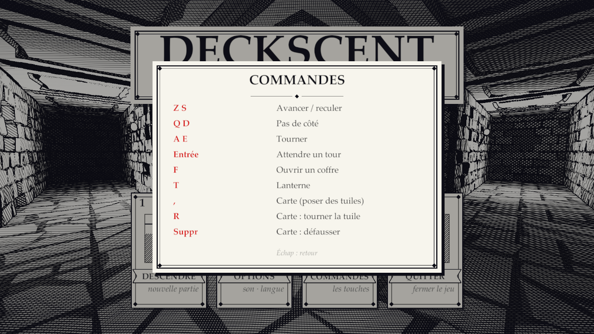
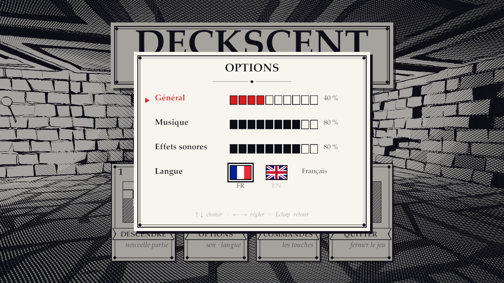
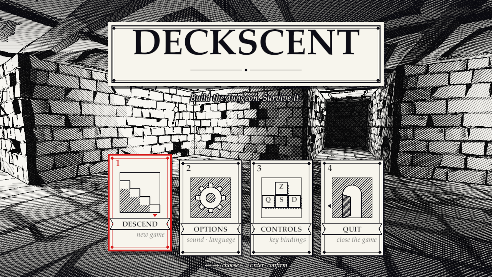

# Menu, options, musique, traduction

Le jeu démarre sur le **menu** (scène `Assets/Scenes/Menu.unity`, scène 0 du build ; Main est la 1). Il garde la DA du jeu : une salle du donjon rendue avec le **même post-process gravure** qu'en jeu, la caméra qui tourne lentement sur elle-même, une musique synthétisée, et par-dessus le titre **Deckscent** dans un cartouche papier cerné d'encre, avec l'accroche « Construisez le donjon. Survivez-y. ».

## Fichiers

- `Assets/Scripts/UI/MainMenu.cs` : la scène (caméra qui tourne, musique, fondu avant la partie). Objet `Menu` de la scène.
- `Assets/Scripts/UI/MenuScreen.cs` : l'écran titre, prefab `Assets/Prefabs/UI/EcranTitre.prefab` ([doc du prefab](prefabs/EcranTitre.md)), dessiné à la main comme la carte et le HUD (`InkCanvas`, `TextPool`, `Engraving`).
- `Assets/Scripts/Audio/MenuMusic.cs` : la musique (objet `Musique`).
- `Assets/Scripts/Settings/GameSettings.cs` : options (volume, langue), sauvegardées. `Assets/Scripts/Settings/Loc.cs` : traduction.
- `Assets/Scripts/UI/SceneFlow.cs` : passages menu → jeu, recommencer, retour au menu, quitter.
- `Assets/Scripts/Editor/MenuBuilder.cs` : menu *Deckscent > Construire la scène du menu* (prefab, scène, ordre du build). Relancer écrase le prefab et la scène.
- Tests : `Assets/Tests/PlayMode/MenuTests.cs`, `Assets/Tests/EditMode/LocTests.cs`.

## Les choix

Présentés comme une **main de cartes**, dessinées comme les cartes-tuiles de l'écran de carte (même cadre à losanges, numéro, illustration carrée hachurée, bandeau du nom, note en italique), agrandies 1,3 fois. La carte choisie se soulève, passe en rouge, et sa petite flèche s'allume.

| Carte | Effet |
|---|---|
| Descendre | Fondu au noir (la musique s'éteint avec), puis la scène Main : nouvelle partie. |
| Options | Volumes (général, musique, effets sonores) et langue (voir plus bas). |
| Commandes | Liste des touches, lues dans `InputSystem_Actions` et affichées selon le clavier (Z Q S D en AZERTY). |
| Quitter | Ferme le jeu (arrête le Play mode dans l'éditeur). |

| | Souris | Clavier | Manette |
|---|---|---|---|
| Choisir | survol | ← →, Q D, 1 à 4 | stick gauche, croix |
| Valider | clic | Entrée | Croix / A |
| Fermer un panneau | clic hors du cadre | Échap | Rond / B |

Touches de la map **UI** d'`InputSystem_Actions` (`Navigate`, `Submit`, `Cancel`) ; la souris et les chiffres sont lus directement.

## Options

| Ligne | Réglage |
|---|---|
| Général, Musique, Effets sonores | Un volume par piste du mixer, jauge à 10 cases comme les PV, de « Muet » à 100 %. ← → par pas de 10 % (en gardant la touche, ça défile), ou clic / glisser sur la jauge. |
| Langue | **FR / EN**, avec les drapeaux. ← → ou Entrée pour changer, ou clic sur un drapeau. La langue en cours est encadrée. |

↑ ↓ (Z S) choisissent la ligne, Échap ou un clic hors du cadre ferme. Tout est **sauvegardé** (`PlayerPrefs`, clés `Deckscent.Volume`, `Deckscent.MusicVolume`, `Deckscent.EffectsVolume` et `Deckscent.Locale`) et réappliqué au lancement, avant la première scène.

Les volumes règlent les trois pistes du mixer `Assets/Resources/Mixage.mixer` (Master, Musique, Effets) : voir [sons.md](sons.md). Le panneau a 4 lignes (`VolumeRows`, `LanguageRow`, `OptionCount` dans `MenuScreen`) ; une jauge se dessine avec `DrawGauge(ligne, …)` et se lit / règle avec `GetVolume` / `SetVolume(ligne, …)`.

## Traduction

Les textes sont écrits **en français** dans le code et passent par `Loc.T("texte")` (ou `Loc.F("Tour {0}", n)` s'ils ont des valeurs) au moment de l'affichage. La table anglaise est le dictionnaire `Loc.En` (clé = texte français exact) ; un texte absent de la table reste en français.

Sont traduits : le menu, l'**écran de carte** (titre, étage, main, légende, aide, noms des formes de tuiles, raisons de refus de pose, messages), le **HUD** (PV, tour, ATQ, DÉF, écran de mort) et les **messages** du jeu (piège franchi, coffre). Les noms de formes (`TileCard`) et les raisons de refus (`DungeonBoard.CheckPlacement`) restent des clés françaises dans le code : c'est l'écran de carte qui les traduit. Un test (`LocTests`) vérifie que toutes les formes et tous les refus ont leur traduction.

**Pour traduire un nouveau texte** : l'entourer de `Loc.T(…)` et ajouter sa ligne dans `Loc.En`. Les noms de touches restent ceux du clavier du système (« Entree », « Suppr » sur un Windows français) ; en français, quelques-uns sont réécrits (Entrée, Espace, Échap…).

## Musique

Le menu joue, sur la piste **Musique** du mixer, une ambiance **synthétisée en temps réel**, sans fichier audio, reprise du prototype Godot (`MenuMusic`, dans `OnAudioFilterRead` d'une `AudioSource` sans clip, à la fréquence de sortie) :

- un **bourdon** grave en ré mineur (ré 2, la 2, ré 3), chaque note doublée et désaccordée pour battre doucement, qui respire sur 19 s ;
- des **cloches** éparses (toutes les 2,2 à 5,5 s) tirées dans le ré mineur pentatonique, parfois suivies d'une note une quinte ou une octave plus bas, avec un écho croisé gauche / droite ;
- un **souffle de vent** (bruit filtré) qui enfle et retombe.

Elle arrive en fondu (3 s) et s'éteint en fondu quand on choisit **Descendre**.

Réglages sur `Musique` : `Drone Level`, `Bell Level`, `Wind Level`, `Bell Interval`, `Fade In`, `Seed` (-1 = tirage différent à chaque lancement). Les notes et timbres sont des constantes du script.

C'est une musique **provisoire** : pour un vrai morceau, retirer `MenuMusic` et donner un clip (`.ogg` en boucle) à l'`AudioSource`.

## Retour au menu

Depuis le jeu, **Échap** (ou Rond / B) **sur l'écran de mort** revient au menu ; Entrée recommence toujours directement.

## La scène

- La salle : un `Maze` avec son propre plan (`MenuBuilder.Plan`, une salle en croix et ses couloirs, huit torches), sans plateau de tuiles. La caméra se place sur sa case `P`, à 1,6 m.
- Même ambiance (0,2), même lanterne (0,9 / 6 m) et même post-process qu'en jeu : les hachures ont la même densité. Rien n'est dupliqué : le post-process gravure s'applique à toute caméra du renderer.
- Le titre utilise la police à empattements du système (`TextPool`).

## Réglages

Sur `Menu` (`MainMenu`) : `Turn Period` (durée d'un tour de caméra, 140 s), `Bob Amount` / `Bob Period` (respiration), `Pitch`, `Eye Height`.
Sur `EcranTitre` (`MenuScreen`) : couleurs papier / encre / accent, `Vignette` (bandes sombres en haut et en bas), `Card Scale`. Les textes et les cartes sont des constantes du script.

## Captures

Play mode dans `Menu`, `script eval` qui appelle `MenuScreen.Select(…)`, `SetPanel(…)` et `SkipAnimations()` (et `GameSettings.SetLocale("en", false)` pour l'anglais, sans toucher aux options sauvegardées), puis `capture game_view`. Images : `docs/images/menu.png`, `menu_options.png`, `menu_commandes.png`, `menu_en.png`.
