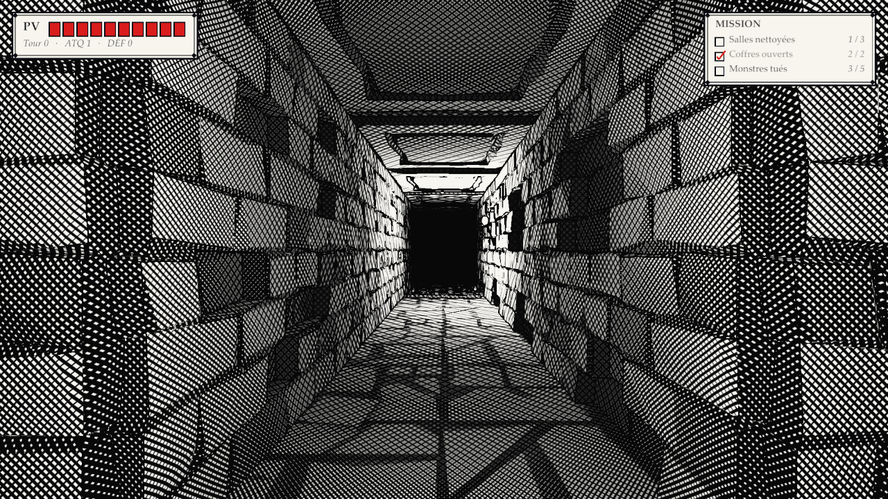
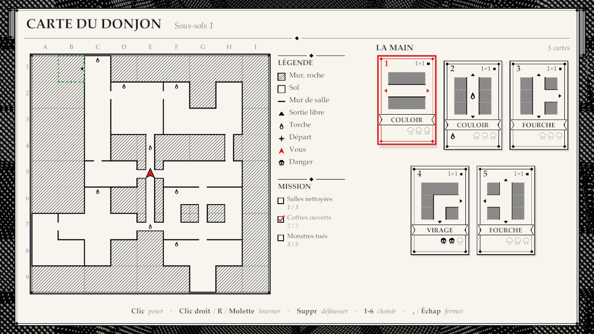

# Mission de l'étage

Chaque étage a une **mission** (la « recette » du [GDD](gdd.md#un-étage)) : quelques objectifs tirés au hasard, à remplir tous. Elle est affichée **dans le HUD**, en haut à droite, et **sur la carte**, sous la légende. Une fois remplie, la salle du boss viendra (tâche 5 de la [todo](todo.md)) ; pour l'instant, le jeu le dit seulement (« Mission remplie ! »).

## Les objectifs

| Objectif | Compte quand… | Fourchette par défaut |
|---|---|---|
| Tours survécus | le tour en cours atteint le compte (des dizaines rondes) | 30 à 60 |
| Salles nettoyées | une salle est **nettoyée et visitée** (voir plus bas) | 2 à 3 |
| Coffres ouverts | un coffre est ouvert | 2 à 3 |
| Monstres tués | un monstre meurt (de la main du joueur ou sur une dalle) | 4 à 8 |
| Pièges franchis | le joueur a traversé une dalle à pics (elle est « nettoyée », voir [pieges.md](pieges.md)) | 2 à 3 |

- **Tirage** : 2 ou 3 objectifs, de sortes toutes différentes. **Peu d'objectifs = plus durs** (moitié haute de leur fourchette), **beaucoup = plus faciles** (moitié basse) : « courte et dure » ou « longue et facile », comme le veut le GDD.
- Le hasard de la mission est à part : il ne change pas le tirage des cartes (même graine, même pioche qu'avant).
- Réglages dans l'inspecteur du **Donjon** (`Mission`, classe `MissionSettings`) : nombre d'objectifs (min, max) et fourchette de chaque sorte. Les salles sont plafonnées à 6 par étage par la pioche : ne pas viser plus.
- Chaque objectif rempli donne un message (« Objectif rempli : Coffres ouverts »), la mission entière « Mission remplie ! ». Dans le HUD et sur la carte, la case de l'objectif est cochée en rouge, et le titre devient « Mission remplie », en rouge.

## Salles nettoyées

Une salle ne compte qu'**une fois nettoyée** : impossible de tricher en posant une salle loin et en l'évitant.

- Le **Spawner** rattache chaque élément qu'il fait apparaître à sa tuile (`Spawner.TileContents`) et suit sa fin : monstre mort (`Enemy.Died`), coffre ouvert (`Chest.Cleared`), dalle franchie (`SpikeTrap.Cleared`). Quand ses monstres sont morts et ses coffres ouverts, la tuile est nettoyée : il émet `TileCleared`.
- **Les dalles à pics ne comptent pas** pour nettoyer une salle (choix de l'utilisateur : devoir passer sur toutes serait pénible). Les franchir est un objectif à part, global comme les tours.
- Une **salle** (carte de salle, pas un couloir) compte quand elle est **nettoyée et que le joueur y est entré** au moins une fois, dans n'importe quel ordre. Une salle vide (ou qui n'a que des dalles) compte dès qu'on y entre. La salle de départ ne compte pas.
- Chaque salle ne compte qu'une fois.

## Fichiers

- `Assets/Scripts/Mission/Mission.cs` : `Mission` (objectifs, tirage, `Report`, `SetTurn`, événements `GoalDone` et `Completed`, `Version` pour redessiner), `MissionGoal`, `GoalKind`, `MissionSettings`. Logique pure, testée en EditMode (`Assets/Tests/EditMode/MissionTests.cs`).
- `Assets/Scripts/Mission/MissionTracker.cs` : suit la mission en jeu (tours, éléments réglés, salles visitées), prévient le joueur. Sur l'objet `Contenu` des scènes, à côté du Spawner (ajouté par *Deckscent > Ajouter le contenu aux scènes*). Tests : `Assets/Tests/PlayMode/MissionTrackerTests.cs`.
- `Dungeon.Mission` : tirée à chaque nouvelle partie ; `Dungeon.SetMission` la remplace (tests, captures).
- Affichage : `Hud.DrawMission` (cartouche en haut à droite) et `MapScreen.DrawMission` (sous la légende), avec la même ligne d'objectif (`Hud.MissionGoalRow`).

## Captures

Play mode dans `Test_Donjon`, `script eval` qui pose une mission connue (`Dungeon.SetMission`) et la fait avancer (`Report`), puis `capture game_view` ; pour la carte, `MapScreen.Open()` avant la capture. Images : `docs/images/mission_hud.png`, `mission_carte.png`.
