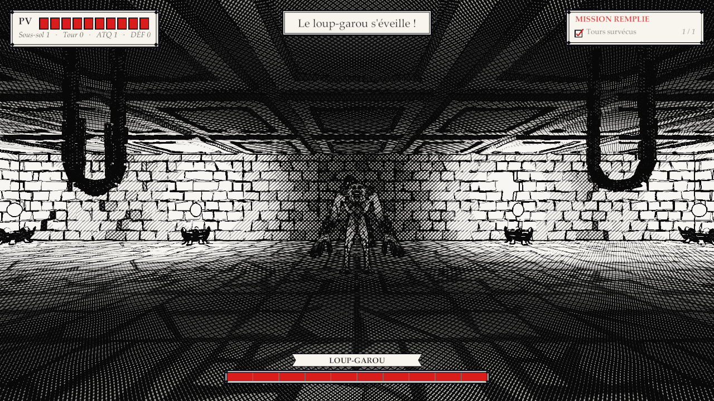
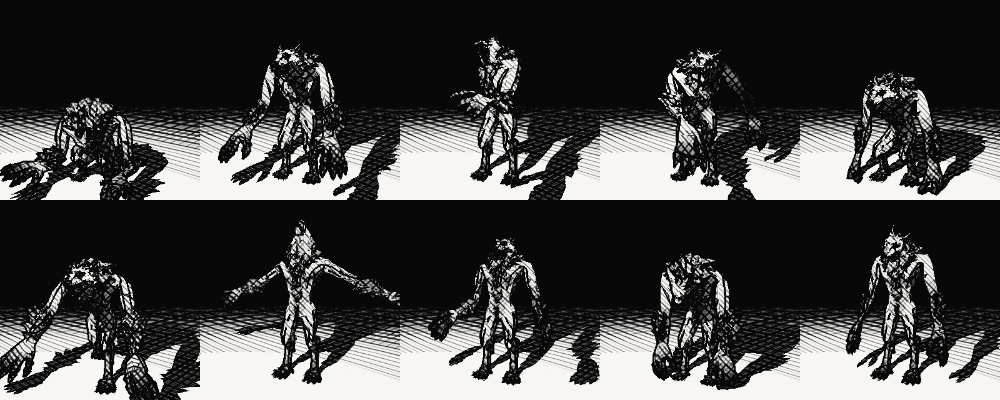

# Loup-garou (boss de l'étage)

Code : `Assets/Scripts/Enemies/Werewolf.cs` (hérite d'`Enemy`), animation : `WerewolfRig.cs`, louveteaux : `WolfCub.cs`. Prefabs : `Assets/Prefabs/Enemies/LoupGarou.prefab` et `Louveteau.prefab` ([doc des prefabs](../prefabs/README.md)), construits par *Deckscent > Construire les prefabs du boss (loup-garou, antre, escalier)* (`BossBuilder.cs`). Il dort dans son **antre**, posée par le jeu une fois la mission remplie ([antre.md](../antre.md)).

## Modèle et animation

Modèle **POLYGON Werewolf** (`SM_Werewolf_01`, riggé), à l'échelle 1,3 (≈ 2,5 m), peau « mort-vivant » retirée, matériau toon `M_Toon_LoupGarou` (texture en gris, lueur propre 0,35 : il se voit dans le noir). Sans le pack : un secours en formes simples (buste, tête, museau, oreilles), qui se penche selon la pose.

**Aucune animation dans les packs** : elles sont **procédurales** (choix de l'utilisateur). `WerewolfRig` part de la T-pose du modèle et tourne quelques os **dans le repère du personnage** (x à sa droite, y en haut, z devant lui), d'après une table de poses ; il passe d'une pose à l'autre en douceur et ajoute une respiration. Le bassin descend quand les jambes plient. Des clips Mixamo pourraient le remplacer : `Werewolf` ne connaît que `SetPose`.

*Sommeil, Garde, Armer, Griffer, Ramasse / Charge, Hurle, Touche, Sonne, Mort.* Planche refaite par *Deckscent > Planche du loup-garou* (`WerewolfPlate.cs`), rendue avec la gravure, sans Play mode (chaque pose est « cuite » dans un maillage : dans l'éditeur, un maillage riggé n'est redéformé qu'une fois par image). `WerewolfPlate.Render(false, chemin, 90)` la rend de profil sans gravure, pratique pour régler la table.

## Au tour par tour

Tout est **annoncé un tour à l'avance** : le joueur a toujours de quoi réagir.

1. **Endormi** devant son trône, jusqu'à ce que le joueur **entre dans l'antre** ou passe dans sa ligne de vue à 5 cases (`Wake Range`). Il **hurle** (un tour), sa barre de vie s'affiche en bas de l'écran et la musique passe en **mode boss** (`MusicDirector.BossMode`).
2. Chaque tour éveillé, il **tire son attaque** (poids choisis par l'utilisateur) :

   | Attaque | Chances | Dégâts | Comment |
   |---|---|---|---|
   | **Coup de base** | 1 sur 6 | 2 | à côté du joueur, tout de suite, sans annonce |
   | **Coup chargé** | 3 sur 6 | 3 | il **arme** (bras levé, grognement) ; au tour suivant, le coup part **vers la case visée, même dans le vide** : reculer ou se décaler le fait rater |
   | **Charge** | 2 sur 6 | 4 | joueur dans la même ligne ou colonne, ligne dégagée, jusqu'à 6 cases (aussi à bout portant) : il **se ramasse** (il rougit et brille, « Le loup-garou se ramasse pour charger ! »), puis fonce tout droit au tour suivant jusqu'au premier obstacle. S'il croise le joueur : 4 dégâts ; s'il percute un mur, il est **sonné** un tour |

   Coup de base ou chargé tirés loin du joueur : il s'approche d'une case. Charge tirée sans être aligné : il s'approche aussi.
3. **2ᵉ phase** à la moitié de ses PV : il hurle et appelle **2 louveteaux** sur les cases libres les plus proches (une fois).
4. Il s'approche d'une case par le chemin le plus court (murs et autres monstres contournés) quand son attaque ne peut pas partir.

**Hurlement** : les braseros et les torches proches s'embrasent un instant ([antre.md](../antre.md#son-décor)).

**Touché** : rejeté en arrière, blanchi un instant. **Mort** : la meute fuit (les louveteaux meurent), il bascule en arrière et s'enfonce dans le sol ; la musique quitte le mode boss ; **l'escalier** sort du sol à sa place ([antre.md](../antre.md#lescalier)).

## Louveteau

Même modèle à l'échelle 0,6. 2 PV, 1 d'attaque : il fonce sur le joueur (poursuite à 20 pas) et mord quand il est à côté, comme un slime.

## Plus fort plus bas

Chaque sous-sol sous le premier : **+2 PV** au boss, +1 aux dégâts de ses trois attaques tous les 2 sous-sols (`ScaleForFloor`). Les autres ennemis (slimes, louveteaux) : +1 PV par étage, +1 d'attaque tous les 3 (`Enemy.ScaleForFloor`).

## Réglages (prefab `LoupGarou`)

| Réglage | Défaut | Rôle |
|---|---|---|
| `Max Health` | 10 | PV au premier étage. |
| `Damage` | 2 | Dégâts du coup de base. |
| `Heavy Damage` | 3 | Dégâts du coup chargé. |
| `Basic Weight` / `Heavy Weight` / `Charge Weight` | 1 / 3 / 2 | Poids du tirage de l'attaque. |
| `Wake Range` | 5 | Il se réveille si le joueur le voit à moins de tant de cases (ou entre dans l'antre). |
| `Charge Damage` | 4 | Dégâts de la charge. |
| `Charge Range` | 6 | Portée de la charge (cases). |
| `Charge Cooldown` | 0 | Tours sans charge après une charge (0 : le tirage seul décide). |
| `Cubs` | 2 | Louveteaux appelés à la moitié des PV. |
| `Chase Range` | 40 | Distance de poursuite, en pas. |
| `Move Time` / `Charge Step Time` | 0,3 / 0,08 s | Durée d'un pas, d'une case de charge. |
| `Charge Color` / `Charge Glow` | rouge / 0,6 | Teinte et lueur quand il annonce sa charge. |

Équilibrage validé en jouant par l'utilisateur (le joueur a 10 PV et 1 d'attaque : 10 coups pour le tuer).

## Tests

`Assets/Tests/PlayMode/BossTests.cs` : antre posée à la mission remplie, réveil, coup armé raté en reculant puis porté, charge annoncée esquivée (boss sonné), escalier et étage suivant, monstres plus forts plus bas.
