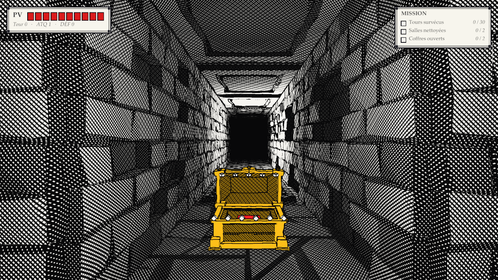

# Mimique

Code : `Assets/Scripts/Enemies/Mimic.cs` (hérite d'`Enemy`), prefab : `Assets/Prefabs/Enemies/Mimique.prefab`, construit par *Deckscent > Construire les prefabs du décor* (`DecorBuilder.BuildMimic`) comme une **copie du prefab Coffre** (mêmes pièces, même dorure, mêmes couvercles) avec des dents blanches sur le bord avant de la caisse, des crocs sous le bord avant du couvercle (ils suivent son ouverture) et une langue rouge au fond de la caisse, cachés tant qu'elle fait le coffre. Le 2ᵉ monstre de la [todo](../todo.md), classique du genre.

## Où

Dans une **salle**, chaque coffre a 15 % de chances d'être une mimique (`Mimic Chance` du Spawner). Elle compte comme un **monstre** pour la mission (et pour nettoyer la salle), pas comme un coffre.

## Comportement

- **Cachée** : elle ne joue pas, ne met pas le joueur « en combat » (pose de tuiles permise) et passe pour un coffre jusque dans la musique (couche « coffre proche », pas « menace »). Seul indice : son **couvercle frémit** de temps en temps (`Twitch Every`, 5 s en moyenne).
- **Essayer de l'ouvrir** (avancer dessus ou Interact) : elle se révèle (« Ce coffre a des dents ! ») et **mord aussitôt** : 3 dégâts.
- **La frapper** sans l'ouvrir (impossible en avançant, puisqu'avancer l'ouvre ; possible si elle s'est révélée) : pas de morsure gratuite.
- **Révélée** : gueule ouverte, elle bondit vers le joueur (5 pas au plus) et mord à côté de lui (2 dégâts). 5 PV.
- **Mort** : elle s'enfonce dans le sol en refermant la gueule.

Plus profond, elle gagne des PV comme les autres monstres (`Enemy.ScaleForFloor`).

Test : `BossTests.LaMimiqueMordQuandOnVeutLOuvrir` (PlayMode).
