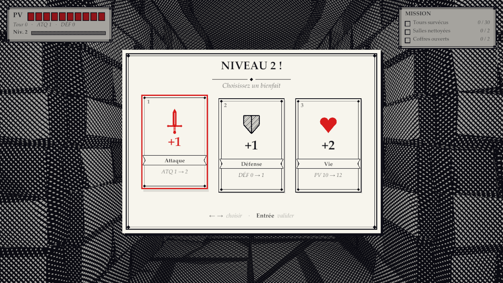

# XP et niveaux

Code : `Assets/Scripts/Player/Experience.cs` (logique pure), `PlayerController` (gain, bienfaits), `Assets/Scripts/UI/LevelUpScreen.cs` (écran de choix). Prefab : `Assets/Prefabs/UI/MonteeDeNiveau.prefab` ([doc du prefab](prefabs/MonteeDeNiveau.md)), construit par *Deckscent > Construire l'écran de niveau*. GDD : [§3 Compétences et éléments](gdd.md#compétences-et-éléments).

## Gagner de l'XP

- **Tout monstre tué** rapporte de l'XP, même tué par une dalle à pics. Un vase ou une caisse ne rapporte rien.
- XP d'un monstre = **ses PV max + son attaque**, après le renfort de l'étage (`Enemy.ExperienceReward`). Les monstres durs et ceux des étages profonds rapportent donc plus (GDD : *high risk, high reward*).

| Monstre | PV max | ATQ | XP (sous-sol 1) |
|---|---|---|---|
| Slime vert | 3 | 1 | 4 |
| Slime bleu | 3 | 2 | 5 |
| Slime rouge | 6 | 1 | 7 |
| Louveteau | 2 | 1 | 3 |
| Mimique | 5 | 2 | 7 |
| Loup-garou | 10 | 2 | 12 |

## Monter de niveau

- Niveau 1 → 2 : **10 XP** ; chaque niveau suivant demande **5 XP de plus** (15, 20, 25…). Le surplus est gardé. Un gros monstre peut faire gagner plusieurs niveaux d'un coup.
- Un niveau gagné **attend son bienfait** (`Experience.Pending`). Dès que le joueur a fini son tour (les monstres ont joué), l'écran de niveau s'ouvre et **met le jeu en pause**, comme la carte.
- **Trois bienfaits**, présentés comme des cartes gravées (épée, écu, cœur), avec la stat avant / après :
  - **Attaque** : ATQ +1 ;
  - **Défense** : DÉF +1 ;
  - **Vie** : PV max +2, et 2 PV rendus (les nouvelles cases arrivent pleines). Le cartouche des PV au HUD **garde sa taille** (10 cases) : au-delà, les cases s'amincissent pour toutes y tenir (choix de l'utilisateur).
- Il faut en choisir un : pas de retour. Plusieurs niveaux d'un coup : un choix par niveau.
- Au HUD, sous Tour / ATQ / DÉF : « Niv. 2 » et une **jauge d'XP** hachurée vers le niveau suivant. L'écran de mort rappelle le niveau atteint.
- Niveaux et bienfaits sont **gardés d'un étage à l'autre** et **perdus à la mort** (nouvelle partie). Plus tard, à la remontée au hub aussi (GDD : chaque expédition repart de zéro).

Pour l'instant les bienfaits sont des stats (choix de l'utilisateur, 2026-11-21). Les compétences de classe (GDD §3) viendront s'ajouter au tirage (`Experience.Pool`) : on en proposera alors 3 parmi toutes.

## Commandes de l'écran

| Action | Clavier / souris | Manette |
|---|---|---|
| Choisir | ← → (Q D), survol | stick, croix |
| Valider | Entrée, clic | bouton du bas |
| Choisir et valider | 1, 2, 3 | |

Un **délai d'une demi-seconde** (`Accept Delay`) avant d'accepter un choix : une touche martelée pendant le combat ne choisit pas à l'aveugle. La carte et la pause ne s'ouvrent pas par-dessus.

## Réglages

Sur le joueur (prefab `Player`, rubrique *Niveaux*) :

| Réglage | Défaut | Rôle |
|---|---|---|
| `First Level` | 10 | XP du niveau 1 au niveau 2. |
| `Per Level` | 5 | XP en plus pour chaque niveau suivant. |
| `Choices` | 3 | Bienfaits proposés (tirés parmi tous). |
| `Attack Gain` | 1 | ATQ du bienfait Attaque. |
| `Defense Gain` | 1 | DÉF du bienfait Défense. |
| `Health Gain` | 2 | PV max (et PV rendus) du bienfait Vie. |

Sur l'écran (prefab `MonteeDeNiveau`) : `Accept Delay` (0,5 s), couleurs papier / encre / accent.

## Questions ouvertes

- Courbe d'XP à caler en jouant (GDD §10) : aujourd'hui, environ 2 à 3 slimes pour le niveau 2.
- La défense est forte contre les monstres à 1 d'attaque (un coup fait toujours au moins 1) : à surveiller.
