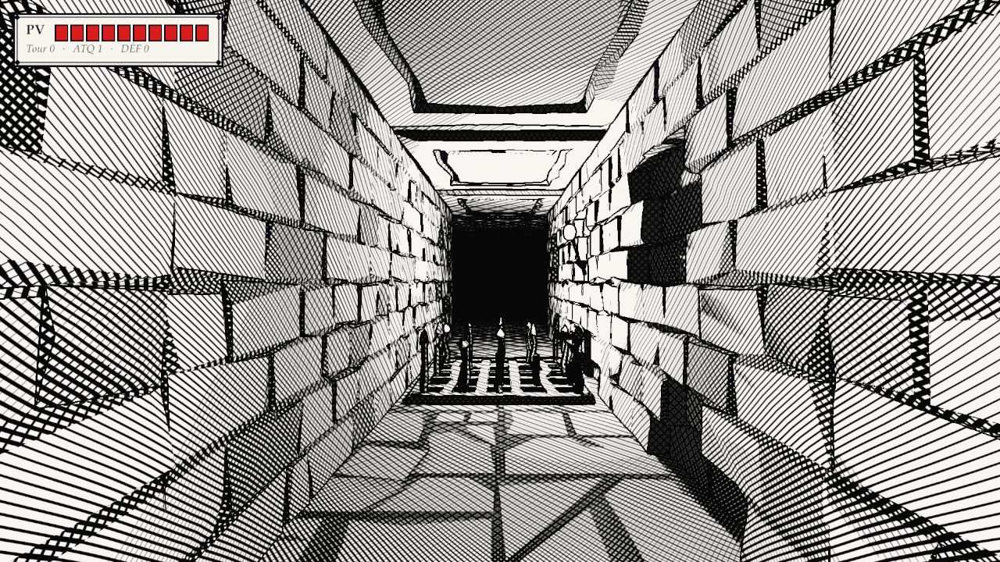

# Pièges

Les pièges jouent au tour par tour comme les monstres (voir [tour-par-tour.md](tour-par-tour.md)) : après chaque action du joueur qui coûte un tour, chaque piège avance d'un cran dans son cycle.

## Dalle à pics

Code : `Assets/Scripts/Traps/SpikeTrap.cs`, prefab : `Assets/Prefabs/Traps/DallePics.prefab` ([doc du prefab](prefabs/DallePics.md)). Apparaît dans les tuiles « piège » et les salles piégées (voir [tuiles.md](tuiles.md#ce-qui-apparaît)).

Une grille au sol (Synty `SM_Trap_Spears_Grate_01`) d'où sortent des piques (`SM_Trap_Spears_01`). Sans le pack Synty : une plaque grise percée de trous et des cônes. Les pics sortent **1 tour sur 3**, et on les voit venir :

| Tour du cycle | État | Ce qu'on voit |
|---|---|---|
| 1 | **Repos** | La grille seule. On peut marcher dessus sans risque. |
| 2 | **Alerte** | Les pointes de lance dépassent nettement de la grille (40 cm) : les pics sortent au prochain tour. |
| 3 | **Pics sortis** | Les piques jaillissent (1 m, sortie sèche). Elles rentrent au tour suivant. |

### Règles

- **Pics qui sortent sous le joueur** : 2 PV de dégâts (avant la défense). Rester dessus pendant l'alerte, c'est se faire toucher.
- **Avancer sur des pics sortis** : permis et sans dégâts. Avancer est un tour, donc ils rentrent, et dès le début du pas (`Anticipate`) pour qu'on ne les traverse pas à l'écran.
- **Les ennemis aussi** prennent les pics : on peut y attirer un slime.
- Tourner ne coûte pas de tour, donc ne fait pas avancer le cycle. Pour passer : avancer au tour de repos, ou attendre (Entrée) le bon moment.
- La dalle ne bloque jamais la case.
- **Nettoyée** : la première fois que le joueur en ressort, elle est marquée nettoyée (`IsCleared`, événement `Cleared`), sans message au HUD (retiré à la demande de l'utilisateur). Ça compte pour l'objectif « Pièges franchis » de la [mission](mission.md). Elle reste dangereuse ensuite.
- Le Spawner décale le cycle des dalles d'une même tuile (`Phase Offset`) : une salle piégée se traverse en rythme.

### Réglages (prefab `DallePics`)

| Réglage | Défaut | Rôle |
|---|---|---|
| `Period` | 3 | Longueur du cycle, en tours. |
| `Active Turns` | 1 | Tours où les pics restent sortis (à la fin du cycle). |
| `Phase Offset` | 0 | Décale le cycle (le Spawner le tire). |
| `Show Warning` | oui | Les pointes dépassent le tour d'avant. Décoché : aucun signe. |
| `Damage` | 2 | Dégâts des pics (joueur ou ennemi). |
| `Spike Height` | 1 m | Hauteur des pics sortis. |
| `Warning Height` | 0,4 m | Hauteur des pointes en alerte. |
| `Rise Time` / `Lower Time` | 0,1 / 0,25 s | Sortie sèche, rentrée plus lente. |

### Côté code

- `StateFor(tour)` : avec `p = (tour + Phase Offset) mod Period`, sortis si `p ≥ Period − Active Turns`, en alerte le tour juste avant. Le cycle suit le compteur de tours du joueur.
- Au repos, les piques sont **sous le sol** : seul le groupe `Pics` monte et descend. Dans l'éditeur, le prefab les montre sortis (pour les voir et les régler) ; en jeu, ils prennent leur état dès le lancement.
- Le décor Synty et sa version de secours sont choisis par `DecorFallback` (sur `Dalle` et sur `Pics`).
- **Son** : quand les pics sortent, un raclement et un tintement métalliques, en 3D (`SoundEmitter` sur la racine, `Spikes Volume`) ; l'alerte est muette. Le joueur touché joue en plus le coup reçu. Voir [sons.md](sons.md).
