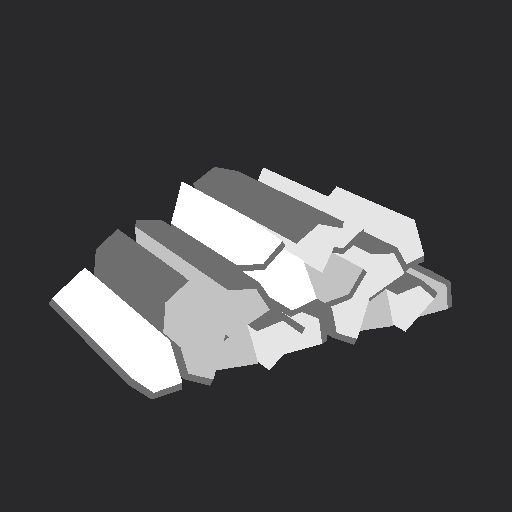

# Bois

`Assets/Prefabs/Camp/Bois.prefab` · [← liste des prefabs](README.md)

Tas de bûches (Farm `SM_Prop_Wood_Stack_01`), décor de passage du camp.



## Hiérarchie

```
Bois
└─ SM_Prop_Wood_Stack_01
   └─ Pièce
      └─ SM_Prop_Wood_Stack_01  [MeshFilter, MeshRenderer]
```

## Contenu

### Bois / SM_Prop_Wood_Stack_01 / Pièce / SM_Prop_Wood_Stack_01

- **MeshFilter**
  - maillage `SM_Prop_Wood_Stack_01` (`Assets/Synty/PolygonFarm/Models/SM_Prop_Wood_Stack_01.fbx`)
- **MeshRenderer**
  - matériaux `M_Toon_PolygonFarm_01_A` (Deckscent/Toon)
