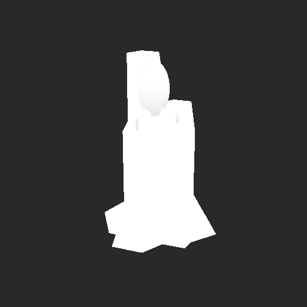

# Bougies

`Assets/Prefabs/Props/Decor/Bougies.prefab` · [← liste des prefabs](README.md)

Bougies au pied d'un mur (Synty `SM_Prop_Candles_01`), flamme blanche et petite lumière qui vacille. De passage. Voir docs/decor.md.



## Hiérarchie

```
Bougies  [DecorFallback, LairDecor]
├─ Flamme  [MeshFilter, MeshRenderer]
├─ Lumière  [Light, UniversalAdditionalLightData, TorchFlicker]
├─ Décor
│  └─ Pièce
│     └─ SM_Prop_Candles_01  [MeshFilter, MeshRenderer]
└─ Secours
   ├─ Bougie  [MeshFilter, MeshRenderer]
   ├─ Bougie  [MeshFilter, MeshRenderer]
   └─ Bougie  [MeshFilter, MeshRenderer]
```

## Contenu

### Bougies

- **DecorFallback**
  - `decor` = `Décor` — La pièce Synty (enfant).
  - `fallback` = `Secours` — La version en formes simples, affichée si le décor n'a pas ses maillages.
  - `forceFallback` = non — Coché : toujours le secours, même si le décor est là (pour comparer).
- **LairDecor**
  - `blocks` = non — Coché : bloque la case (joueur, monstres, charge). Décoché : décor de passage (ossements au sol…).

### Bougies / Flamme

- **Transform**
  - position (0, 0.42, 0)
  - échelle (0.08, 0.14, 0.08)
- **MeshFilter**
  - maillage `Sphere` (`Library/unity default resources`)
- **MeshRenderer**
  - matériaux `M_Flamme` (Universal Render Pipeline/Unlit)
  - ombres portées : Off

### Bougies / Lumière

- **Transform**
  - position (0, 0.6, 0.15)
- **Light**
  - Point, couleur (1, 1, 1), intensité 1.4, portée 3.5 m, ombres Hard
- **UniversalAdditionalLightData**
- **TorchFlicker**
  - `baseIntensity` = 1.4 — Intensité moyenne de la torche.
  - `flicker` = 0.25 — Amplitude du vacillement.
  - `howlReach` = 20 — Quand un loup-garou hurle à moins de cette distance (mètres), la flamme s'embrase un instant. 0 = jamais.

### Bougies / Décor / Pièce

- **Transform**
  - échelle (1.322, 1.322, 1.322)

### Bougies / Décor / Pièce / SM_Prop_Candles_01

- **MeshFilter**
  - maillage `SM_Prop_Candles_01` (`Assets/Synty/PolygonDungeon/Models/SM_Prop_Candles_01.fbx`)
- **MeshRenderer**
  - matériaux `M_Toon_PolygonDungeon_01` (Deckscent/Toon)

### Bougies / Secours / Bougie

- **Transform**
  - position (-0.15, 0.12, 0)
  - échelle (0.07, 0.12, 0.07)
- **MeshFilter**
  - maillage `Cylinder` (`Library/unity default resources`)
- **MeshRenderer**
  - matériaux `M_Toon_Os` (Deckscent/Toon)

### Bougies / Secours / Bougie

- **Transform**
  - position (0, 0.16, 0.1)
  - échelle (0.07, 0.16, 0.07)
- **MeshFilter**
  - maillage `Cylinder` (`Library/unity default resources`)
- **MeshRenderer**
  - matériaux `M_Toon_Os` (Deckscent/Toon)

### Bougies / Secours / Bougie

- **Transform**
  - position (0.15, 0.2, 0)
  - échelle (0.07, 0.2, 0.07)
- **MeshFilter**
  - maillage `Cylinder` (`Library/unity default resources`)
- **MeshRenderer**
  - matériaux `M_Toon_Os` (Deckscent/Toon)
