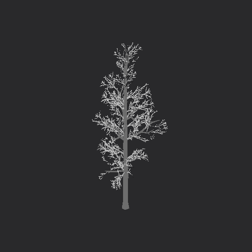

# BouleauMort

`Assets/Prefabs/Camp/BouleauMort.prefab` · [← liste des prefabs](README.md)

Bouleau mort (Nature), forêt autour du camp.



## Hiérarchie

```
BouleauMort
└─ Pièce
   └─ SM_Tree_Birch_Dead_01  [MeshFilter, MeshRenderer]
```

## Contenu

### BouleauMort / Pièce / SM_Tree_Birch_Dead_01

- **MeshFilter**
  - maillage `SM_Tree_Birch_Dead_01` (`Assets/Synty/PolygonNature/Models/SM_Tree_Birch_Dead_01.fbx`)
- **MeshRenderer**
  - matériaux `M_Toon_PolygonNature_01` (Deckscent/Toon), `M_Toon_Tree_Dead_01` (Deckscent/Toon)
