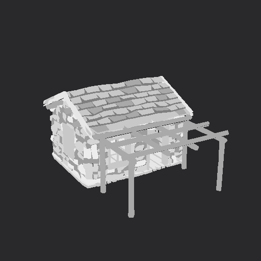

# Cabane

`Assets/Prefabs/Camp/Cabane.prefab` · [← liste des prefabs](README.md)

Cabane de pierre (Meadow Forest `SM_Bld_Stone_Cabin_01`), à l'ouest du camp, au-delà du muret.



## Hiérarchie

```
Cabane
└─ Pièce
   └─ SM_Bld_Stone_Cabin_01  [MeshFilter, MeshRenderer]
```

## Contenu

### Cabane / Pièce / SM_Bld_Stone_Cabin_01

- **MeshFilter**
  - maillage `SM_Bld_Stone_Cabin_01` (`Assets/Synty/PolygonNatureBiomes/PNB_Meadow_Forest/Models/SM_Bld_Stone_Cabin_01.fbx`)
- **MeshRenderer**
  - matériaux `M_Toon_PolygonNatureBiomesMeadow_Mat_01` (Deckscent/Toon)
