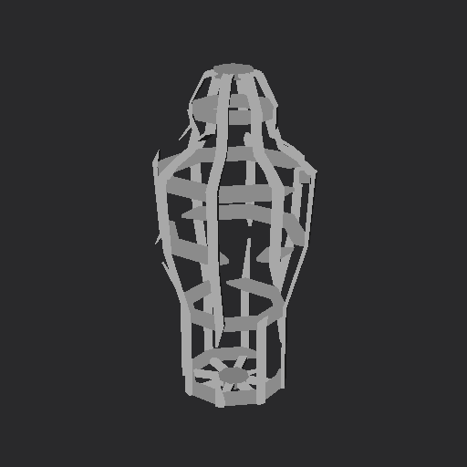

# Cage

`Assets/Prefabs/Props/Antre/Cage.prefab` · [← liste des prefabs](README.md)

Décor de l'antre du boss : cage de torture (Synty `SM_Prop_Toture_Cage_01`) le long des murs. Bloque sa case. Voir docs/antre.md.



## Hiérarchie

```
Cage  [DecorFallback, LairDecor]
├─ Décor
│  └─ Pièce
│     └─ SM_Prop_Toture_Cage_01  [MeshFilter, MeshRenderer]
└─ Secours
   ├─ Barreau  [MeshFilter, MeshRenderer]
   ├─ Barreau  [MeshFilter, MeshRenderer]
   ├─ Barreau  [MeshFilter, MeshRenderer]
   ├─ Barreau  [MeshFilter, MeshRenderer]
   ├─ Barreau  [MeshFilter, MeshRenderer]
   ├─ Barreau  [MeshFilter, MeshRenderer]
   ├─ Barreau  [MeshFilter, MeshRenderer]
   └─ Barreau  [MeshFilter, MeshRenderer]
```

## Contenu

### Cage

- **DecorFallback**
  - `decor` = `Décor` — La pièce Synty (enfant).
  - `fallback` = `Secours` — La version en formes simples, affichée si le décor n'a pas ses maillages.
  - `forceFallback` = non — Coché : toujours le secours, même si le décor est là (pour comparer).
- **LairDecor**
  - `blocks` = oui — Coché : bloque la case (joueur, monstres, charge). Décoché : décor de passage (ossements au sol…).

### Cage / Décor / Pièce

- **Transform**
  - échelle (1.193, 1.193, 1.193)

### Cage / Décor / Pièce / SM_Prop_Toture_Cage_01

- **MeshFilter**
  - maillage `SM_Prop_Toture_Cage_01` (`Assets/Synty/PolygonDungeon/Models/SM_Prop_Toture_Cage_01.fbx`)
- **MeshRenderer**
  - matériaux `M_Toon_PolygonDungeon_01` (Deckscent/Toon)

### Cage / Secours / Barreau

- **Transform**
  - position (0, 1, 0.5)
  - échelle (0.05, 1, 0.05)
- **MeshFilter**
  - maillage `Cylinder` (`Library/unity default resources`)
- **MeshRenderer**
  - matériaux `M_Toon_Gris_Antre` (Deckscent/Toon)

### Cage / Secours / Barreau

- **Transform**
  - position (0.354, 1, 0.354)
  - échelle (0.05, 1, 0.05)
- **MeshFilter**
  - maillage `Cylinder` (`Library/unity default resources`)
- **MeshRenderer**
  - matériaux `M_Toon_Gris_Antre` (Deckscent/Toon)

### Cage / Secours / Barreau

- **Transform**
  - position (0.5, 1, 0)
  - échelle (0.05, 1, 0.05)
- **MeshFilter**
  - maillage `Cylinder` (`Library/unity default resources`)
- **MeshRenderer**
  - matériaux `M_Toon_Gris_Antre` (Deckscent/Toon)

### Cage / Secours / Barreau

- **Transform**
  - position (0.354, 1, -0.354)
  - échelle (0.05, 1, 0.05)
- **MeshFilter**
  - maillage `Cylinder` (`Library/unity default resources`)
- **MeshRenderer**
  - matériaux `M_Toon_Gris_Antre` (Deckscent/Toon)

### Cage / Secours / Barreau

- **Transform**
  - position (0, 1, -0.5)
  - échelle (0.05, 1, 0.05)
- **MeshFilter**
  - maillage `Cylinder` (`Library/unity default resources`)
- **MeshRenderer**
  - matériaux `M_Toon_Gris_Antre` (Deckscent/Toon)

### Cage / Secours / Barreau

- **Transform**
  - position (-0.354, 1, -0.354)
  - échelle (0.05, 1, 0.05)
- **MeshFilter**
  - maillage `Cylinder` (`Library/unity default resources`)
- **MeshRenderer**
  - matériaux `M_Toon_Gris_Antre` (Deckscent/Toon)

### Cage / Secours / Barreau

- **Transform**
  - position (-0.5, 1, 0)
  - échelle (0.05, 1, 0.05)
- **MeshFilter**
  - maillage `Cylinder` (`Library/unity default resources`)
- **MeshRenderer**
  - matériaux `M_Toon_Gris_Antre` (Deckscent/Toon)

### Cage / Secours / Barreau

- **Transform**
  - position (-0.354, 1, 0.354)
  - échelle (0.05, 1, 0.05)
- **MeshFilter**
  - maillage `Cylinder` (`Library/unity default resources`)
- **MeshRenderer**
  - matériaux `M_Toon_Gris_Antre` (Deckscent/Toon)
