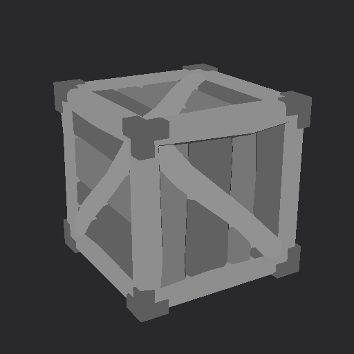

# Caisse

`Assets/Prefabs/Props/Decor/Caisse.prefab` · [← liste des prefabs](README.md)

Caisse à briser (Synty `SM_Prop_Crate_Wood_01`, lueur propre), dans les coins des salles. On la brise en avançant dessus : elle explose en éclats ; parfois une potion ou une carte. Voir docs/decor.md.



## Hiérarchie

```
Caisse  [Breakable, AudioSource, SoundEmitter]
└─ Corps  [DecorFallback]
   ├─ Décor
   │  └─ Pièce
   │     └─ SM_Prop_Crate_Wood_01  [MeshFilter, MeshRenderer]
   └─ Secours
      └─ Caisse  [MeshFilter, MeshRenderer]
```

## Contenu

### Caisse

- **Breakable**
  - `potionChance` = 0.2 — Chance qu'il cache une potion (PV).
  - `potionHeal` = 2 — PV rendus par la potion.
  - `cardChance` = 0.12 — Chance qu'il cache une carte (si la potion n'est pas sortie et que la main n'est pas pleine).
  - `body` = `Corps` — Ce qui se brise (le modèle) : il disparaît d'un coup, remplacé par des éclats.
  - `fragments` = 12 — Nombre d'éclats quand il explose.
  - `burst` = 4 — Vitesse maximale des éclats (m/s).
  - `debrisTime` = 1.2 — Durée de vie des éclats, avant de disparaître (secondes).
  - `wooden` = oui — Coché : du bois (éclats de bois), sinon de la terre cuite (poussière).
  - `sounds` = `Caisse` — Ce qui joue le bruit de casse. Vide : cherché sur l'objet.
- **AudioSource**
- **SoundEmitter**
  - `pitchJitter` = 0.08 — Variation de hauteur au hasard, en plus ou en moins (0,08 = ±8 %).

### Caisse / Corps

- **DecorFallback**
  - `decor` = `Décor` — La pièce Synty (enfant).
  - `fallback` = `Secours` — La version en formes simples, affichée si le décor n'a pas ses maillages.
  - `forceFallback` = non — Coché : toujours le secours, même si le décor est là (pour comparer).

### Caisse / Corps / Décor / Pièce

- **Transform**
  - échelle (0.911, 0.911, 0.911)

### Caisse / Corps / Décor / Pièce / SM_Prop_Crate_Wood_01

- **MeshFilter**
  - maillage `SM_Prop_Crate_Wood_01` (`Assets/Synty/PolygonDungeon/Models/SM_Prop_Crate_Wood_01.fbx`)
- **MeshRenderer**
  - matériaux `M_Toon_PolygonDungeon_Lueur` (Deckscent/Toon)

### Caisse / Corps / Secours / Caisse

- **Transform**
  - position (0, 0.45, 0)
  - échelle (0.9, 0.9, 0.9)
- **MeshFilter**
  - maillage `Cube` (`Library/unity default resources`)
- **MeshRenderer**
  - matériaux `M_Toon_Gris_Decor` (Deckscent/Toon)
