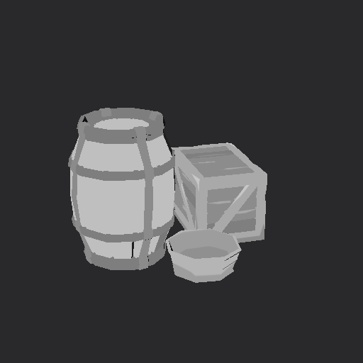

# Caisses

`Assets/Prefabs/Camp/Caisses.prefab` · [← liste des prefabs](README.md)

Caisse, tonneau et seau (décor de passage du camp, contre les murets).



## Hiérarchie

```
Caisses
├─ SM_Prop_Camp_Crate_01
│  └─ Pièce
│     └─ SM_Prop_Camp_Crate_01  [MeshFilter, MeshRenderer]
├─ SM_Prop_Barrel_01
│  └─ Pièce
│     └─ SM_Prop_Barrel_01  [MeshFilter, MeshRenderer]
└─ SM_Prop_Camp_Bucket_01
   └─ Pièce
      └─ SM_Prop_Camp_Bucket_01  [MeshFilter, MeshRenderer]
```

## Contenu

### Caisses / SM_Prop_Camp_Crate_01

- **Transform**
  - position (-0.4, 0, 0)
  - rotation (0, 15, 0)°

### Caisses / SM_Prop_Camp_Crate_01 / Pièce / SM_Prop_Camp_Crate_01

- **MeshFilter**
  - maillage `SM_Prop_Camp_Crate_01` (`Assets/Synty/PolygonNatureBiomes/PNB_Meadow_Forest/Models/SM_Prop_Camp_Crate_01.fbx`)
- **MeshRenderer**
  - matériaux `M_Toon_PolygonNatureBiomesMeadow_Mat_01` (Deckscent/Toon)

### Caisses / SM_Prop_Barrel_01

- **Transform**
  - position (0.45, 0, 0.1)

### Caisses / SM_Prop_Barrel_01 / Pièce

- **Transform**
  - position (0, 0, 0)

### Caisses / SM_Prop_Barrel_01 / Pièce / SM_Prop_Barrel_01

- **MeshFilter**
  - maillage `SM_Prop_Barrel_01` (`Assets/Synty/PolygonDungeon/Models/SM_Prop_Barrel_01.fbx`)
- **MeshRenderer**
  - matériaux `M_Toon_PolygonDungeon_01` (Deckscent/Toon)

### Caisses / SM_Prop_Camp_Bucket_01

- **Transform**
  - position (0.1, 0, 0.6)

### Caisses / SM_Prop_Camp_Bucket_01 / Pièce / SM_Prop_Camp_Bucket_01

- **MeshFilter**
  - maillage `SM_Prop_Camp_Bucket_01` (`Assets/Synty/PolygonNatureBiomes/PNB_Meadow_Forest/Models/SM_Prop_Camp_Bucket_01.fbx`)
- **MeshRenderer**
  - matériaux `M_Toon_PolygonNatureBiomesMeadow_Mat_01` (Deckscent/Toon)
