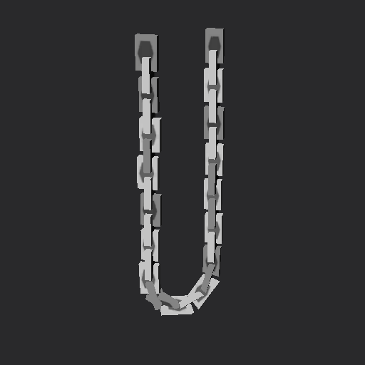

# Chaines

`Assets/Prefabs/Props/Antre/Chaines.prefab` · [← liste des prefabs](README.md)

Décor de l'antre du boss : chaînes qui pendent du plafond (Synty `SM_Prop_Chain_03`, ou maillons en formes simples). Ne bloque pas : on passe dessous. Voir docs/antre.md.



## Hiérarchie

```
Chaines  [DecorFallback, LairDecor]
├─ Décor
│  └─ Pièce
│     └─ SM_Prop_Chain_03  [MeshFilter, MeshRenderer]
└─ Secours
   ├─ Maillon  [MeshFilter, MeshRenderer]
   ├─ Maillon  [MeshFilter, MeshRenderer]
   ├─ Maillon  [MeshFilter, MeshRenderer]
   ├─ Maillon  [MeshFilter, MeshRenderer]
   ├─ Maillon  [MeshFilter, MeshRenderer]
   └─ Maillon  [MeshFilter, MeshRenderer]
```

## Contenu

### Chaines

- **DecorFallback**
  - `decor` = `Décor` — La pièce Synty (enfant).
  - `fallback` = `Secours` — La version en formes simples, affichée si le décor n'a pas ses maillages.
  - `forceFallback` = non — Coché : toujours le secours, même si le décor est là (pour comparer).
- **LairDecor**
  - `blocks` = non — Coché : bloque la case (joueur, monstres, charge). Décoché : décor de passage (ossements au sol…).

### Chaines / Décor

- **Transform**
  - position (0, 1.7, 0)

### Chaines / Décor / Pièce

- **Transform**
  - position (0.227, 1.735, 0)
  - échelle (1.449, 1.449, 1.449)

### Chaines / Décor / Pièce / SM_Prop_Chain_03

- **MeshFilter**
  - maillage `SM_Prop_Chain_03` (`Assets/Synty/PolygonDungeon/Models/SM_Prop_Chain_03.fbx`)
- **MeshRenderer**
  - matériaux `M_Toon_PolygonDungeon_01` (Deckscent/Toon)

### Chaines / Secours / Maillon

- **Transform**
  - position (0, 3.4, 0)
  - échelle (0.06, 0.12, 0.06)
- **MeshFilter**
  - maillage `Cylinder` (`Library/unity default resources`)
- **MeshRenderer**
  - matériaux `M_Toon_Gris_Antre` (Deckscent/Toon)

### Chaines / Secours / Maillon

- **Transform**
  - position (0, 3.15, 0)
  - rotation (0, 90, 0)°
  - échelle (0.06, 0.12, 0.06)
- **MeshFilter**
  - maillage `Cylinder` (`Library/unity default resources`)
- **MeshRenderer**
  - matériaux `M_Toon_Gris_Antre` (Deckscent/Toon)

### Chaines / Secours / Maillon

- **Transform**
  - position (0, 2.9, 0)
  - rotation (0, 180, 0)°
  - échelle (0.06, 0.12, 0.06)
- **MeshFilter**
  - maillage `Cylinder` (`Library/unity default resources`)
- **MeshRenderer**
  - matériaux `M_Toon_Gris_Antre` (Deckscent/Toon)

### Chaines / Secours / Maillon

- **Transform**
  - position (0, 2.65, 0)
  - rotation (0, 270, 0)°
  - échelle (0.06, 0.12, 0.06)
- **MeshFilter**
  - maillage `Cylinder` (`Library/unity default resources`)
- **MeshRenderer**
  - matériaux `M_Toon_Gris_Antre` (Deckscent/Toon)

### Chaines / Secours / Maillon

- **Transform**
  - position (0, 2.4, 0)
  - rotation (0, 0, 0)°
  - échelle (0.06, 0.12, 0.06)
- **MeshFilter**
  - maillage `Cylinder` (`Library/unity default resources`)
- **MeshRenderer**
  - matériaux `M_Toon_Gris_Antre` (Deckscent/Toon)

### Chaines / Secours / Maillon

- **Transform**
  - position (0, 2.15, 0)
  - rotation (0, 90, 0)°
  - échelle (0.06, 0.12, 0.06)
- **MeshFilter**
  - maillage `Cylinder` (`Library/unity default resources`)
- **MeshRenderer**
  - matériaux `M_Toon_Gris_Antre` (Deckscent/Toon)
