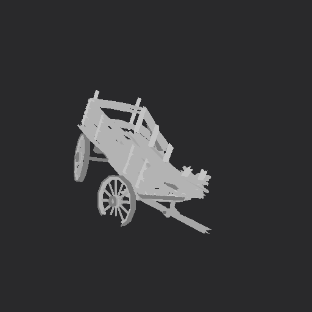

# ChariotBrise

`Assets/Prefabs/Camp/ChariotBrise.prefab` · [← liste des prefabs](README.md)

Chariot brisé (Meadow Forest), à l'est du camp, au-delà du muret.



## Hiérarchie

```
ChariotBrise
└─ Pièce
   └─ SM_Prop_Wagon_Broken_01  [MeshFilter, MeshRenderer]
```

## Contenu

### ChariotBrise / Pièce / SM_Prop_Wagon_Broken_01

- **MeshFilter**
  - maillage `SM_Prop_Wagon_Broken_01` (`Assets/Synty/PolygonNatureBiomes/PNB_Meadow_Forest/Models/SM_Prop_Wagon_Broken_01.fbx`)
- **MeshRenderer**
  - matériaux `M_Toon_PolygonNatureBiomesMeadow_Mat_01` (Deckscent/Toon)
