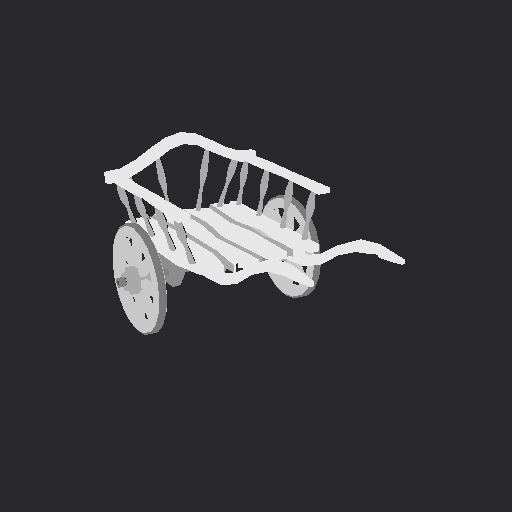

# Charrette

`Assets/Prefabs/Camp/Charrette.prefab` · [← liste des prefabs](README.md)

Charrette à bras du camp (Meadow Forest `SM_Prop_HandCart_01`). Bloque sa case.



## Hiérarchie

```
Charrette  [CampObstacle]
└─ Pièce
   ├─ SM_Prop_HandCart_01  [MeshFilter, MeshRenderer]
   ├─ SM_Prop_HandCart_01_Wheel_l  [MeshFilter, MeshRenderer]
   └─ SM_Prop_HandCart_01_Wheel_r  [MeshFilter, MeshRenderer]
```

## Contenu

### Charrette

- **CampObstacle**
  - `blocks` = oui — Coché : bloque la case. Décoché : décor de passage.

### Charrette / Pièce

- **Transform**
  - position (0, 0, -0.66)

### Charrette / Pièce / SM_Prop_HandCart_01

- **MeshFilter**
  - maillage `SM_Prop_HandCart_01` (`Assets/Synty/PolygonNatureBiomes/PNB_Meadow_Forest/Models/SM_Prop_HandCart_01.fbx`)
- **MeshRenderer**
  - matériaux `M_Toon_PolygonNatureBiomesMeadow_Mat_01` (Deckscent/Toon)

### Charrette / Pièce / SM_Prop_HandCart_01_Wheel_l

- **Transform**
  - position (-0.746, 0.479, 0)
- **MeshFilter**
  - maillage `SM_Prop_HandCart_01_Wheel_l` (`Assets/Synty/PolygonNatureBiomes/PNB_Meadow_Forest/Models/SM_Prop_HandCart_01.fbx`)
- **MeshRenderer**
  - matériaux `M_Toon_PolygonNatureBiomesMeadow_Mat_01` (Deckscent/Toon)

### Charrette / Pièce / SM_Prop_HandCart_01_Wheel_r

- **Transform**
  - position (0.754, 0.479, 0)
- **MeshFilter**
  - maillage `SM_Prop_HandCart_01_Wheel_r` (`Assets/Synty/PolygonNatureBiomes/PNB_Meadow_Forest/Models/SM_Prop_HandCart_01.fbx`)
- **MeshRenderer**
  - matériaux `M_Toon_PolygonNatureBiomesMeadow_Mat_01` (Deckscent/Toon)
