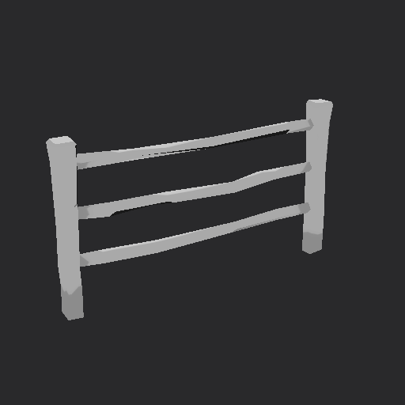

# Cloture

`Assets/Prefabs/Camp/Cloture.prefab` · [← liste des prefabs](README.md)

Clôture de bois du camp (Meadow Forest `SM_Prop_Meadow_Fence_03`), variante de muret.



## Hiérarchie

```
Cloture
└─ Pièce
   └─ SM_Prop_Meadow_Fence_03  [MeshFilter, MeshRenderer]
```

## Contenu

### Cloture / Pièce

- **Transform**
  - position (-1.382, 0.162, 0)
  - échelle (1.1, 1.1, 1.1)

### Cloture / Pièce / SM_Prop_Meadow_Fence_03

- **MeshFilter**
  - maillage `SM_Prop_Meadow_Fence_03` (`Assets/Synty/PolygonNatureBiomes/PNB_Meadow_Forest/Models/SM_Prop_Meadow_Fence_03.fbx`)
- **MeshRenderer**
  - matériaux `M_Toon_PolygonNatureBiomesMeadow_Mat_01` (Deckscent/Toon)
