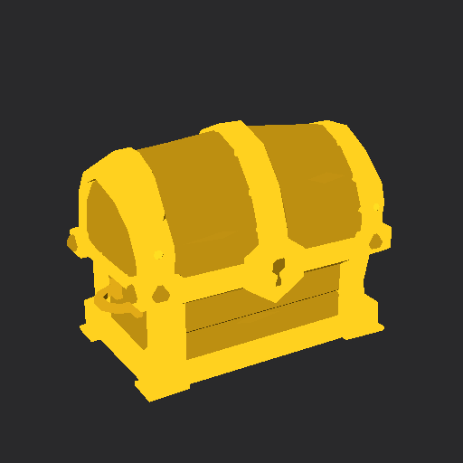

# Coffre

`Assets/Prefabs/Props/Coffre.prefab` · [← liste des prefabs](README.md)

Coffre doré (Synty `SM_Prop_Chest_03`, ou blocs si le pack manque), couvercle sur charnière. S'ouvre en avançant dessus ou avec Interact (un tour) : une carte de plus dans la main ou +3 PV, puis il s'enfonce dans le sol. Posé par le Spawner (contenu « tresor »). Voir docs/coffres.md.



## Hiérarchie

```
Coffre  [DecorFallback, Chest]
├─ Décor
│  ├─ Caisse  [MeshFilter, MeshRenderer]
│  └─ Charnière
│     └─ Couvercle  [MeshFilter, MeshRenderer]
└─ Secours
   ├─ Caisse  [MeshFilter, MeshRenderer]
   ├─ Ferrure_G  [MeshFilter, MeshRenderer]
   ├─ Ferrure_D  [MeshFilter, MeshRenderer]
   └─ Charnière
      ├─ Couvercle  [MeshFilter, MeshRenderer]
      ├─ Ferrure_G  [MeshFilter, MeshRenderer]
      ├─ Ferrure_D  [MeshFilter, MeshRenderer]
      └─ Serrure  [MeshFilter, MeshRenderer]
```

## Contenu

### Coffre

- **DecorFallback**
  - `decor` = `Décor` — La pièce Synty (enfant).
  - `fallback` = `Secours` — La version en formes simples, affichée si le décor n'a pas ses maillages.
  - `forceFallback` = non — Coché : toujours le secours, même si le décor est là (pour comparer).
- **Chest**
  - `healAmount` = 3 — PV rendus quand le butin est des PV.
  - `cardChance` = 0.5 — Chance que le butin soit une carte (sinon des PV). PV au maximum : une carte ; main pleine (ou pas de pioche) : des PV.
  - `lids` = liste de 2 — Les couvercles, pivot sur leur charnière (celui du décor Synty et celui des formes de secours : seul l'un des deux est affiché).
  - `openAngle` = -105 — Angle d'ouverture du couvercle (degrés, autour de son axe X).
  - `openTime` = 0.35 — Durée de l'ouverture (secondes).
  - `vanishDelay` = 0.8 — Temps pendant lequel le coffre vide reste visible avant de s'enfoncer (secondes).
  - `sinkDepth` = 1 — Profondeur à laquelle il s'enfonce dans le sol (mètres).

### Coffre / Décor / Caisse

- **MeshFilter**
  - maillage `SM_Prop_Chest_03` (`Assets/Synty/PolygonDungeon/Models/SM_Prop_Chest_03.fbx`)
- **MeshRenderer**
  - matériaux `M_Toon_Coffre` (Deckscent/Toon)

### Coffre / Décor / Charnière

- **Transform**
  - position (0.003, 0.411, -0.304)

### Coffre / Décor / Charnière / Couvercle

- **MeshFilter**
  - maillage `SM_Prop_Chest_03_Lid` (`Assets/Synty/PolygonDungeon/Models/SM_Prop_Chest_03.fbx`)
- **MeshRenderer**
  - matériaux `M_Toon_Coffre` (Deckscent/Toon)

### Coffre / Secours / Caisse

- **Transform**
  - position (0, 0.25, 0)
  - échelle (1, 0.5, 0.65)
- **MeshFilter**
  - maillage `Cube` (`Library/unity default resources`)
- **MeshRenderer**
  - matériaux `M_Toon_Or` (Deckscent/Toon)

### Coffre / Secours / Ferrure_G

- **Transform**
  - position (-0.32, 0.25, 0)
  - échelle (0.08, 0.51, 0.67)
- **MeshFilter**
  - maillage `Cube` (`Library/unity default resources`)
- **MeshRenderer**
  - matériaux `M_Toon_Encre` (Deckscent/Toon)

### Coffre / Secours / Ferrure_D

- **Transform**
  - position (0.32, 0.25, 0)
  - échelle (0.08, 0.51, 0.67)
- **MeshFilter**
  - maillage `Cube` (`Library/unity default resources`)
- **MeshRenderer**
  - matériaux `M_Toon_Encre` (Deckscent/Toon)

### Coffre / Secours / Charnière

- **Transform**
  - position (0, 0.5, -0.325)

### Coffre / Secours / Charnière / Couvercle

- **Transform**
  - position (0, 0.11, 0.325)
  - échelle (1, 0.22, 0.65)
- **MeshFilter**
  - maillage `Cube` (`Library/unity default resources`)
- **MeshRenderer**
  - matériaux `M_Toon_Or` (Deckscent/Toon)

### Coffre / Secours / Charnière / Ferrure_G

- **Transform**
  - position (-0.32, 0.11, 0.325)
  - échelle (0.08, 0.23, 0.67)
- **MeshFilter**
  - maillage `Cube` (`Library/unity default resources`)
- **MeshRenderer**
  - matériaux `M_Toon_Encre` (Deckscent/Toon)

### Coffre / Secours / Charnière / Ferrure_D

- **Transform**
  - position (0.32, 0.11, 0.325)
  - échelle (0.08, 0.23, 0.67)
- **MeshFilter**
  - maillage `Cube` (`Library/unity default resources`)
- **MeshRenderer**
  - matériaux `M_Toon_Encre` (Deckscent/Toon)

### Coffre / Secours / Charnière / Serrure

- **Transform**
  - position (0, 0, 0.67)
  - échelle (0.16, 0.2, 0.06)
- **MeshFilter**
  - maillage `Cube` (`Library/unity default resources`)
- **MeshRenderer**
  - matériaux `M_Toon_Encre` (Deckscent/Toon)
