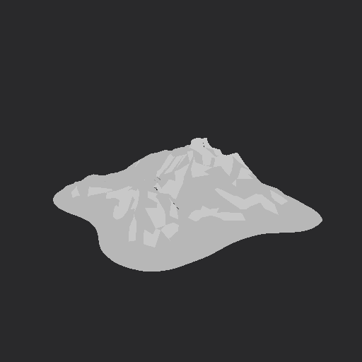

# Colline

`Assets/Prefabs/Camp/Colline.prefab` · [← liste des prefabs](README.md)

Colline (Farm `SM_Generic_Mountains_Grass_01`), à l'horizon du camp.



## Hiérarchie

```
Colline
└─ Pièce
   └─ SM_Generic_Mountains_Grass_01  [MeshFilter, MeshRenderer]
```

## Contenu

### Colline / Pièce / SM_Generic_Mountains_Grass_01

- **MeshFilter**
  - maillage `SM_Generic_Mountains_Grass_01` (`Assets/Synty/PolygonFarm/Models/SM_Generic_Mountains_Grass_01.fbx`)
- **MeshRenderer**
  - matériaux `M_Toon_PolygonFarm_01_A` (Deckscent/Toon)
