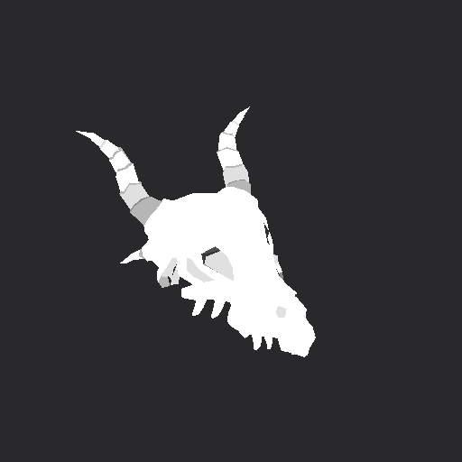

# Crane

`Assets/Prefabs/Props/Decor/Crane.prefab` · [← liste des prefabs](README.md)

Crâne au pied d'un mur (Synty `SM_Env_Bone_Skull_01`). De passage. Voir docs/decor.md.



## Hiérarchie

```
Crane  [DecorFallback, LairDecor]
├─ Décor
│  └─ Pièce
│     └─ SM_Env_Bone_Skull_01  [MeshFilter, MeshRenderer]
└─ Secours
   └─ Crâne  [MeshFilter, MeshRenderer]
```

## Contenu

### Crane

- **DecorFallback**
  - `decor` = `Décor` — La pièce Synty (enfant).
  - `fallback` = `Secours` — La version en formes simples, affichée si le décor n'a pas ses maillages.
  - `forceFallback` = non — Coché : toujours le secours, même si le décor est là (pour comparer).
- **LairDecor**
  - `blocks` = non — Coché : bloque la case (joueur, monstres, charge). Décoché : décor de passage (ossements au sol…).

### Crane / Décor / Pièce

- **Transform**
  - position (0, 0.043, -0.101)
  - échelle (0.034, 0.034, 0.034)

### Crane / Décor / Pièce / SM_Env_Bone_Skull_01

- **MeshFilter**
  - maillage `SM_Env_Bone_Skull_01` (`Assets/Synty/PolygonDungeon/Models/SM_Env_Bone_Skull_01.fbx`)
- **MeshRenderer**
  - matériaux `M_Toon_PolygonDungeon_01` (Deckscent/Toon)

### Crane / Secours / Crâne

- **Transform**
  - position (0, 0.13, 0)
  - échelle (0.28, 0.25, 0.32)
- **MeshFilter**
  - maillage `Sphere` (`Library/unity default resources`)
- **MeshRenderer**
  - matériaux `M_Toon_Os` (Deckscent/Toon)
