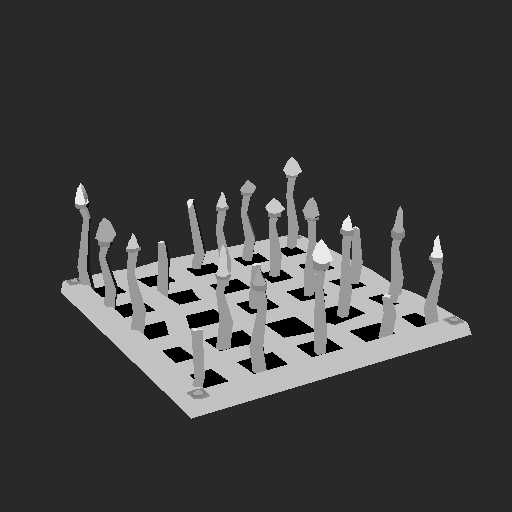

# DallePics

`Assets/Prefabs/Traps/DallePics.prefab` · [← liste des prefabs](README.md)

Piège : dalle à pics (grille et piques Synty `SM_Trap_Spears_Grate_01` / `SM_Trap_Spears_01`, ou plaque grise et cônes si le pack manque). Pics sortis 1 tour sur 3, pointes visibles le tour d'avant, 2 dégâts au joueur comme aux ennemis. Posé par le Spawner (contenu « piege »). Voir docs/pieges.md.



## Hiérarchie

```
DallePics  [SpikeTrap]
├─ Dalle  [DecorFallback]
│  ├─ Décor
│  │  └─ Pièce
│  │     └─ SM_Trap_Spears_Grate_01  [MeshFilter, MeshRenderer]
│  └─ Secours
│     ├─ Dalle  [MeshFilter, MeshRenderer]
│     ├─ Trou  [MeshFilter, MeshRenderer]
│     ├─ Trou  [MeshFilter, MeshRenderer]
│     ├─ Trou  [MeshFilter, MeshRenderer]
│     ├─ Trou  [MeshFilter, MeshRenderer]
│     ├─ Trou  [MeshFilter, MeshRenderer]
│     ├─ Trou  [MeshFilter, MeshRenderer]
│     ├─ Trou  [MeshFilter, MeshRenderer]
│     ├─ Trou  [MeshFilter, MeshRenderer]
│     ├─ Trou  [MeshFilter, MeshRenderer]
│     ├─ Trou  [MeshFilter, MeshRenderer]
│     ├─ Trou  [MeshFilter, MeshRenderer]
│     ├─ Trou  [MeshFilter, MeshRenderer]
│     ├─ Trou  [MeshFilter, MeshRenderer]
│     ├─ Trou  [MeshFilter, MeshRenderer]
│     ├─ Trou  [MeshFilter, MeshRenderer]
│     └─ Trou  [MeshFilter, MeshRenderer]
└─ Pics  [DecorFallback]
   ├─ Décor
   │  └─ Pièce
   │     └─ SM_Trap_Spears_01  [MeshFilter, MeshRenderer]
   └─ Secours
      ├─ Pic  [MeshFilter, MeshRenderer]
      ├─ Pic  [MeshFilter, MeshRenderer]
      ├─ Pic  [MeshFilter, MeshRenderer]
      ├─ Pic  [MeshFilter, MeshRenderer]
      ├─ Pic  [MeshFilter, MeshRenderer]
      ├─ Pic  [MeshFilter, MeshRenderer]
      ├─ Pic  [MeshFilter, MeshRenderer]
      ├─ Pic  [MeshFilter, MeshRenderer]
      ├─ Pic  [MeshFilter, MeshRenderer]
      ├─ Pic  [MeshFilter, MeshRenderer]
      ├─ Pic  [MeshFilter, MeshRenderer]
      ├─ Pic  [MeshFilter, MeshRenderer]
      ├─ Pic  [MeshFilter, MeshRenderer]
      ├─ Pic  [MeshFilter, MeshRenderer]
      ├─ Pic  [MeshFilter, MeshRenderer]
      └─ Pic  [MeshFilter, MeshRenderer]
```

## Contenu

### DallePics

- **SpikeTrap**
  - `period` = 3 — Longueur du cycle, en tours.
  - `activeTurns` = 1 — Nombre de tours où les pics restent sortis, à la fin du cycle.
  - `phaseOffset` = 0 — Décale le cycle (pour désynchroniser plusieurs dalles voisines).
  - `showWarning` = oui — Le tour avant la sortie, les pointes dépassent de la dalle.
  - `damage` = 2 — Dégâts quand les pics touchent (joueur ou ennemi), avant la défense.
  - `spikes` = `Pics` — Le groupe de pics qui monte et descend (enfant).
  - `spikeHeight` = 1 — Hauteur des pics au-dessus du sol quand ils sont sortis (mètres) : leur point le plus haut.
  - `warningHeight` = 0.4 — Hauteur des pointes en alerte (mètres).
  - `riseTime` = 0.1 — Durée de la sortie des pics (secondes) : sèche.
  - `lowerTime` = 0.25 — Durée de la rentrée des pics (secondes) : plus lente.

### DallePics / Dalle

- **DecorFallback**
  - `decor` = `Décor` — La pièce Synty (enfant).
  - `fallback` = `Secours` — La version en formes simples, affichée si le décor n'a pas ses maillages.
  - `forceFallback` = non — Coché : toujours le secours, même si le décor est là (pour comparer).

### DallePics / Dalle / Décor / Pièce

- **Transform**
  - échelle (1, 0.35, 1)

### DallePics / Dalle / Décor / Pièce / SM_Trap_Spears_Grate_01

- **MeshFilter**
  - maillage `SM_Trap_Spears_Grate_01` (`Assets/Synty/PolygonDungeon/Models/SM_Trap_Spears_Grate_01.fbx`)
- **MeshRenderer**
  - matériaux `M_Toon_PolygonDungeon_01` (Deckscent/Toon)

### DallePics / Dalle / Secours / Dalle

- **Transform**
  - position (0, 0.03, 0)
  - échelle (2.4, 0.06, 2.4)
- **MeshFilter**
  - maillage `Cube` (`Library/unity default resources`)
- **MeshRenderer**
  - matériaux `M_Toon_Gris_Dalle` (Deckscent/Toon)

### DallePics / Dalle / Secours / Trou

- **Transform**
  - position (-0.9, 0.061, -0.9)
  - échelle (0.264, 0.001, 0.264)
- **MeshFilter**
  - maillage `Cylinder` (`Library/unity default resources`)
- **MeshRenderer**
  - matériaux `M_Toon_Encre` (Deckscent/Toon)

### DallePics / Dalle / Secours / Trou

- **Transform**
  - position (-0.9, 0.061, -0.3)
  - échelle (0.264, 0.001, 0.264)
- **MeshFilter**
  - maillage `Cylinder` (`Library/unity default resources`)
- **MeshRenderer**
  - matériaux `M_Toon_Encre` (Deckscent/Toon)

### DallePics / Dalle / Secours / Trou

- **Transform**
  - position (-0.9, 0.061, 0.3)
  - échelle (0.264, 0.001, 0.264)
- **MeshFilter**
  - maillage `Cylinder` (`Library/unity default resources`)
- **MeshRenderer**
  - matériaux `M_Toon_Encre` (Deckscent/Toon)

### DallePics / Dalle / Secours / Trou

- **Transform**
  - position (-0.9, 0.061, 0.9)
  - échelle (0.264, 0.001, 0.264)
- **MeshFilter**
  - maillage `Cylinder` (`Library/unity default resources`)
- **MeshRenderer**
  - matériaux `M_Toon_Encre` (Deckscent/Toon)

### DallePics / Dalle / Secours / Trou

- **Transform**
  - position (-0.3, 0.061, -0.9)
  - échelle (0.264, 0.001, 0.264)
- **MeshFilter**
  - maillage `Cylinder` (`Library/unity default resources`)
- **MeshRenderer**
  - matériaux `M_Toon_Encre` (Deckscent/Toon)

### DallePics / Dalle / Secours / Trou

- **Transform**
  - position (-0.3, 0.061, -0.3)
  - échelle (0.264, 0.001, 0.264)
- **MeshFilter**
  - maillage `Cylinder` (`Library/unity default resources`)
- **MeshRenderer**
  - matériaux `M_Toon_Encre` (Deckscent/Toon)

### DallePics / Dalle / Secours / Trou

- **Transform**
  - position (-0.3, 0.061, 0.3)
  - échelle (0.264, 0.001, 0.264)
- **MeshFilter**
  - maillage `Cylinder` (`Library/unity default resources`)
- **MeshRenderer**
  - matériaux `M_Toon_Encre` (Deckscent/Toon)

### DallePics / Dalle / Secours / Trou

- **Transform**
  - position (-0.3, 0.061, 0.9)
  - échelle (0.264, 0.001, 0.264)
- **MeshFilter**
  - maillage `Cylinder` (`Library/unity default resources`)
- **MeshRenderer**
  - matériaux `M_Toon_Encre` (Deckscent/Toon)

### DallePics / Dalle / Secours / Trou

- **Transform**
  - position (0.3, 0.061, -0.9)
  - échelle (0.264, 0.001, 0.264)
- **MeshFilter**
  - maillage `Cylinder` (`Library/unity default resources`)
- **MeshRenderer**
  - matériaux `M_Toon_Encre` (Deckscent/Toon)

### DallePics / Dalle / Secours / Trou

- **Transform**
  - position (0.3, 0.061, -0.3)
  - échelle (0.264, 0.001, 0.264)
- **MeshFilter**
  - maillage `Cylinder` (`Library/unity default resources`)
- **MeshRenderer**
  - matériaux `M_Toon_Encre` (Deckscent/Toon)

### DallePics / Dalle / Secours / Trou

- **Transform**
  - position (0.3, 0.061, 0.3)
  - échelle (0.264, 0.001, 0.264)
- **MeshFilter**
  - maillage `Cylinder` (`Library/unity default resources`)
- **MeshRenderer**
  - matériaux `M_Toon_Encre` (Deckscent/Toon)

### DallePics / Dalle / Secours / Trou

- **Transform**
  - position (0.3, 0.061, 0.9)
  - échelle (0.264, 0.001, 0.264)
- **MeshFilter**
  - maillage `Cylinder` (`Library/unity default resources`)
- **MeshRenderer**
  - matériaux `M_Toon_Encre` (Deckscent/Toon)

### DallePics / Dalle / Secours / Trou

- **Transform**
  - position (0.9, 0.061, -0.9)
  - échelle (0.264, 0.001, 0.264)
- **MeshFilter**
  - maillage `Cylinder` (`Library/unity default resources`)
- **MeshRenderer**
  - matériaux `M_Toon_Encre` (Deckscent/Toon)

### DallePics / Dalle / Secours / Trou

- **Transform**
  - position (0.9, 0.061, -0.3)
  - échelle (0.264, 0.001, 0.264)
- **MeshFilter**
  - maillage `Cylinder` (`Library/unity default resources`)
- **MeshRenderer**
  - matériaux `M_Toon_Encre` (Deckscent/Toon)

### DallePics / Dalle / Secours / Trou

- **Transform**
  - position (0.9, 0.061, 0.3)
  - échelle (0.264, 0.001, 0.264)
- **MeshFilter**
  - maillage `Cylinder` (`Library/unity default resources`)
- **MeshRenderer**
  - matériaux `M_Toon_Encre` (Deckscent/Toon)

### DallePics / Dalle / Secours / Trou

- **Transform**
  - position (0.9, 0.061, 0.9)
  - échelle (0.264, 0.001, 0.264)
- **MeshFilter**
  - maillage `Cylinder` (`Library/unity default resources`)
- **MeshRenderer**
  - matériaux `M_Toon_Encre` (Deckscent/Toon)

### DallePics / Pics

- **DecorFallback**
  - `decor` = `Décor` — La pièce Synty (enfant).
  - `fallback` = `Secours` — La version en formes simples, affichée si le décor n'a pas ses maillages.
  - `forceFallback` = non — Coché : toujours le secours, même si le décor est là (pour comparer).

### DallePics / Pics / Décor / Pièce

- **Transform**
  - échelle (1.1, 0.424, 1.1)

### DallePics / Pics / Décor / Pièce / SM_Trap_Spears_01

- **MeshFilter**
  - maillage `SM_Trap_Spears_01` (`Assets/Synty/PolygonDungeon/Models/SM_Trap_Spears_01.fbx`)
- **MeshRenderer**
  - matériaux `M_Toon_PolygonDungeon_01` (Deckscent/Toon)
  - ombres portées : Off

### DallePics / Pics / Secours / Pic

- **Transform**
  - position (-0.9, 0, -0.9)
  - échelle (0.24, 1, 0.24)
- **MeshFilter**
  - maillage `Cone` (`Assets/Meshes/Cone.asset`)
- **MeshRenderer**
  - matériaux `M_Toon_Gris_Pics` (Deckscent/Toon)
  - ombres portées : Off

### DallePics / Pics / Secours / Pic

- **Transform**
  - position (-0.9, 0, -0.3)
  - échelle (0.24, 1, 0.24)
- **MeshFilter**
  - maillage `Cone` (`Assets/Meshes/Cone.asset`)
- **MeshRenderer**
  - matériaux `M_Toon_Gris_Pics` (Deckscent/Toon)
  - ombres portées : Off

### DallePics / Pics / Secours / Pic

- **Transform**
  - position (-0.9, 0, 0.3)
  - échelle (0.24, 1, 0.24)
- **MeshFilter**
  - maillage `Cone` (`Assets/Meshes/Cone.asset`)
- **MeshRenderer**
  - matériaux `M_Toon_Gris_Pics` (Deckscent/Toon)
  - ombres portées : Off

### DallePics / Pics / Secours / Pic

- **Transform**
  - position (-0.9, 0, 0.9)
  - échelle (0.24, 1, 0.24)
- **MeshFilter**
  - maillage `Cone` (`Assets/Meshes/Cone.asset`)
- **MeshRenderer**
  - matériaux `M_Toon_Gris_Pics` (Deckscent/Toon)
  - ombres portées : Off

### DallePics / Pics / Secours / Pic

- **Transform**
  - position (-0.3, 0, -0.9)
  - échelle (0.24, 1, 0.24)
- **MeshFilter**
  - maillage `Cone` (`Assets/Meshes/Cone.asset`)
- **MeshRenderer**
  - matériaux `M_Toon_Gris_Pics` (Deckscent/Toon)
  - ombres portées : Off

### DallePics / Pics / Secours / Pic

- **Transform**
  - position (-0.3, 0, -0.3)
  - échelle (0.24, 1, 0.24)
- **MeshFilter**
  - maillage `Cone` (`Assets/Meshes/Cone.asset`)
- **MeshRenderer**
  - matériaux `M_Toon_Gris_Pics` (Deckscent/Toon)
  - ombres portées : Off

### DallePics / Pics / Secours / Pic

- **Transform**
  - position (-0.3, 0, 0.3)
  - échelle (0.24, 1, 0.24)
- **MeshFilter**
  - maillage `Cone` (`Assets/Meshes/Cone.asset`)
- **MeshRenderer**
  - matériaux `M_Toon_Gris_Pics` (Deckscent/Toon)
  - ombres portées : Off

### DallePics / Pics / Secours / Pic

- **Transform**
  - position (-0.3, 0, 0.9)
  - échelle (0.24, 1, 0.24)
- **MeshFilter**
  - maillage `Cone` (`Assets/Meshes/Cone.asset`)
- **MeshRenderer**
  - matériaux `M_Toon_Gris_Pics` (Deckscent/Toon)
  - ombres portées : Off

### DallePics / Pics / Secours / Pic

- **Transform**
  - position (0.3, 0, -0.9)
  - échelle (0.24, 1, 0.24)
- **MeshFilter**
  - maillage `Cone` (`Assets/Meshes/Cone.asset`)
- **MeshRenderer**
  - matériaux `M_Toon_Gris_Pics` (Deckscent/Toon)
  - ombres portées : Off

### DallePics / Pics / Secours / Pic

- **Transform**
  - position (0.3, 0, -0.3)
  - échelle (0.24, 1, 0.24)
- **MeshFilter**
  - maillage `Cone` (`Assets/Meshes/Cone.asset`)
- **MeshRenderer**
  - matériaux `M_Toon_Gris_Pics` (Deckscent/Toon)
  - ombres portées : Off

### DallePics / Pics / Secours / Pic

- **Transform**
  - position (0.3, 0, 0.3)
  - échelle (0.24, 1, 0.24)
- **MeshFilter**
  - maillage `Cone` (`Assets/Meshes/Cone.asset`)
- **MeshRenderer**
  - matériaux `M_Toon_Gris_Pics` (Deckscent/Toon)
  - ombres portées : Off

### DallePics / Pics / Secours / Pic

- **Transform**
  - position (0.3, 0, 0.9)
  - échelle (0.24, 1, 0.24)
- **MeshFilter**
  - maillage `Cone` (`Assets/Meshes/Cone.asset`)
- **MeshRenderer**
  - matériaux `M_Toon_Gris_Pics` (Deckscent/Toon)
  - ombres portées : Off

### DallePics / Pics / Secours / Pic

- **Transform**
  - position (0.9, 0, -0.9)
  - échelle (0.24, 1, 0.24)
- **MeshFilter**
  - maillage `Cone` (`Assets/Meshes/Cone.asset`)
- **MeshRenderer**
  - matériaux `M_Toon_Gris_Pics` (Deckscent/Toon)
  - ombres portées : Off

### DallePics / Pics / Secours / Pic

- **Transform**
  - position (0.9, 0, -0.3)
  - échelle (0.24, 1, 0.24)
- **MeshFilter**
  - maillage `Cone` (`Assets/Meshes/Cone.asset`)
- **MeshRenderer**
  - matériaux `M_Toon_Gris_Pics` (Deckscent/Toon)
  - ombres portées : Off

### DallePics / Pics / Secours / Pic

- **Transform**
  - position (0.9, 0, 0.3)
  - échelle (0.24, 1, 0.24)
- **MeshFilter**
  - maillage `Cone` (`Assets/Meshes/Cone.asset`)
- **MeshRenderer**
  - matériaux `M_Toon_Gris_Pics` (Deckscent/Toon)
  - ombres portées : Off

### DallePics / Pics / Secours / Pic

- **Transform**
  - position (0.9, 0, 0.9)
  - échelle (0.24, 1, 0.24)
- **MeshFilter**
  - maillage `Cone` (`Assets/Meshes/Cone.asset`)
- **MeshRenderer**
  - matériaux `M_Toon_Gris_Pics` (Deckscent/Toon)
  - ombres portées : Off
