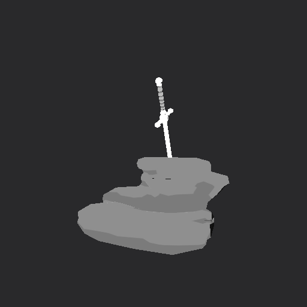

# EpeeDansLaPierre

`Assets/Prefabs/Camp/EpeeDansLaPierre.prefab` · [← liste des prefabs](README.md)

Épée plantée dans la pierre (Meadow Forest `SM_Prop_Sword_Stone_01`), décor du camp. Bloque sa case.



## Hiérarchie

```
EpeeDansLaPierre  [CampObstacle]
└─ Pièce
   ├─ SM_Prop_Sword_Stone_01  [MeshFilter, MeshRenderer]
   └─ SM_Prop_Sword_01  [MeshFilter, MeshRenderer]
```

## Contenu

### EpeeDansLaPierre

- **CampObstacle**
  - `blocks` = oui — Coché : bloque la case. Décoché : décor de passage.

### EpeeDansLaPierre / Pièce

- **Transform**
  - position (-0.181, 0.001, 0.162)

### EpeeDansLaPierre / Pièce / SM_Prop_Sword_Stone_01

- **MeshFilter**
  - maillage `SM_Prop_Sword_Stone_01` (`Assets/Synty/PolygonNatureBiomes/PNB_Meadow_Forest/Models/SM_Prop_Sword_Stone_01.fbx`)
- **MeshRenderer**
  - matériaux `M_Toon_PolygonNatureBiomesMeadow_Mat_01` (Deckscent/Toon)

### EpeeDansLaPierre / Pièce / SM_Prop_Sword_01

- **Transform**
  - position (0.332, 2.04, 0.278)
  - rotation (354.505, 325.893, 352.364)°
- **MeshFilter**
  - maillage `SM_Prop_Sword_01` (`Assets/Synty/PolygonNatureBiomes/PNB_Meadow_Forest/Models/SM_Prop_Sword_01.fbx`)
- **MeshRenderer**
  - matériaux `M_Toon_PolygonNatureBiomesMeadow_Mat_01` (Deckscent/Toon)
