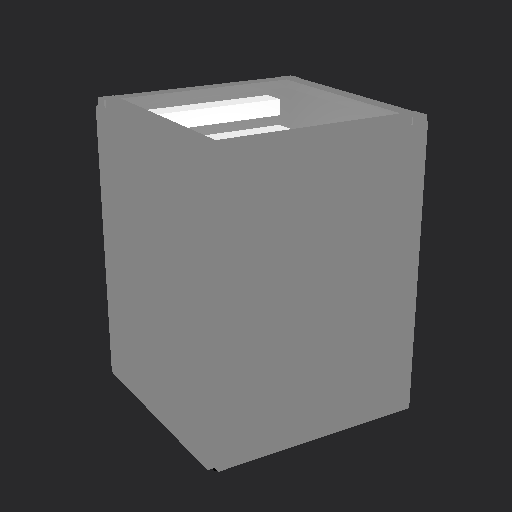

# Escalier

`Assets/Prefabs/Props/Escalier.prefab` · [← liste des prefabs](README.md)

Escalier qui descend au sous-sol suivant : un puits sous la case (le sol est percé par `Maze.AddHole`), un rebord de pierre, des marches qui plongent, une lueur blanche qui monte du fond. À la mort du boss, la dalle s'effondre dans le puits ; on le prend en avançant dessus ou avec Interact. Voir docs/antre.md.



## Hiérarchie

```
Escalier  [Stairs, AudioSource, SoundEmitter]
├─ Puits
│  ├─ Paroi  [MeshFilter, MeshRenderer]
│  ├─ Paroi  [MeshFilter, MeshRenderer]
│  ├─ Paroi  [MeshFilter, MeshRenderer]
│  ├─ Paroi  [MeshFilter, MeshRenderer]
│  ├─ Fond  [MeshFilter, MeshRenderer]
│  ├─ Rebord  [MeshFilter, MeshRenderer]
│  ├─ Rebord  [MeshFilter, MeshRenderer]
│  ├─ Rebord  [MeshFilter, MeshRenderer]
│  ├─ Rebord  [MeshFilter, MeshRenderer]
│  ├─ Marche  [MeshFilter, MeshRenderer]
│  ├─ Marche  [MeshFilter, MeshRenderer]
│  ├─ Marche  [MeshFilter, MeshRenderer]
│  ├─ Marche  [MeshFilter, MeshRenderer]
│  ├─ Marche  [MeshFilter, MeshRenderer]
│  ├─ Marche  [MeshFilter, MeshRenderer]
│  ├─ Marche  [MeshFilter, MeshRenderer]
│  ├─ Marche  [MeshFilter, MeshRenderer]
│  └─ Marche  [MeshFilter, MeshRenderer]
├─ Lueur  [Light]
└─ Dalle  [MeshFilter, MeshRenderer]
```

## Contenu

### Escalier

- **Stairs**
  - `slab` = `Dalle` — La dalle qui s'effondre dans le puits à l'ouverture (enfant, cachée ensuite).
  - `fallDepth` = 4 — Profondeur de la chute de la dalle (mètres).
  - `fallTime` = 0.9 — Durée de la chute de la dalle (secondes).
  - `sounds` = `Escalier` — Ce qui joue le raclement de pierre. Vide : cherché sur l'escalier.
- **AudioSource**
- **SoundEmitter**
  - `pitchJitter` = 0.08 — Variation de hauteur au hasard, en plus ou en moins (0,08 = ±8 %).

### Escalier / Puits / Paroi

- **Transform**
  - position (0, -2, 1.55)
  - échelle (3, 4, 0.1)
- **MeshFilter**
  - maillage `Cube` (`Library/unity default resources`)
- **MeshRenderer**
  - matériaux `M_Toon_Gris_Puits` (Deckscent/Toon)

### Escalier / Puits / Paroi

- **Transform**
  - position (1.55, -2, 0)
  - rotation (0, 90, 0)°
  - échelle (3, 4, 0.1)
- **MeshFilter**
  - maillage `Cube` (`Library/unity default resources`)
- **MeshRenderer**
  - matériaux `M_Toon_Gris_Puits` (Deckscent/Toon)

### Escalier / Puits / Paroi

- **Transform**
  - position (0, -2, -1.55)
  - rotation (0, 180, 0)°
  - échelle (3, 4, 0.1)
- **MeshFilter**
  - maillage `Cube` (`Library/unity default resources`)
- **MeshRenderer**
  - matériaux `M_Toon_Gris_Puits` (Deckscent/Toon)

### Escalier / Puits / Paroi

- **Transform**
  - position (-1.55, -2, 0)
  - rotation (0, 270, 0)°
  - échelle (3, 4, 0.1)
- **MeshFilter**
  - maillage `Cube` (`Library/unity default resources`)
- **MeshRenderer**
  - matériaux `M_Toon_Gris_Puits` (Deckscent/Toon)

### Escalier / Puits / Fond

- **Transform**
  - position (0, -4, 0)
  - échelle (3, 0.1, 3)
- **MeshFilter**
  - maillage `Cube` (`Library/unity default resources`)
- **MeshRenderer**
  - matériaux `M_Toon_Encre` (Deckscent/Toon)

### Escalier / Puits / Rebord

- **Transform**
  - position (0, 0.04, 1.42)
  - échelle (3.1, 0.12, 0.22)
- **MeshFilter**
  - maillage `Cube` (`Library/unity default resources`)
- **MeshRenderer**
  - matériaux `M_Toon_Gris_Puits` (Deckscent/Toon)

### Escalier / Puits / Rebord

- **Transform**
  - position (1.42, 0.04, 0)
  - rotation (0, 90, 0)°
  - échelle (3.1, 0.12, 0.22)
- **MeshFilter**
  - maillage `Cube` (`Library/unity default resources`)
- **MeshRenderer**
  - matériaux `M_Toon_Gris_Puits` (Deckscent/Toon)

### Escalier / Puits / Rebord

- **Transform**
  - position (0, 0.04, -1.42)
  - rotation (0, 180, 0)°
  - échelle (3.1, 0.12, 0.22)
- **MeshFilter**
  - maillage `Cube` (`Library/unity default resources`)
- **MeshRenderer**
  - matériaux `M_Toon_Gris_Puits` (Deckscent/Toon)

### Escalier / Puits / Rebord

- **Transform**
  - position (-1.42, 0.04, 0)
  - rotation (0, 270, 0)°
  - échelle (3.1, 0.12, 0.22)
- **MeshFilter**
  - maillage `Cube` (`Library/unity default resources`)
- **MeshRenderer**
  - matériaux `M_Toon_Gris_Puits` (Deckscent/Toon)

### Escalier / Puits / Marche

- **Transform**
  - position (0, -0.26, -1.333)
  - échelle (2.2, 0.24, 0.333)
- **MeshFilter**
  - maillage `Cube` (`Library/unity default resources`)
- **MeshRenderer**
  - matériaux `M_Toon_Gris_Escalier` (Deckscent/Toon)

### Escalier / Puits / Marche

- **Transform**
  - position (0, -0.64, -1)
  - échelle (2.2, 0.24, 0.333)
- **MeshFilter**
  - maillage `Cube` (`Library/unity default resources`)
- **MeshRenderer**
  - matériaux `M_Toon_Gris_Escalier` (Deckscent/Toon)

### Escalier / Puits / Marche

- **Transform**
  - position (0, -1.02, -0.667)
  - échelle (2.2, 0.24, 0.333)
- **MeshFilter**
  - maillage `Cube` (`Library/unity default resources`)
- **MeshRenderer**
  - matériaux `M_Toon_Gris_Escalier` (Deckscent/Toon)

### Escalier / Puits / Marche

- **Transform**
  - position (0, -1.4, -0.333)
  - échelle (2.2, 0.24, 0.333)
- **MeshFilter**
  - maillage `Cube` (`Library/unity default resources`)
- **MeshRenderer**
  - matériaux `M_Toon_Gris_Escalier` (Deckscent/Toon)

### Escalier / Puits / Marche

- **Transform**
  - position (0, -1.78, 0)
  - échelle (2.2, 0.24, 0.333)
- **MeshFilter**
  - maillage `Cube` (`Library/unity default resources`)
- **MeshRenderer**
  - matériaux `M_Toon_Gris_Escalier` (Deckscent/Toon)

### Escalier / Puits / Marche

- **Transform**
  - position (0, -2.16, 0.333)
  - échelle (2.2, 0.24, 0.333)
- **MeshFilter**
  - maillage `Cube` (`Library/unity default resources`)
- **MeshRenderer**
  - matériaux `M_Toon_Gris_Escalier` (Deckscent/Toon)

### Escalier / Puits / Marche

- **Transform**
  - position (0, -2.54, 0.667)
  - échelle (2.2, 0.24, 0.333)
- **MeshFilter**
  - maillage `Cube` (`Library/unity default resources`)
- **MeshRenderer**
  - matériaux `M_Toon_Gris_Escalier` (Deckscent/Toon)

### Escalier / Puits / Marche

- **Transform**
  - position (0, -2.92, 1)
  - échelle (2.2, 0.24, 0.333)
- **MeshFilter**
  - maillage `Cube` (`Library/unity default resources`)
- **MeshRenderer**
  - matériaux `M_Toon_Gris_Escalier` (Deckscent/Toon)

### Escalier / Puits / Marche

- **Transform**
  - position (0, -3.3, 1.333)
  - échelle (2.2, 0.24, 0.333)
- **MeshFilter**
  - maillage `Cube` (`Library/unity default resources`)
- **MeshRenderer**
  - matériaux `M_Toon_Gris_Escalier` (Deckscent/Toon)

### Escalier / Lueur

- **Transform**
  - position (0, -2.6, 0.6)
- **Light**
  - Point, couleur (1, 1, 1), intensité 3, portée 7 m, ombres None

### Escalier / Dalle

- **Transform**
  - position (0, -0.06, 0)
  - échelle (2.9, 0.12, 2.9)
- **MeshFilter**
  - maillage `Cube` (`Library/unity default resources`)
- **MeshRenderer**
  - matériaux `M_Toon_Gris_Puits` (Deckscent/Toon)
