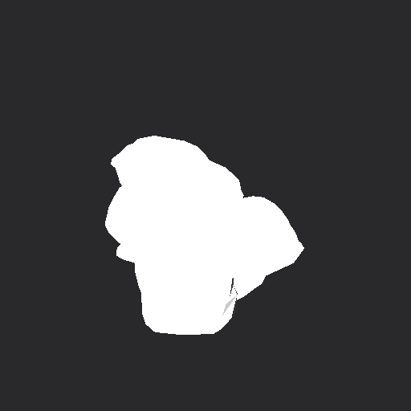

# Falaise_01

`Assets/Prefabs/Camp/Falaise_01.prefab` · [← liste des prefabs](README.md)

Falaise (Nature `SM_Rock_Cluster_Large_03`) derrière l'entrée du donjon.



## Hiérarchie

```
Falaise_01
└─ Pièce
   └─ SM_Rock_Cluster_Large_03  [MeshFilter, MeshRenderer]
```

## Contenu

### Falaise_01 / Pièce / SM_Rock_Cluster_Large_03

- **MeshFilter**
  - maillage `SM_Rock_Cluster_Large_03` (`Assets/Synty/PolygonNature/Models/SM_Rock_Cluster_Large_03.fbx`)
- **MeshRenderer**
  - matériaux `M_Toon_PolygonNature_Snow_01` (Deckscent/Toon)
