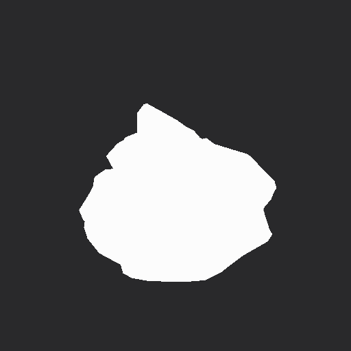

# Falaise_02

`Assets/Prefabs/Camp/Falaise_02.prefab` · [← liste des prefabs](README.md)

Falaise (Nature `SM_Rock_Cluster_Large_05`) derrière l'entrée du donjon.



## Hiérarchie

```
Falaise_02
└─ Pièce
   └─ SM_Rock_Cluster_Large_05  [MeshFilter, MeshRenderer]
```

## Contenu

### Falaise_02 / Pièce / SM_Rock_Cluster_Large_05

- **MeshFilter**
  - maillage `SM_Rock_Cluster_Large_05` (`Assets/Synty/PolygonNature/Models/SM_Rock_Cluster_Large_05.fbx`)
- **MeshRenderer**
  - matériaux `M_Toon_PolygonNature_01` (Deckscent/Toon)
