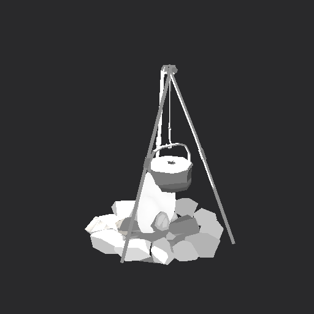

# FeuDeCamp

`Assets/Prefabs/Camp/FeuDeCamp.prefab` · [← liste des prefabs](README.md)

Feu de camp au milieu du camp : pierres, bûches, trépied et marmite (Meadow Forest), flammes blanches et lumière qui vacille (3 / 12 m). Bloque sa case.



## Hiérarchie

```
FeuDeCamp  [AudioSource, SoundEmitter, CampObstacle]
├─ Pierres
│  └─ Pièce
│     └─ SM_Prop_Camp_Fireplace_Stones_01  [MeshFilter, MeshRenderer]
├─ Buches
│  └─ Pièce
│     └─ SM_Prop_Camp_Fireplace_01  [MeshFilter, MeshRenderer]
├─ Trepied
│  └─ Pièce
│     └─ SM_Prop_Camp_Fire_Tripod_01  [MeshFilter, MeshRenderer]
├─ Flamme
│  └─ Forme  [MeshFilter, MeshRenderer]
├─ Flamme
│  └─ Forme  [MeshFilter, MeshRenderer]
├─ Flamme
│  └─ Forme  [MeshFilter, MeshRenderer]
└─ Lumière  [Light, TorchFlicker]
```

## Contenu

### FeuDeCamp

- **AudioSource**
- **SoundEmitter**
  - `pitchJitter` = 0.08 — Variation de hauteur au hasard, en plus ou en moins (0,08 = ±8 %).
- **CampObstacle**
  - `blocks` = oui — Coché : bloque la case. Décoché : décor de passage.

### FeuDeCamp / Pierres / Pièce

- **Transform**
  - position (0.005, 0.072, -0.023)
  - échelle (1.2, 1.2, 1.2)

### FeuDeCamp / Pierres / Pièce / SM_Prop_Camp_Fireplace_Stones_01

- **MeshFilter**
  - maillage `SM_Prop_Camp_Fireplace_Stones_01` (`Assets/Synty/PolygonNatureBiomes/PNB_Meadow_Forest/Models/SM_Prop_Camp_Fireplace_Stones_01.fbx`)
- **MeshRenderer**
  - matériaux `M_Toon_PolygonNatureBiomesMeadow_Mat_01` (Deckscent/Toon)

### FeuDeCamp / Buches / Pièce

- **Transform**
  - position (0.023, 0.032, 0.019)
  - échelle (1.2, 1.2, 1.2)

### FeuDeCamp / Buches / Pièce / SM_Prop_Camp_Fireplace_01

- **MeshFilter**
  - maillage `SM_Prop_Camp_Fireplace_01` (`Assets/Synty/PolygonNatureBiomes/PNB_Meadow_Forest/Models/SM_Prop_Camp_Fireplace_01.fbx`)
- **MeshRenderer**
  - matériaux `M_Toon_PolygonNatureBiomesMeadow_Mat_01` (Deckscent/Toon)

### FeuDeCamp / Trepied / Pièce

- **Transform**
  - position (-0.086, 0.047, 0.084)
  - échelle (1.1, 1.1, 1.1)

### FeuDeCamp / Trepied / Pièce / SM_Prop_Camp_Fire_Tripod_01

- **MeshFilter**
  - maillage `SM_Prop_Camp_Fire_Tripod_01` (`Assets/Synty/PolygonNatureBiomes/PNB_Meadow_Forest/Models/SM_Prop_Camp_Fire_Tripod_01.fbx`)
- **MeshRenderer**
  - matériaux `M_Toon_PolygonNatureBiomesMeadow_Mat_01` (Deckscent/Toon)

### FeuDeCamp / Flamme / Forme

- **Transform**
  - position (0, 0.45, 0)
  - échelle (0.38, 0.7, 0.38)
- **MeshFilter**
  - maillage `Sphere` (`Library/unity default resources`)
- **MeshRenderer**
  - matériaux `M_Flamme` (Universal Render Pipeline/Unlit)
  - ombres portées : Off

### FeuDeCamp / Flamme / Forme

- **Transform**
  - position (0.15, 0.35, 0.1)
  - échelle (0.24, 0.45, 0.24)
- **MeshFilter**
  - maillage `Sphere` (`Library/unity default resources`)
- **MeshRenderer**
  - matériaux `M_Flamme` (Universal Render Pipeline/Unlit)
  - ombres portées : Off

### FeuDeCamp / Flamme / Forme

- **Transform**
  - position (-0.14, 0.32, -0.08)
  - échelle (0.22, 0.4, 0.22)
- **MeshFilter**
  - maillage `Sphere` (`Library/unity default resources`)
- **MeshRenderer**
  - matériaux `M_Flamme` (Universal Render Pipeline/Unlit)
  - ombres portées : Off

### FeuDeCamp / Lumière

- **Transform**
  - position (0, 1.1, 0)
- **Light**
  - Point, couleur (1, 0.97, 0.92), intensité 3, portée 12 m, ombres Hard
- **TorchFlicker**
  - `baseIntensity` = 2.5 — Intensité moyenne de la torche.
  - `flicker` = 0.35 — Amplitude du vacillement.
  - `howlReach` = 20 — Quand un loup-garou hurle à moins de cette distance (mètres), la flamme s'embrase un instant. 0 = jamais.
