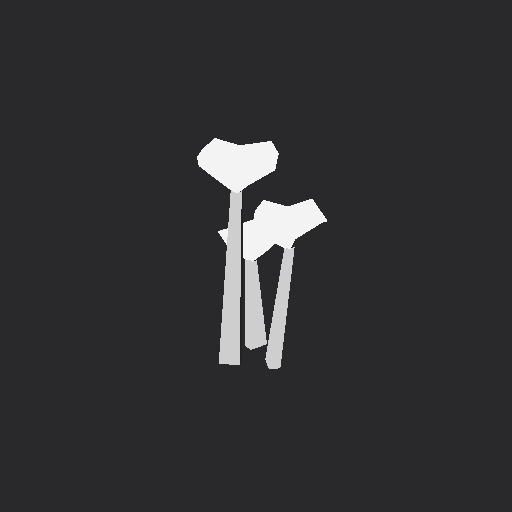

# Fleurs

`Assets/Prefabs/Camp/Fleurs.prefab` · [← liste des prefabs](README.md)

Fleurs (Farm `SM_Env_Flowers_01`), semées çà et là dans le camp.



## Hiérarchie

```
Fleurs
└─ Pièce
   └─ SM_Env_Flowers_01  [MeshFilter, MeshRenderer]
```

## Contenu

### Fleurs / Pièce

- **Transform**
  - position (0, 0.045, 0)
  - échelle (0.5, 0.5, 0.5)

### Fleurs / Pièce / SM_Env_Flowers_01

- **MeshFilter**
  - maillage `SM_Env_Flowers_01` (`Assets/Synty/PolygonDungeon/Models/SM_Env_Flowers_01.fbx`)
- **MeshRenderer**
  - matériaux `M_Toon_PolygonDungeon_01` (Deckscent/Toon)
