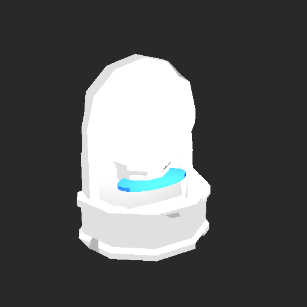

# Fontaine

`Assets/Prefabs/Props/Decor/Fontaine.prefab` · [← liste des prefabs](README.md)

Fontaine de pierre (sanctuaire, Synty `SM_Env_Stone_Fountain_01`) : eau bleue qui luit (accent), lueur blanche. Retirée de la pioche pour le moment (2026-11-20) ; on boit en s'arrêtant sur sa case (+4 PV, une fois), puis elle se tarit. Ne bloque pas. Voir docs/decor.md.



## Hiérarchie

```
Fontaine  [DecorFallback, Shrine, AudioSource, SoundEmitter]
├─ Décor
│  └─ Pièce
│     └─ SM_Env_Stone_Fountain_01  [MeshFilter, MeshRenderer]
├─ Secours
│  └─ Vasque  [MeshFilter, MeshRenderer]
├─ Eau  [MeshFilter, MeshRenderer]
└─ Lueur  [Light]
```

## Contenu

### Fontaine

- **DecorFallback**
  - `decor` = `Décor` — La pièce Synty (enfant).
  - `fallback` = `Secours` — La version en formes simples, affichée si le décor n'a pas ses maillages.
  - `forceFallback` = non — Coché : toujours le secours, même si le décor est là (pour comparer).
- **Shrine**
  - `heal` = 4 — PV rendus en buvant.
  - `water` = `Eau` — L'eau (rendu coloré, saturé), qui passe au gris une fois bue.
  - `glow` = `Lueur` — La lueur de l'eau (lumière blanche), éteinte une fois bue.
  - `sounds` = `Fontaine` — Ce qui joue le bruit de l'eau. Vide : cherché sur l'objet.
- **AudioSource**
- **SoundEmitter**
  - `pitchJitter` = 0.08 — Variation de hauteur au hasard, en plus ou en moins (0,08 = ±8 %).

### Fontaine / Décor / Pièce

- **Transform**
  - position (0, 0, 0)
  - échelle (1.366, 1.366, 1.366)

### Fontaine / Décor / Pièce / SM_Env_Stone_Fountain_01

- **MeshFilter**
  - maillage `SM_Env_Stone_Fountain_01` (`Assets/Synty/PolygonDungeon/Models/SM_Env_Stone_Fountain_01.fbx`)
- **MeshRenderer**
  - matériaux `M_Toon_PolygonDungeon_Lueur` (Deckscent/Toon)

### Fontaine / Secours / Vasque

- **Transform**
  - position (0, 0.35, 0)
  - échelle (1.2, 0.35, 1.2)
- **MeshFilter**
  - maillage `Cylinder` (`Library/unity default resources`)
- **MeshRenderer**
  - matériaux `M_Toon_Gris_Decor` (Deckscent/Toon)

### Fontaine / Eau

- **Transform**
  - position (0, 0.62, -0.02)
  - échelle (0.75, 0.02, 0.36)
- **MeshFilter**
  - maillage `Cylinder` (`Library/unity default resources`)
- **MeshRenderer**
  - matériaux `M_Toon_Eau` (Deckscent/Toon)
  - ombres portées : Off

### Fontaine / Lueur

- **Transform**
  - position (0, 1.2, 0.3)
- **Light**
  - Point, couleur (1, 1, 1), intensité 1.5, portée 5 m, ombres None
