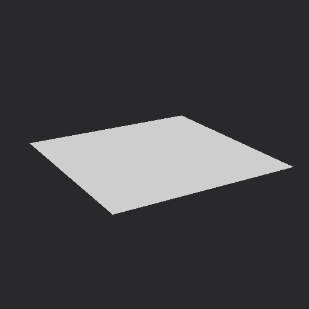

# Herbe

`Assets/Prefabs/Camp/Herbe.prefab` · [← liste des prefabs](README.md)

Case d'herbe du camp (Farm `SM_Generic_Ground_Tile_01`), le sol du labyrinthe du camp. Voir docs/camp.md.



## Hiérarchie

```
Herbe
└─ Pièce
   └─ SM_Generic_Ground_Tile_01  [MeshFilter, MeshRenderer]
```

## Contenu

### Herbe / Pièce

- **Transform**
  - position (1.5, 0, -1.5)
  - échelle (0.6, 0.6, 0.6)

### Herbe / Pièce / SM_Generic_Ground_Tile_01

- **MeshFilter**
  - maillage `SM_Generic_Ground_Tile_01` (`Assets/Synty/PolygonFarm/Models/SM_Generic_Ground_Tile_01.fbx`)
- **MeshRenderer**
  - matériaux `M_Toon_PolygonFarm_01_A` (Deckscent/Toon)
