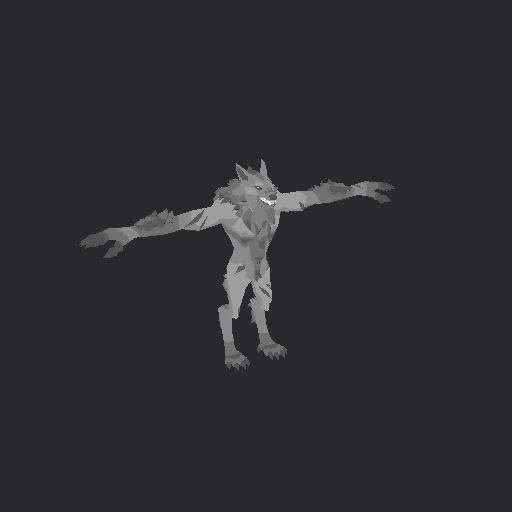

# Louveteau

`Assets/Prefabs/Enemies/Louveteau.prefab` · [← liste des prefabs](README.md)

Louveteau appelé par le loup-garou à la moitié de ses PV : même modèle à l'échelle 0,6, 2 PV, 1 d'attaque, il fonce et mord. Meurt avec le boss. Voir docs/monstres/loup-garou.md.



## Hiérarchie

```
Louveteau  [AudioSource, SoundEmitter, WolfCub]
└─ Modèle  [DecorFallback, WerewolfRig]
   ├─ SM_Werewolf_01
   │  ├─ Root
   │  │  └─ Hips
   │  │     ├─ Spine_01
   │  │     │  ├─ Belly_01
   │  │     │  └─ Spine_02
   │  │     │     └─ Spine_03
   │  │     │        ├─ Clavicle_L
   │  │     │        │  └─ Shoulder_L
   │  │     │        │     └─ Elbow_L
   │  │     │        │        └─ Hand_L
   │  │     │        │           ├─ Finger_01
   │  │     │        │           │  └─ Finger_02
   │  │     │        │           │     └─ Finger_03
   │  │     │        │           │        └─ Finger_04
   │  │     │        │           ├─ IndexFinger_01
   │  │     │        │           │  └─ IndexFinger_02
   │  │     │        │           │     └─ IndexFinger_03
   │  │     │        │           │        └─ IndexFinger_04
   │  │     │        │           └─ Thumb_01
   │  │     │        │              └─ Thumb_02
   │  │     │        │                 └─ Thumb_03
   │  │     │        ├─ Clavicle_R
   │  │     │        │  └─ Shoulder_R
   │  │     │        │     └─ Elbow_R
   │  │     │        │        └─ Hand_R
   │  │     │        │           ├─ Finger_01 1
   │  │     │        │           │  └─ Finger_02 1
   │  │     │        │           │     └─ Finger_03 1
   │  │     │        │           │        └─ Finger_04 1
   │  │     │        │           ├─ IndexFinger_01 1
   │  │     │        │           │  └─ IndexFinger_02 1
   │  │     │        │           │     └─ IndexFinger_03 1
   │  │     │        │           │        └─ IndexFinger_04 1
   │  │     │        │           └─ Thumb_01 1
   │  │     │        │              └─ Thumb_02 1
   │  │     │        │                 └─ Thumb_03 1
   │  │     │        └─ Neck
   │  │     │           └─ Head
   │  │     │              ├─ Eyebrows
   │  │     │              ├─ Eyes
   │  │     │              └─ Jaw
   │  │     ├─ UpperLeg_L
   │  │     │  └─ LowerLeg_L
   │  │     │     └─ Ankle_L
   │  │     │        └─ Ball_L
   │  │     │           └─ Toes_L
   │  │     └─ UpperLeg_R
   │  │        └─ LowerLeg_R
   │  │           └─ Ankle_R
   │  │              └─ Ball_R
   │  │                 └─ Toes_R
   │  └─ SM_Werewolf_Mesh_01  [SkinnedMeshRenderer]
   └─ Secours
      ├─ Corps
      │  ├─ Buste  [MeshFilter, MeshRenderer]
      │  ├─ Tête  [MeshFilter, MeshRenderer]
      │  ├─ Museau  [MeshFilter, MeshRenderer]
      │  ├─ Oreille  [MeshFilter, MeshRenderer]
      │  ├─ Bras  [MeshFilter, MeshRenderer]
      │  ├─ Oreille  [MeshFilter, MeshRenderer]
      │  └─ Bras  [MeshFilter, MeshRenderer]
      ├─ Jambe  [MeshFilter, MeshRenderer]
      └─ Jambe  [MeshFilter, MeshRenderer]
```

## Contenu

### Louveteau

- **AudioSource**
- **SoundEmitter**
  - `pitchJitter` = 0.08 — Variation de hauteur au hasard, en plus ou en moins (0,08 = ±8 %).
- **WolfCub**
  - `maxHealth` = 2 — Points de vie au départ.
  - `damage` = 1 — Dégâts infligés au joueur par attaque, avant sa défense.
  - `defense` = 0 — Retirée des dégâts reçus. Un coup fait toujours au moins 1.
  - `chaseRange` = 20 — Distance de poursuite (en pas, murs contournés).
  - `moveTime` = 0.2 — Durée d'un bond ou d'une morsure (secondes).
  - `rig` = `Modèle` — Les poses du modèle.
  - `tinted` = liste de 10 — Rendus blanchis quand il est touché.
  - `sounds` = `Louveteau`

### Louveteau / Modèle

- **DecorFallback**
  - `decor` = `SM_Werewolf_01` — La pièce Synty (enfant).
  - `fallback` = `Secours` — La version en formes simples, affichée si le décor n'a pas ses maillages.
  - `forceFallback` = non — Coché : toujours le secours, même si le décor est là (pour comparer).
- **WerewolfRig**
  - `skeleton` = `SM_Werewolf_01` — Racine du squelette du modèle Synty (le FBX). Vide : secours en formes simples.
  - `fallbackBody` = `Corps` — Corps du secours en formes simples, penché selon la pose quand le modèle manque.
  - `blendTime` = 0.2 — Durée d'un passage de pose par défaut (secondes).
  - `breathing` = 3 — Amplitude de la respiration (degrés de buste).
  - `breathRate` = 0.6 — Respirations par seconde.

### Louveteau / Modèle / SM_Werewolf_01

- **Transform**
  - échelle (0.6, 0.6, 0.6)

### Louveteau / Modèle / SM_Werewolf_01 / Root / Hips

- **Transform**
  - position (0, 0.876, 0)
  - rotation (0.02, 358.744, 0.925)°

### Louveteau / Modèle / SM_Werewolf_01 / Root / Hips / Spine_01

- **Transform**
  - position (0.001, 0.103, -0.016)
  - rotation (3.025, 0.983, 358.123)°

### Louveteau / Modèle / SM_Werewolf_01 / Root / Hips / Spine_01 / Belly_01

- **Transform**
  - position (0.002, -0.068, 0.243)

### Louveteau / Modèle / SM_Werewolf_01 / Root / Hips / Spine_01 / Spine_02

- **Transform**
  - position (-0.003, 0.181, -0.001)
  - rotation (349.676, 357.03, 1.412)°

### Louveteau / Modèle / SM_Werewolf_01 / Root / Hips / Spine_01 / Spine_02 / Spine_03

- **Transform**
  - position (0, 0.179, -0.003)
  - rotation (23.977, 3.738, 0.071)°

### Louveteau / Modèle / SM_Werewolf_01 / Root / Hips / Spine_01 / Spine_02 / Spine_03 / Clavicle_L

- **Transform**
  - position (-0.168, 0.076, -0.002)
  - rotation (343.578, 351.119, 100.099)°

### Louveteau / Modèle / SM_Werewolf_01 / Root / Hips / Spine_01 / Spine_02 / Spine_03 / Clavicle_L / Shoulder_L

- **Transform**
  - position (0.003, 0.161, 0)
  - rotation (5.903, 359.225, 353.194)°

### Louveteau / Modèle / SM_Werewolf_01 / Root / Hips / Spine_01 / Spine_02 / Spine_03 / Clavicle_L / Shoulder_L / Elbow_L

- **Transform**
  - position (0.005, 0.457, 0)
  - rotation (6.57, 359.587, 359.689)°

### Louveteau / Modèle / SM_Werewolf_01 / Root / Hips / Spine_01 / Spine_02 / Spine_03 / Clavicle_L / Shoulder_L / Elbow_L / Hand_L

- **Transform**
  - position (0.002, 0.329, 0.001)
  - rotation (359.574, 348.666, 0.824)°

### Louveteau / Modèle / SM_Werewolf_01 / Root / Hips / Spine_01 / Spine_02 / Spine_03 / Clavicle_L / Shoulder_L / Elbow_L / Hand_L / Finger_01

- **Transform**
  - position (-0.012, 0.146, -0.059)
  - rotation (9.401, 193.235, 352.207)°

### Louveteau / Modèle / SM_Werewolf_01 / Root / Hips / Spine_01 / Spine_02 / Spine_03 / Clavicle_L / Shoulder_L / Elbow_L / Hand_L / Finger_01 / Finger_02

- **Transform**
  - position (0, 0.064, 0)
  - rotation (357.76, 358.425, 355.021)°

### Louveteau / Modèle / SM_Werewolf_01 / Root / Hips / Spine_01 / Spine_02 / Spine_03 / Clavicle_L / Shoulder_L / Elbow_L / Hand_L / Finger_01 / Finger_02 / Finger_03

- **Transform**
  - position (-0.002, 0.053, 0)
  - rotation (7.726, 359.337, 349.197)°

### Louveteau / Modèle / SM_Werewolf_01 / Root / Hips / Spine_01 / Spine_02 / Spine_03 / Clavicle_L / Shoulder_L / Elbow_L / Hand_L / Finger_01 / Finger_02 / Finger_03 / Finger_04

- **Transform**
  - position (0.001, 0.047, 0)
  - rotation (358.404, 0.007, 2.543)°

### Louveteau / Modèle / SM_Werewolf_01 / Root / Hips / Spine_01 / Spine_02 / Spine_03 / Clavicle_L / Shoulder_L / Elbow_L / Hand_L / IndexFinger_01

- **Transform**
  - position (0.017, 0.158, 0.026)
  - rotation (357.329, 188.801, 0.511)°

### Louveteau / Modèle / SM_Werewolf_01 / Root / Hips / Spine_01 / Spine_02 / Spine_03 / Clavicle_L / Shoulder_L / Elbow_L / Hand_L / IndexFinger_01 / IndexFinger_02

- **Transform**
  - position (0, 0.061, -0.001)
  - rotation (0.97, 4.147, 345.095)°

### Louveteau / Modèle / SM_Werewolf_01 / Root / Hips / Spine_01 / Spine_02 / Spine_03 / Clavicle_L / Shoulder_L / Elbow_L / Hand_L / IndexFinger_01 / IndexFinger_02 / IndexFinger_03

- **Transform**
  - position (0, 0.058, 0)
  - rotation (2.861, 359.41, 351.811)°

### Louveteau / Modèle / SM_Werewolf_01 / Root / Hips / Spine_01 / Spine_02 / Spine_03 / Clavicle_L / Shoulder_L / Elbow_L / Hand_L / IndexFinger_01 / IndexFinger_02 / IndexFinger_03 / IndexFinger_04

- **Transform**
  - position (0, 0.059, 0)
  - rotation (359.976, 356.021, 0.806)°

### Louveteau / Modèle / SM_Werewolf_01 / Root / Hips / Spine_01 / Spine_02 / Spine_03 / Clavicle_L / Shoulder_L / Elbow_L / Hand_L / Thumb_01

- **Transform**
  - position (-0.009, 0.058, 0.067)
  - rotation (349.416, 92.642, 29.175)°

### Louveteau / Modèle / SM_Werewolf_01 / Root / Hips / Spine_01 / Spine_02 / Spine_03 / Clavicle_L / Shoulder_L / Elbow_L / Hand_L / Thumb_01 / Thumb_02

- **Transform**
  - position (0, 0.097, 0.001)
  - rotation (340.416, 10.638, 345.431)°

### Louveteau / Modèle / SM_Werewolf_01 / Root / Hips / Spine_01 / Spine_02 / Spine_03 / Clavicle_L / Shoulder_L / Elbow_L / Hand_L / Thumb_01 / Thumb_02 / Thumb_03

- **Transform**
  - position (0, 0.092, 0.001)
  - rotation (359.831, 2.176, 0.672)°

### Louveteau / Modèle / SM_Werewolf_01 / Root / Hips / Spine_01 / Spine_02 / Spine_03 / Clavicle_R

- **Transform**
  - position (0.167, 0.078, 0.002)
  - rotation (16.511, 187.368, 99.444)°

### Louveteau / Modèle / SM_Werewolf_01 / Root / Hips / Spine_01 / Spine_02 / Spine_03 / Clavicle_R / Shoulder_R

- **Transform**
  - position (0.003, 0.161, 0)
  - rotation (5.903, 180.775, 6.806)°

### Louveteau / Modèle / SM_Werewolf_01 / Root / Hips / Spine_01 / Spine_02 / Spine_03 / Clavicle_R / Shoulder_R / Elbow_R

- **Transform**
  - position (-0.005, 0.457, 0)
  - rotation (6.57, 0.413, 0.311)°

### Louveteau / Modèle / SM_Werewolf_01 / Root / Hips / Spine_01 / Spine_02 / Spine_03 / Clavicle_R / Shoulder_R / Elbow_R / Hand_R

- **Transform**
  - position (-0.002, 0.329, 0.001)
  - rotation (359.574, 11.334, 359.176)°

### Louveteau / Modèle / SM_Werewolf_01 / Root / Hips / Spine_01 / Spine_02 / Spine_03 / Clavicle_R / Shoulder_R / Elbow_R / Hand_R / Finger_01 1

- **Transform**
  - position (0.012, 0.146, -0.059)
  - rotation (9.401, 166.765, 7.793)°

### Louveteau / Modèle / SM_Werewolf_01 / Root / Hips / Spine_01 / Spine_02 / Spine_03 / Clavicle_R / Shoulder_R / Elbow_R / Hand_R / Finger_01 1 / Finger_02 1

- **Transform**
  - position (0, 0.064, 0)
  - rotation (357.76, 1.575, 4.979)°

### Louveteau / Modèle / SM_Werewolf_01 / Root / Hips / Spine_01 / Spine_02 / Spine_03 / Clavicle_R / Shoulder_R / Elbow_R / Hand_R / Finger_01 1 / Finger_02 1 / Finger_03 1

- **Transform**
  - position (0.002, 0.053, 0)
  - rotation (7.726, 0.664, 10.803)°

### Louveteau / Modèle / SM_Werewolf_01 / Root / Hips / Spine_01 / Spine_02 / Spine_03 / Clavicle_R / Shoulder_R / Elbow_R / Hand_R / Finger_01 1 / Finger_02 1 / Finger_03 1 / Finger_04 1

- **Transform**
  - position (-0.001, 0.047, 0)
  - rotation (358.404, 359.993, 357.457)°

### Louveteau / Modèle / SM_Werewolf_01 / Root / Hips / Spine_01 / Spine_02 / Spine_03 / Clavicle_R / Shoulder_R / Elbow_R / Hand_R / IndexFinger_01 1

- **Transform**
  - position (-0.017, 0.158, 0.026)
  - rotation (357.329, 171.199, 359.489)°

### Louveteau / Modèle / SM_Werewolf_01 / Root / Hips / Spine_01 / Spine_02 / Spine_03 / Clavicle_R / Shoulder_R / Elbow_R / Hand_R / IndexFinger_01 1 / IndexFinger_02 1

- **Transform**
  - position (0, 0.061, -0.001)
  - rotation (0.97, 355.853, 14.905)°

### Louveteau / Modèle / SM_Werewolf_01 / Root / Hips / Spine_01 / Spine_02 / Spine_03 / Clavicle_R / Shoulder_R / Elbow_R / Hand_R / IndexFinger_01 1 / IndexFinger_02 1 / IndexFinger_03 1

- **Transform**
  - position (0, 0.058, 0)
  - rotation (2.861, 0.59, 8.19)°

### Louveteau / Modèle / SM_Werewolf_01 / Root / Hips / Spine_01 / Spine_02 / Spine_03 / Clavicle_R / Shoulder_R / Elbow_R / Hand_R / IndexFinger_01 1 / IndexFinger_02 1 / IndexFinger_03 1 / IndexFinger_04 1

- **Transform**
  - position (0, 0.059, 0)
  - rotation (359.976, 3.979, 359.194)°

### Louveteau / Modèle / SM_Werewolf_01 / Root / Hips / Spine_01 / Spine_02 / Spine_03 / Clavicle_R / Shoulder_R / Elbow_R / Hand_R / Thumb_01 1

- **Transform**
  - position (0.009, 0.058, 0.067)
  - rotation (349.416, 267.358, 330.825)°

### Louveteau / Modèle / SM_Werewolf_01 / Root / Hips / Spine_01 / Spine_02 / Spine_03 / Clavicle_R / Shoulder_R / Elbow_R / Hand_R / Thumb_01 1 / Thumb_02 1

- **Transform**
  - position (0, 0.097, 0.001)
  - rotation (340.416, 349.362, 14.569)°

### Louveteau / Modèle / SM_Werewolf_01 / Root / Hips / Spine_01 / Spine_02 / Spine_03 / Clavicle_R / Shoulder_R / Elbow_R / Hand_R / Thumb_01 1 / Thumb_02 1 / Thumb_03 1

- **Transform**
  - position (0, 0.092, 0.001)
  - rotation (359.831, 357.824, 359.328)°

### Louveteau / Modèle / SM_Werewolf_01 / Root / Hips / Spine_01 / Spine_02 / Spine_03 / Neck

- **Transform**
  - position (-0.001, 0.26, -0.011)
  - rotation (26.875, 359.58, 0.239)°

### Louveteau / Modèle / SM_Werewolf_01 / Root / Hips / Spine_01 / Spine_02 / Spine_03 / Neck / Head

- **Transform**
  - position (0, 0.104, 0.003)
  - rotation (30.928, 359.377, 359.47)°

### Louveteau / Modèle / SM_Werewolf_01 / Root / Hips / Spine_01 / Spine_02 / Spine_03 / Neck / Head / Eyebrows

- **Transform**
  - position (-0.001, 0.17, -0.009)
  - rotation (276.882, 358.277, 182.302)°

### Louveteau / Modèle / SM_Werewolf_01 / Root / Hips / Spine_01 / Spine_02 / Spine_03 / Neck / Head / Eyes

- **Transform**
  - position (-0.001, 0.154, 0.005)
  - rotation (285.613, 4.934, 175.692)°

### Louveteau / Modèle / SM_Werewolf_01 / Root / Hips / Spine_01 / Spine_02 / Spine_03 / Neck / Head / Jaw

- **Transform**
  - position (0, 0.024, 0.039)
  - rotation (299.64, 0.078, 180.558)°

### Louveteau / Modèle / SM_Werewolf_01 / Root / Hips / UpperLeg_L

- **Transform**
  - position (-0.124, -0.041, 0.003)
  - rotation (4.573, 5.141, 177.2)°

### Louveteau / Modèle / SM_Werewolf_01 / Root / Hips / UpperLeg_L / LowerLeg_L

- **Transform**
  - position (0.018, 0.378, 0)
  - rotation (0.094, 1.926, 356.738)°

### Louveteau / Modèle / SM_Werewolf_01 / Root / Hips / UpperLeg_L / LowerLeg_L / Ankle_L

- **Transform**
  - position (-0.003, 0.378, 0)
  - rotation (68.453, 5.751, 5.453)°

### Louveteau / Modèle / SM_Werewolf_01 / Root / Hips / UpperLeg_L / LowerLeg_L / Ankle_L / Ball_L

- **Transform**
  - position (0, 0.129, -0.004)
  - rotation (25.061, 3.457, 359.154)°

### Louveteau / Modèle / SM_Werewolf_01 / Root / Hips / UpperLeg_L / LowerLeg_L / Ankle_L / Ball_L / Toes_L

- **Transform**
  - position (-0.001, 0.073, 0.001)
  - rotation (4.882, 359.547, 0.686)°

### Louveteau / Modèle / SM_Werewolf_01 / Root / Hips / UpperLeg_R

- **Transform**
  - position (0.123, -0.045, -0.003)
  - rotation (4.41, 358.205, 185.74)°

### Louveteau / Modèle / SM_Werewolf_01 / Root / Hips / UpperLeg_R / LowerLeg_R

- **Transform**
  - position (0.013, 0.378, 0)
  - rotation (0.946, 358.928, 357.99)°

### Louveteau / Modèle / SM_Werewolf_01 / Root / Hips / UpperLeg_R / LowerLeg_R / Ankle_R

- **Transform**
  - position (-0.001, 0.378, -0.006)
  - rotation (65.595, 350.8, 351.472)°

### Louveteau / Modèle / SM_Werewolf_01 / Root / Hips / UpperLeg_R / LowerLeg_R / Ankle_R / Ball_R

- **Transform**
  - position (0, 0.129, 0)
  - rotation (26.88, 359.06, 0.112)°

### Louveteau / Modèle / SM_Werewolf_01 / Root / Hips / UpperLeg_R / LowerLeg_R / Ankle_R / Ball_R / Toes_R

- **Transform**
  - position (0, 0.073, 0.001)
  - rotation (359.931, 359.532, 1.025)°

### Louveteau / Modèle / SM_Werewolf_01 / SM_Werewolf_Mesh_01

- **SkinnedMeshRenderer**

### Louveteau / Modèle / Secours

- **Transform**
  - échelle (0.6, 0.6, 0.6)

### Louveteau / Modèle / Secours / Corps

- **Transform**
  - position (0, 0.9, 0)

### Louveteau / Modèle / Secours / Corps / Buste

- **Transform**
  - position (0, 0.35, 0)
  - échelle (0.7, 0.55, 0.5)
- **MeshFilter**
  - maillage `Capsule` (`Library/unity default resources`)
- **MeshRenderer**
  - matériaux `M_Toon_Gris_Loup` (Deckscent/Toon)

### Louveteau / Modèle / Secours / Corps / Tête

- **Transform**
  - position (0, 0.85, 0.2)
  - échelle (0.38, 0.36, 0.45)
- **MeshFilter**
  - maillage `Sphere` (`Library/unity default resources`)
- **MeshRenderer**
  - matériaux `M_Toon_Gris_Loup` (Deckscent/Toon)

### Louveteau / Modèle / Secours / Corps / Museau

- **Transform**
  - position (0, 0.8, 0.45)
  - échelle (0.16, 0.14, 0.25)
- **MeshFilter**
  - maillage `Cube` (`Library/unity default resources`)
- **MeshRenderer**
  - matériaux `M_Toon_Gris_Loup` (Deckscent/Toon)

### Louveteau / Modèle / Secours / Corps / Oreille

- **Transform**
  - position (-0.12, 1.05, 0.15)
  - échelle (0.07, 0.18, 0.05)
- **MeshFilter**
  - maillage `Cube` (`Library/unity default resources`)
- **MeshRenderer**
  - matériaux `M_Toon_Gris_Loup` (Deckscent/Toon)

### Louveteau / Modèle / Secours / Corps / Bras

- **Transform**
  - position (-0.45, 0.2, 0.15)
  - échelle (0.18, 0.4, 0.18)
- **MeshFilter**
  - maillage `Capsule` (`Library/unity default resources`)
- **MeshRenderer**
  - matériaux `M_Toon_Gris_Loup` (Deckscent/Toon)

### Louveteau / Modèle / Secours / Corps / Oreille

- **Transform**
  - position (0.12, 1.05, 0.15)
  - échelle (0.07, 0.18, 0.05)
- **MeshFilter**
  - maillage `Cube` (`Library/unity default resources`)
- **MeshRenderer**
  - matériaux `M_Toon_Gris_Loup` (Deckscent/Toon)

### Louveteau / Modèle / Secours / Corps / Bras

- **Transform**
  - position (0.45, 0.2, 0.15)
  - échelle (0.18, 0.4, 0.18)
- **MeshFilter**
  - maillage `Capsule` (`Library/unity default resources`)
- **MeshRenderer**
  - matériaux `M_Toon_Gris_Loup` (Deckscent/Toon)

### Louveteau / Modèle / Secours / Jambe

- **Transform**
  - position (-0.18, 0.45, 0)
  - échelle (0.22, 0.45, 0.22)
- **MeshFilter**
  - maillage `Capsule` (`Library/unity default resources`)
- **MeshRenderer**
  - matériaux `M_Toon_Gris_Loup` (Deckscent/Toon)

### Louveteau / Modèle / Secours / Jambe

- **Transform**
  - position (0.18, 0.45, 0)
  - échelle (0.22, 0.45, 0.22)
- **MeshFilter**
  - maillage `Capsule` (`Library/unity default resources`)
- **MeshRenderer**
  - matériaux `M_Toon_Gris_Loup` (Deckscent/Toon)
