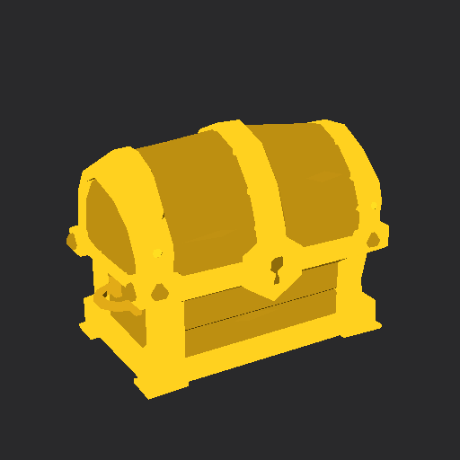

# Mimique

`Assets/Prefabs/Enemies/Mimique.prefab` · [← liste des prefabs](README.md)

Mimique : un monstre qui se fait passer pour un coffre (copie du prefab Coffre). Son couvercle frémit parfois ; essayer de l'ouvrir le révèle et il mord (3 dégâts), puis il bondit et mord (2). 5 PV. Remplace 15 % des coffres de salle. Voir docs/monstres/mimique.md.



## Hiérarchie

```
Mimique  [DecorFallback, Mimic, AudioSource, SoundEmitter]
├─ Décor
│  ├─ Caisse  [MeshFilter, MeshRenderer]
│  └─ Charnière
│     ├─ Couvercle  [MeshFilter, MeshRenderer]
│     └─ Dents_Haut
│        ├─ Croc  [MeshFilter, MeshRenderer]
│        ├─ Croc  [MeshFilter, MeshRenderer]
│        ├─ Croc  [MeshFilter, MeshRenderer]
│        ├─ Croc  [MeshFilter, MeshRenderer]
│        └─ Croc  [MeshFilter, MeshRenderer]
├─ Secours
│  ├─ Caisse  [MeshFilter, MeshRenderer]
│  ├─ Ferrure_G  [MeshFilter, MeshRenderer]
│  ├─ Ferrure_D  [MeshFilter, MeshRenderer]
│  └─ Charnière
│     ├─ Couvercle  [MeshFilter, MeshRenderer]
│     ├─ Ferrure_G  [MeshFilter, MeshRenderer]
│     ├─ Ferrure_D  [MeshFilter, MeshRenderer]
│     └─ Serrure  [MeshFilter, MeshRenderer]
└─ Dents_Bas
   ├─ Dent  [MeshFilter, MeshRenderer]
   ├─ Dent  [MeshFilter, MeshRenderer]
   ├─ Dent  [MeshFilter, MeshRenderer]
   ├─ Dent  [MeshFilter, MeshRenderer]
   ├─ Dent  [MeshFilter, MeshRenderer]
   ├─ Dent  [MeshFilter, MeshRenderer]
   └─ Langue  [MeshFilter, MeshRenderer]
```

## Contenu

### Mimique

- **DecorFallback**
  - `decor` = `Décor` — La pièce Synty (enfant).
  - `fallback` = `Secours` — La version en formes simples, affichée si le décor n'a pas ses maillages.
  - `forceFallback` = non — Coché : toujours le secours, même si le décor est là (pour comparer).
- **Mimic**
  - `maxHealth` = 5 — Points de vie au départ.
  - `damage` = 2 — Dégâts infligés au joueur par attaque, avant sa défense.
  - `defense` = 0 — Retirée des dégâts reçus. Un coup fait toujours au moins 1.
  - `chaseRange` = 5 — Distance de poursuite une fois révélé (en pas, murs contournés).
  - `ambushDamage` = 3 — Dégâts de la morsure de surprise (quand on essaie de l'ouvrir).
  - `moveTime` = 0.25 — Durée d'un bond ou d'une morsure (secondes).
  - `lids` = liste de 2 — Les couvercles (décor Synty et secours), pivot sur la charnière.
  - `maw` = liste de 2 — Dents et langue (dents du bas et langue dans la caisse, crocs sous le couvercle) : cachées tant qu'il fait le coffre.
  - `openAngle` = -85 — Angle de la gueule ouverte (degrés, autour de l'axe X du couvercle).
  - `twitchEvery` = 5 — Tous les combien de secondes, en moyenne, son couvercle frémit (l'indice).
  - `sounds` = `Mimique`
- **AudioSource**
- **SoundEmitter**
  - `pitchJitter` = 0.08 — Variation de hauteur au hasard, en plus ou en moins (0,08 = ±8 %).

### Mimique / Décor / Caisse

- **MeshFilter**
  - maillage `SM_Prop_Chest_03` (`Assets/Synty/PolygonDungeon/Models/SM_Prop_Chest_03.fbx`)
- **MeshRenderer**
  - matériaux `M_Toon_Coffre` (Deckscent/Toon)

### Mimique / Décor / Charnière

- **Transform**
  - position (0.003, 0.411, -0.304)

### Mimique / Décor / Charnière / Couvercle

- **MeshFilter**
  - maillage `SM_Prop_Chest_03_Lid` (`Assets/Synty/PolygonDungeon/Models/SM_Prop_Chest_03.fbx`)
- **MeshRenderer**
  - matériaux `M_Toon_Coffre` (Deckscent/Toon)

### Mimique / Décor / Charnière / Dents_Haut

- **Transform**
  - position (-0.003, -0.411, 0.304)

### Mimique / Décor / Charnière / Dents_Haut / Croc

- **Transform**
  - position (-0.454, 0.251, 0.31)
  - rotation (0, 0, 45)°
  - échelle (0.06, 0.06, 0.04)
- **MeshFilter**
  - maillage `Cube` (`Library/unity default resources`)
- **MeshRenderer**
  - matériaux `M_Toon_Blanc` (Deckscent/Toon)
  - ombres portées : Off

### Mimique / Décor / Charnière / Dents_Haut / Croc

- **Transform**
  - position (-0.226, 0.251, 0.31)
  - rotation (0, 0, 45)°
  - échelle (0.06, 0.06, 0.04)
- **MeshFilter**
  - maillage `Cube` (`Library/unity default resources`)
- **MeshRenderer**
  - matériaux `M_Toon_Blanc` (Deckscent/Toon)
  - ombres portées : Off

### Mimique / Décor / Charnière / Dents_Haut / Croc

- **Transform**
  - position (0.003, 0.251, 0.31)
  - rotation (0, 0, 45)°
  - échelle (0.06, 0.06, 0.04)
- **MeshFilter**
  - maillage `Cube` (`Library/unity default resources`)
- **MeshRenderer**
  - matériaux `M_Toon_Blanc` (Deckscent/Toon)
  - ombres portées : Off

### Mimique / Décor / Charnière / Dents_Haut / Croc

- **Transform**
  - position (0.231, 0.251, 0.31)
  - rotation (0, 0, 45)°
  - échelle (0.06, 0.06, 0.04)
- **MeshFilter**
  - maillage `Cube` (`Library/unity default resources`)
- **MeshRenderer**
  - matériaux `M_Toon_Blanc` (Deckscent/Toon)
  - ombres portées : Off

### Mimique / Décor / Charnière / Dents_Haut / Croc

- **Transform**
  - position (0.459, 0.251, 0.31)
  - rotation (0, 0, 45)°
  - échelle (0.06, 0.06, 0.04)
- **MeshFilter**
  - maillage `Cube` (`Library/unity default resources`)
- **MeshRenderer**
  - matériaux `M_Toon_Blanc` (Deckscent/Toon)
  - ombres portées : Off

### Mimique / Secours / Caisse

- **Transform**
  - position (0, 0.25, 0)
  - échelle (1, 0.5, 0.65)
- **MeshFilter**
  - maillage `Cube` (`Library/unity default resources`)
- **MeshRenderer**
  - matériaux `M_Toon_Or` (Deckscent/Toon)

### Mimique / Secours / Ferrure_G

- **Transform**
  - position (-0.32, 0.25, 0)
  - échelle (0.08, 0.51, 0.67)
- **MeshFilter**
  - maillage `Cube` (`Library/unity default resources`)
- **MeshRenderer**
  - matériaux `M_Toon_Encre` (Deckscent/Toon)

### Mimique / Secours / Ferrure_D

- **Transform**
  - position (0.32, 0.25, 0)
  - échelle (0.08, 0.51, 0.67)
- **MeshFilter**
  - maillage `Cube` (`Library/unity default resources`)
- **MeshRenderer**
  - matériaux `M_Toon_Encre` (Deckscent/Toon)

### Mimique / Secours / Charnière

- **Transform**
  - position (0, 0.5, -0.325)

### Mimique / Secours / Charnière / Couvercle

- **Transform**
  - position (0, 0.11, 0.325)
  - échelle (1, 0.22, 0.65)
- **MeshFilter**
  - maillage `Cube` (`Library/unity default resources`)
- **MeshRenderer**
  - matériaux `M_Toon_Or` (Deckscent/Toon)

### Mimique / Secours / Charnière / Ferrure_G

- **Transform**
  - position (-0.32, 0.11, 0.325)
  - échelle (0.08, 0.23, 0.67)
- **MeshFilter**
  - maillage `Cube` (`Library/unity default resources`)
- **MeshRenderer**
  - matériaux `M_Toon_Encre` (Deckscent/Toon)

### Mimique / Secours / Charnière / Ferrure_D

- **Transform**
  - position (0.32, 0.11, 0.325)
  - échelle (0.08, 0.23, 0.67)
- **MeshFilter**
  - maillage `Cube` (`Library/unity default resources`)
- **MeshRenderer**
  - matériaux `M_Toon_Encre` (Deckscent/Toon)

### Mimique / Secours / Charnière / Serrure

- **Transform**
  - position (0, 0, 0.67)
  - échelle (0.16, 0.2, 0.06)
- **MeshFilter**
  - maillage `Cube` (`Library/unity default resources`)
- **MeshRenderer**
  - matériaux `M_Toon_Encre` (Deckscent/Toon)

### Mimique / Dents_Bas / Dent

- **Transform**
  - position (-0.516, 0.443, 0.291)
  - rotation (0, 0, 45)°
  - échelle (0.06, 0.06, 0.04)
- **MeshFilter**
  - maillage `Cube` (`Library/unity default resources`)
- **MeshRenderer**
  - matériaux `M_Toon_Blanc` (Deckscent/Toon)
  - ombres portées : Off

### Mimique / Dents_Bas / Dent

- **Transform**
  - position (-0.309, 0.443, 0.291)
  - rotation (0, 0, 45)°
  - échelle (0.06, 0.06, 0.04)
- **MeshFilter**
  - maillage `Cube` (`Library/unity default resources`)
- **MeshRenderer**
  - matériaux `M_Toon_Blanc` (Deckscent/Toon)
  - ombres portées : Off

### Mimique / Dents_Bas / Dent

- **Transform**
  - position (-0.102, 0.443, 0.291)
  - rotation (0, 0, 45)°
  - échelle (0.06, 0.06, 0.04)
- **MeshFilter**
  - maillage `Cube` (`Library/unity default resources`)
- **MeshRenderer**
  - matériaux `M_Toon_Blanc` (Deckscent/Toon)
  - ombres portées : Off

### Mimique / Dents_Bas / Dent

- **Transform**
  - position (0.105, 0.443, 0.291)
  - rotation (0, 0, 45)°
  - échelle (0.06, 0.06, 0.04)
- **MeshFilter**
  - maillage `Cube` (`Library/unity default resources`)
- **MeshRenderer**
  - matériaux `M_Toon_Blanc` (Deckscent/Toon)
  - ombres portées : Off

### Mimique / Dents_Bas / Dent

- **Transform**
  - position (0.311, 0.443, 0.291)
  - rotation (0, 0, 45)°
  - échelle (0.06, 0.06, 0.04)
- **MeshFilter**
  - maillage `Cube` (`Library/unity default resources`)
- **MeshRenderer**
  - matériaux `M_Toon_Blanc` (Deckscent/Toon)
  - ombres portées : Off

### Mimique / Dents_Bas / Dent

- **Transform**
  - position (0.518, 0.443, 0.291)
  - rotation (0, 0, 45)°
  - échelle (0.06, 0.06, 0.04)
- **MeshFilter**
  - maillage `Cube` (`Library/unity default resources`)
- **MeshRenderer**
  - matériaux `M_Toon_Blanc` (Deckscent/Toon)
  - ombres portées : Off

### Mimique / Dents_Bas / Langue

- **Transform**
  - position (0.001, 0.248, -0.055)
  - échelle (0.382, 0.05, 0.326)
- **MeshFilter**
  - maillage `Cube` (`Library/unity default resources`)
- **MeshRenderer**
  - matériaux `M_Toon_Langue` (Deckscent/Toon)
  - ombres portées : Off
