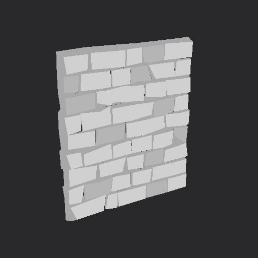

# Mur_01

`Assets/Prefabs/Maze/Mur_01.prefab` · [← liste des prefabs](README.md)

Pan de mur du décor (Synty `SM_Env_Wall_01`). Posé au milieu de chaque bord fermé d'une case de sol, face (+Z) vers la case.



## Hiérarchie

```
Mur_01
└─ Pièce
   └─ SM_Env_Wall_01  [MeshFilter, MeshRenderer]
```

## Contenu

### Mur_01 / Pièce

- **Transform**
  - position (1.5, 0, 0)
  - échelle (0.6, 0.7, 0.6)

### Mur_01 / Pièce / SM_Env_Wall_01

- **MeshFilter**
  - maillage `SM_Env_Wall_01` (`Assets/Synty/PolygonDungeon/Models/SM_Env_Wall_01.fbx`)
- **MeshRenderer**
  - matériaux `M_Toon_PolygonDungeon_01` (Deckscent/Toon)
