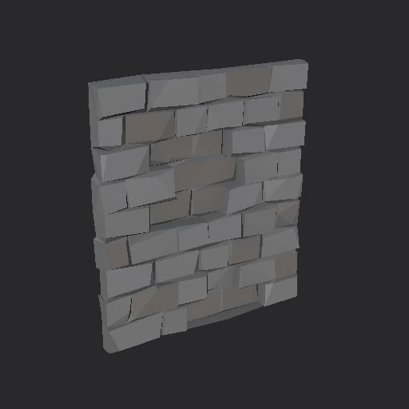

# Mur_03

`Assets/Prefabs/Maze/Mur_03.prefab` · [← liste des prefabs](README.md)

Variante de pan de mur (Synty `SM_Env_Wall_03`).



## Hiérarchie

```
Mur_03
└─ Pièce
   └─ SM_Env_Wall_03  [MeshFilter, MeshRenderer]
```

## Contenu

### Mur_03 / Pièce

- **Transform**
  - position (1.5, 0, 0)
  - échelle (0.6, 0.7, 0.6)

### Mur_03 / Pièce / SM_Env_Wall_03

- **MeshFilter**
  - maillage `SM_Env_Wall_03` (`Assets/Synty/PolygonDungeon/Models/SM_Env_Wall_03.fbx`)
- **MeshRenderer**
  - matériaux `PolygonDungeon_01` (Synty/Generic_Basic)
