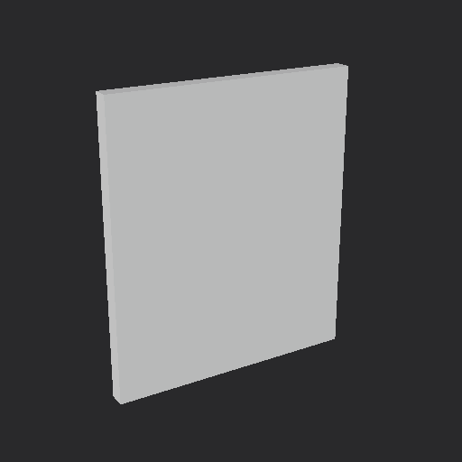

# Mur_Gris

`Assets/Prefabs/Maze/Mur_Gris.prefab` · [← liste des prefabs](README.md)

Pan de mur de secours (bloc gris), utilisé si le pack Synty manque.



## Hiérarchie

```
Mur_Gris
└─ Forme  [MeshFilter, MeshRenderer]
```

## Contenu

### Mur_Gris / Forme

- **Transform**
  - position (0, 1.75, -0.1)
  - échelle (3, 3.5, 0.2)
- **MeshFilter**
  - maillage `Cube` (`Library/unity default resources`)
- **MeshRenderer**
  - matériaux `M_Gris_Mur` (Universal Render Pipeline/Lit)
