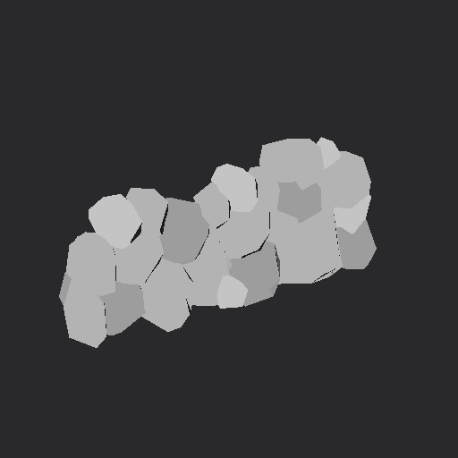

# Muret_01

`Assets/Prefabs/Camp/Muret_01.prefab` · [← liste des prefabs](README.md)

Muret de pierre du camp (Meadow Forest `SM_Prop_Stonewall_Small_01`) : le « mur » d'un bord fermé, bas, on voit la forêt par-dessus.



## Hiérarchie

```
Muret_01
└─ Pièce
   └─ SM_Prop_Stonewall_Small_01_LOD0  [MeshFilter, MeshRenderer]
```

## Contenu

### Muret_01 / Pièce

- **Transform**
  - position (-1.327, 0.083, 0.002)
  - échelle (1.08, 1.08, 1.08)

### Muret_01 / Pièce / SM_Prop_Stonewall_Small_01_LOD0

- **MeshFilter**
  - maillage `SM_Prop_Stonewall_Small_01_LOD0` (`Assets/Synty/PolygonNatureBiomes/PNB_Meadow_Forest/Models/SM_Prop_Stonewall_Small_01.fbx`)
- **MeshRenderer**
  - matériaux `M_Toon_NoWind_Mat_01` (Deckscent/Toon)
