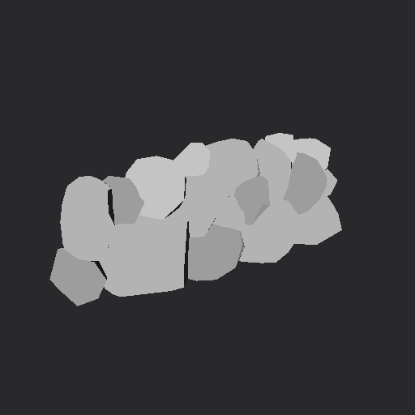

# Muret_02

`Assets/Prefabs/Camp/Muret_02.prefab` · [← liste des prefabs](README.md)

Variante de muret du camp (Meadow Forest `SM_Prop_Stonewall_Small_02`).



## Hiérarchie

```
Muret_02
└─ Pièce
   └─ SM_Prop_Stonewall_Small_02_LOD0  [MeshFilter, MeshRenderer]
```

## Contenu

### Muret_02 / Pièce

- **Transform**
  - position (-1.405, 0.029, 0)
  - échelle (1.08, 1.08, 1.08)

### Muret_02 / Pièce / SM_Prop_Stonewall_Small_02_LOD0

- **MeshFilter**
  - maillage `SM_Prop_Stonewall_Small_02_LOD0` (`Assets/Synty/PolygonNatureBiomes/PNB_Meadow_Forest/Models/SM_Prop_Stonewall_Small_02.fbx`)
- **MeshRenderer**
  - matériaux `M_Toon_NoWind_Mat_01` (Deckscent/Toon)
