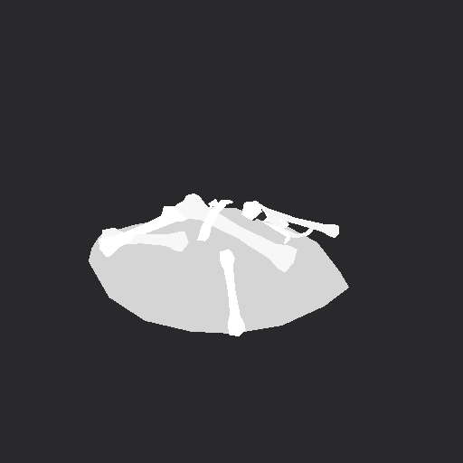

# Os

`Assets/Prefabs/Props/Antre/Os.prefab` · [← liste des prefabs](README.md)

Décor de l'antre du boss : tas d'os (Synty `SM_Env_BonePile_01`) le long des murs. Bloque sa case. Voir docs/antre.md.



## Hiérarchie

```
Os  [DecorFallback, LairDecor]
├─ Décor
│  └─ Pièce
│     └─ SM_Env_BonePile_01  [MeshFilter, MeshRenderer]
└─ Secours
   ├─ Tas  [MeshFilter, MeshRenderer]
   └─ Crâne  [MeshFilter, MeshRenderer]
```

## Contenu

### Os

- **DecorFallback**
  - `decor` = `Décor` — La pièce Synty (enfant).
  - `fallback` = `Secours` — La version en formes simples, affichée si le décor n'a pas ses maillages.
  - `forceFallback` = non — Coché : toujours le secours, même si le décor est là (pour comparer).
- **LairDecor**
  - `blocks` = oui — Coché : bloque la case (joueur, monstres, charge). Décoché : décor de passage (ossements au sol…).

### Os / Décor / Pièce

- **Transform**
  - position (0, 0.083, 0)
  - échelle (0.579, 0.579, 0.579)

### Os / Décor / Pièce / SM_Env_BonePile_01

- **MeshFilter**
  - maillage `SM_Env_BonePile_01` (`Assets/Synty/PolygonDungeon/Models/SM_Env_BonePile_01.fbx`)
- **MeshRenderer**
  - matériaux `M_Toon_PolygonDungeon_01` (Deckscent/Toon)

### Os / Secours / Tas

- **Transform**
  - position (0, 0.15, 0)
  - échelle (1.2, 0.4, 1.1)
- **MeshFilter**
  - maillage `Sphere` (`Library/unity default resources`)
- **MeshRenderer**
  - matériaux `M_Toon_Os` (Deckscent/Toon)

### Os / Secours / Crâne

- **Transform**
  - position (0.2, 0.4, 0.1)
  - échelle (0.25, 0.25, 0.25)
- **MeshFilter**
  - maillage `Sphere` (`Library/unity default resources`)
- **MeshRenderer**
  - matériaux `M_Toon_Os` (Deckscent/Toon)
