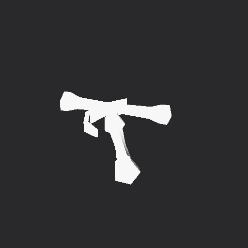

# Ossements

`Assets/Prefabs/Props/Antre/Ossements.prefab` · [← liste des prefabs](README.md)

Décor de l'antre du boss : ossements épars au sol (Synty `SM_Env_BonePile_Small_01`). Ne bloque pas. Voir docs/antre.md.



## Hiérarchie

```
Ossements  [DecorFallback, LairDecor]
├─ Décor
│  └─ Pièce
│     └─ SM_Env_BonePile_Small_01  [MeshFilter, MeshRenderer]
└─ Secours
   ├─ Os  [MeshFilter, MeshRenderer]
   └─ Crâne  [MeshFilter, MeshRenderer]
```

## Contenu

### Ossements

- **DecorFallback**
  - `decor` = `Décor` — La pièce Synty (enfant).
  - `fallback` = `Secours` — La version en formes simples, affichée si le décor n'a pas ses maillages.
  - `forceFallback` = non — Coché : toujours le secours, même si le décor est là (pour comparer).
- **LairDecor**
  - `blocks` = non — Coché : bloque la case (joueur, monstres, charge). Décoché : décor de passage (ossements au sol…).

### Ossements / Décor / Pièce

- **Transform**
  - position (0, 0.024, 0)
  - échelle (0.664, 0.664, 0.664)

### Ossements / Décor / Pièce / SM_Env_BonePile_Small_01

- **MeshFilter**
  - maillage `SM_Env_BonePile_Small_01` (`Assets/Synty/PolygonDungeon/Models/SM_Env_BonePile_Small_01.fbx`)
- **MeshRenderer**
  - matériaux `M_Toon_PolygonDungeon_01` (Deckscent/Toon)

### Ossements / Secours / Os

- **Transform**
  - position (0, 0.05, 0)
  - rotation (90, 30, 0)°
  - échelle (0.08, 0.25, 0.08)
- **MeshFilter**
  - maillage `Capsule` (`Library/unity default resources`)
- **MeshRenderer**
  - matériaux `M_Toon_Os` (Deckscent/Toon)

### Ossements / Secours / Crâne

- **Transform**
  - position (0.3, 0.1, 0.2)
  - échelle (0.2, 0.2, 0.2)
- **MeshFilter**
  - maillage `Sphere` (`Library/unity default resources`)
- **MeshRenderer**
  - matériaux `M_Toon_Os` (Deckscent/Toon)
