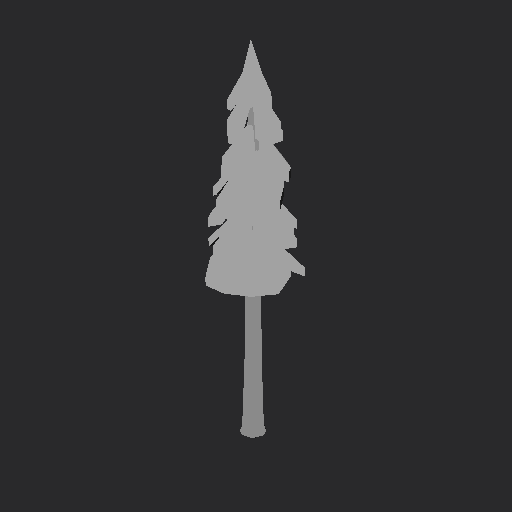

# PinMaigre_02

`Assets/Prefabs/Camp/PinMaigre_02.prefab` · [← liste des prefabs](README.md)

Pin dégarni (Nature), forêt autour du camp.



## Hiérarchie

```
PinMaigre_02
└─ Pièce
   └─ SM_Tree_PolyPine_Sparse_02  [MeshFilter, MeshRenderer]
```

## Contenu

### PinMaigre_02 / Pièce / SM_Tree_PolyPine_Sparse_02

- **MeshFilter**
  - maillage `SM_Tree_PolyPine_Sparse_02` (`Assets/Synty/PolygonNature/Models/SM_Tree_PolyPine_Sparse_02.fbx`)
- **MeshRenderer**
  - matériaux `M_Toon_PolygonNature_Tree_01` (Deckscent/Toon)
