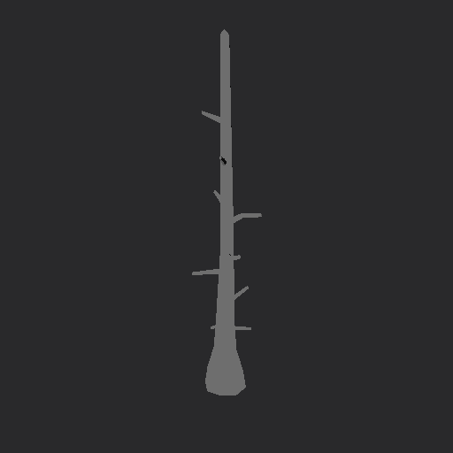

# PinMort

`Assets/Prefabs/Camp/PinMort.prefab` · [← liste des prefabs](README.md)

Pin mort (Nature), forêt autour du camp.



## Hiérarchie

```
PinMort
└─ Pièce
   └─ SM_Tree_Pine_Dead_01  [MeshFilter, MeshRenderer]
```

## Contenu

### PinMort / Pièce / SM_Tree_Pine_Dead_01

- **MeshFilter**
  - maillage `SM_Tree_Pine_Dead_01` (`Assets/Synty/PolygonNature/Models/SM_Tree_Pine_Dead_01.fbx`)
- **MeshRenderer**
  - matériaux `M_Toon_PolygonNature_Tree_Trunk_01` (Deckscent/Toon)
