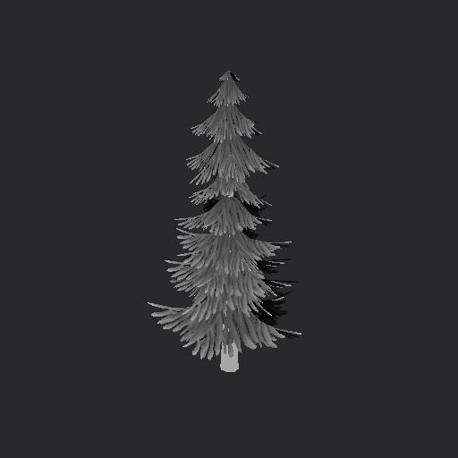

# Pin_01

`Assets/Prefabs/Camp/Pin_01.prefab` · [← liste des prefabs](README.md)

Pin (Nature), forêt autour du camp.



## Hiérarchie

```
Pin_01
└─ Pièce
   └─ SM_Tree_Pine_01  [MeshFilter, MeshRenderer]
```

## Contenu

### Pin_01 / Pièce / SM_Tree_Pine_01

- **MeshFilter**
  - maillage `SM_Tree_Pine_01` (`Assets/Synty/PolygonNature/Models/SM_Tree_Pine_01.fbx`)
- **MeshRenderer**
  - matériaux `M_Toon_PolygonNature_Tree_Trunk_01` (Deckscent/Toon), `M_Toon_Leaves_Pine_01` (Deckscent/Toon)
