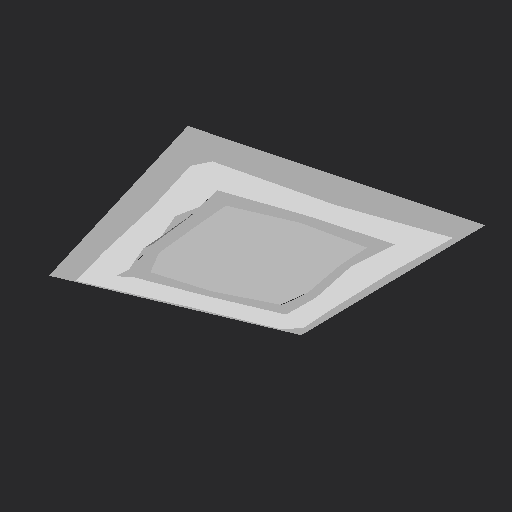

# Plafond

`Assets/Prefabs/Maze/Plafond.prefab` · [← liste des prefabs](README.md)

Plafond d'une case (Synty `SM_Env_Ceiling_Stone_Flat_01`), tourné vers le bas : invisible vu d'en haut.



## Hiérarchie

```
Plafond
└─ Pièce
   └─ SM_Env_Ceiling_Stone_Flat_01  [MeshFilter, MeshRenderer]
```

## Contenu

### Plafond / Pièce

- **Transform**
  - position (1.5, 0, -1.5)
  - échelle (0.6, 0.6, 0.6)

### Plafond / Pièce / SM_Env_Ceiling_Stone_Flat_01

- **MeshFilter**
  - maillage `SM_Env_Ceiling_Stone_Flat_01` (`Assets/Synty/PolygonDungeon/Models/SM_Env_Ceiling_Stone_Flat_01.fbx`)
- **MeshRenderer**
  - matériaux `M_Toon_PolygonDungeon_01` (Deckscent/Toon)
