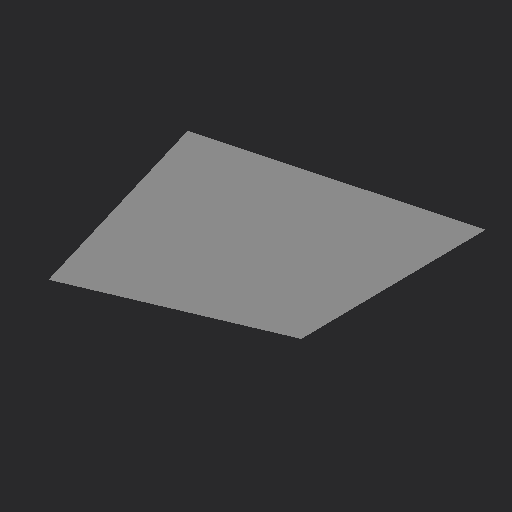

# Plafond_Gris

`Assets/Prefabs/Maze/Plafond_Gris.prefab` · [← liste des prefabs](README.md)

Plafond de secours (quad gris tourné vers le bas).



## Hiérarchie

```
Plafond_Gris
└─ Forme  [MeshFilter, MeshRenderer]
```

## Contenu

### Plafond_Gris / Forme

- **Transform**
  - rotation (270, 0, 0)°
  - échelle (3, 3, 1)
- **MeshFilter**
  - maillage `Quad` (`Library/unity default resources`)
- **MeshRenderer**
  - matériaux `M_Gris_Plafond` (Universal Render Pipeline/Lit)
