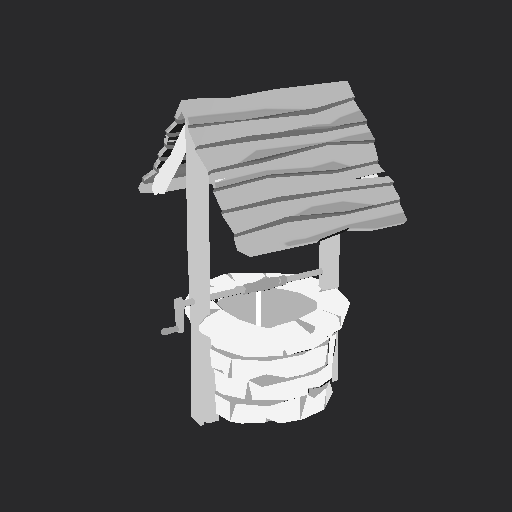

# Puits

`Assets/Prefabs/Camp/Puits.prefab` · [← liste des prefabs](README.md)

Puits du camp (Meadow Forest `SM_Prop_Well_01`). Bloque sa case.



## Hiérarchie

```
Puits  [CampObstacle]
└─ Pièce
   └─ SM_Prop_Well_01  [MeshFilter, MeshRenderer]
```

## Contenu

### Puits

- **CampObstacle**
  - `blocks` = oui — Coché : bloque la case. Décoché : décor de passage.

### Puits / Pièce

- **Transform**
  - position (-0.118, 0.131, 0)

### Puits / Pièce / SM_Prop_Well_01

- **MeshFilter**
  - maillage `SM_Prop_Well_01` (`Assets/Synty/PolygonNatureBiomes/PNB_Meadow_Forest/Models/SM_Prop_Well_01.fbx`)
- **MeshRenderer**
  - matériaux `M_Toon_PolygonNatureBiomesMeadow_Mat_01` (Deckscent/Toon)
